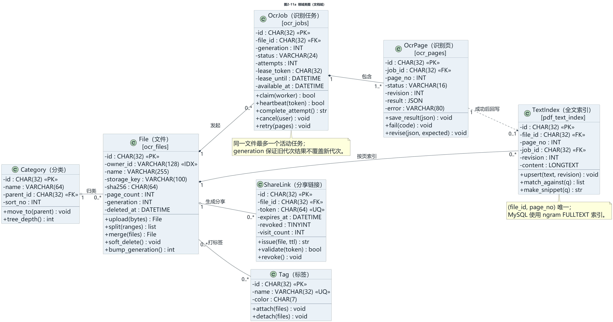
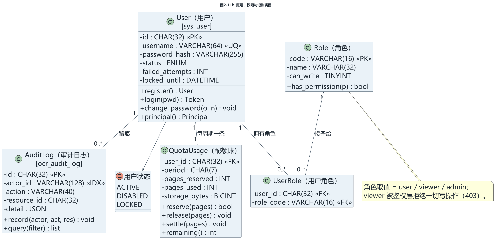
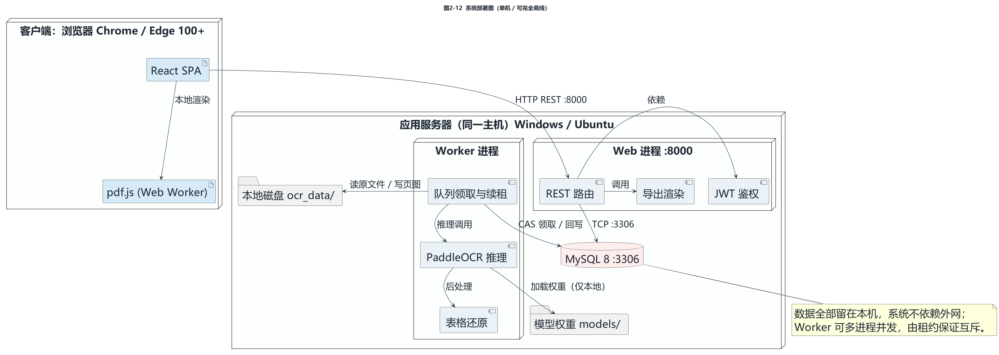

# 系统设计文档素材（自需求分析文档迁出）

> **说明**：本文档收录按评审意见从《需求分析文档》中迁出的**设计性内容**，作为后续编写《概要/详细设计文档》的素材。
>
> - 迁出原因：需求文档只应描述"做什么"，数据字典、JSON 结构、索引设计、类图、部署图等属于"怎么做"的设计内容，与需求文档的定位混淆。
> - 各小节标注了原需求文档中的章节号与表/图号，编号暂沿用原编号，待并入设计文档时统一重新编号（注意：与需求文档现行的表 2-3「数据实体总览」、表 2-15「数据保留与清理策略」存在编号重名，编写设计文档时必须全部重编）。
> - 界面原型设计（原需求文档第 4 章）已单独保存为 [`界面原型设计.md`](../design/界面原型设计.md)。

## 目录

- 1 数据设计
  - 1.1 设计原则与约定（原需求文档 2.13.1）
  - 1.2 数据字典（原 2.13.3，表 2-3～2-12）
  - 1.3 JSON 字段结构定义与校验规则（原 2.13.4，表 2-13）
  - 1.4 完整性约束与索引策略（原 2.13.6，表 2-15）
- 2 结构建模
  - 2.1 领域类图（原 2.12.4，图 2-11a / 2-11b）
  - 2.2 系统部署图（原 2.12.5，图 2-12）
- 3 其他迁出内容

---

# 1 数据设计

## 1.1 设计原则与约定（原需求文档 2.13.1）

- 存储引擎 InnoDB，字符集 utf8mb4，排序规则 utf8mb4_unicode_ci。
- 主键统一为 32 位十六进制字符串（UUID 去掉连字符），由应用层生成，不使用数据库自增，便于分库与离线生成。
- 时间统一以 UTC 存入 DATETIME（不带时区信息），展示层负责转换为本地时间。
- 配额与页数等计数一律使用整数存储，避免浮点误差。
- 软删除统一使用 deleted_at 字段，删除操作只置位该字段，不物理删除记录。
- 并发控制使用两组版本号：页结果用 revision（乐观锁），文件重识别用 generation（代次）。
- 所有 JSON 字段必须给出结构定义与校验规则，未知键一律拒绝（见 1.3）。

## 1.2 数据字典（原需求文档 2.13.3）

以下逐表给出属性定义与限制条件。列含义：键与索引列中 PK 为主键、FK 为外键、UQ 为唯一键、IDX 为索引；约束与取值域列给出 CHECK、枚举取值与业务规则；标注"需求新增"的字段为需求分析阶段提出的扩展，尚未在现有模块中实现。

### 表 2-3 数据字典：sys_user（账号）

| 字段 | 类型(长度) | 空 | 默认值 | 键与索引 | 约束与取值域 | 说明 |
|---|---|---|---|---|---|---|
| id | VARCHAR(32) | 否 | --- | PK | 32 位十六进制 | 用户标识，UUID 去连字符 |
| username | VARCHAR(64) | 否 | --- | UQ | 4～32 字符，字母数字下划线 | 登录名，全库唯一 |
| password_hash | VARCHAR(255) | 否 | --- | --- | 加盐哈希结果 | 禁止存明文，盐值并入字段 |
| email | VARCHAR(128) | 是 | NULL | --- | 符合邮箱格式 | 仅用于找回，不强制 |
| status | VARCHAR(16) | 否 | active | --- | active/disabled/locked | 账号状态 |
| failed_attempts | INT | 否 | 0 | --- | ≥ 0 | 连续登录失败次数，成功后清零 |
| locked_until | DATETIME | 是 | NULL | --- | UTC 时间 | 锁定到期时间，为空表示未锁定 |
| created_at | DATETIME | 否 | 当前 UTC | IDX | --- | 注册时间，支持按时间筛选 |

### 表 2-4 数据字典：sys_role 与 sys_user_role（角色与授权）

| 字段 | 类型(长度) | 空 | 默认值 | 键与索引 | 约束与取值域 | 说明 |
|---|---|---|---|---|---|---|
| role_code | VARCHAR(16) | 否 | --- | PK | user/viewer/admin | 角色代码，三值枚举 |
| role_name | VARCHAR(32) | 否 | --- | --- | --- | 角色显示名 |
| can_write | TINYINT | 否 | 1 | --- | 0 或 1 | viewer 为 0，其余为 1 |
| user_id | VARCHAR(32) | 否 | --- | PK(FK) | 引用 sys_user.id | 联合主键之一 |
| role_code（关联表） | VARCHAR(16) | 否 | --- | PK(FK) | 引用 sys_role.role_code | 联合主键之一，防重复授予 |

### 表 2-5 数据字典：file_category 与 file_tag、file_tag_rel（分类与标签）

| 字段 | 类型(长度) | 空 | 默认值 | 键与索引 | 约束与取值域 | 说明 |
|---|---|---|---|---|---|---|
| id | VARCHAR(32) | 否 | --- | PK | 32 位十六进制 | 分类或标签标识 |
| name | VARCHAR(64) | 否 | --- | UQ | 1～64 字符 | 分类名（同级唯一）或标签名（全库唯一） |
| parent_id | VARCHAR(32) | 是 | NULL | FK | 自引用，根节点为空 | 父分类，移动时校验不成环且层级 ≤ 5 |
| sort_no | INT | 否 | 0 | --- | ≥ 0 | 同级排序号 |
| color | CHAR(7) | 是 | NULL | --- | #RRGGBB | 标签颜色（仅标签表有） |
| file_id（关联表） | VARCHAR(32) | 否 | --- | PK(FK) | 引用 ocr_files.id | 标签关联的联合主键之一 |
| tag_id（关联表） | VARCHAR(32) | 否 | --- | PK(FK) | 引用 file_tag.id | 标签关联的联合主键之一 |

### 表 2-6 数据字典：ocr_files（文件元数据）

| 字段 | 类型(长度) | 空 | 默认值 | 键与索引 | 约束与取值域 | 说明 |
|---|---|---|---|---|---|---|
| id | VARCHAR(32) | 否 | --- | PK | 32 位十六进制 | 文件标识 |
| owner_id | VARCHAR(128) | 否 | --- | IDX | 引用用户标识 | 归属者，支撑列表筛选与权限校验 |
| name | VARCHAR(255) | 否 | --- | --- | 1～255 字符 | 文件显示名 |
| storage_key | VARCHAR(100) | 否 | --- | --- | 与磁盘路径一一对应 | 存储键，禁止出现路径穿越字符 |
| media_type | VARCHAR(40) | 否 | --- | --- | 合法 MIME | 文件类型，用于校验与展示 |
| sha256 | CHAR(64) | 否 | --- | IDX | 64 位十六进制 | 内容摘要，用于去重判定 |
| size | INT UNSIGNED | 否 | --- | --- | 1～20971520（20 MiB） | 文件字节数 |
| page_count | INT | 否 | --- | --- | 1～100 | 页数，用于配额预留与进度展示 |
| active_job_id | VARCHAR(32) | 是 | NULL | --- | 引用 ocr_jobs.id | 当前活动任务，非空即禁止新建任务 |
| generation | INT | 否 | 0 | --- | ≥ 0 | 代次号，每次新建任务递增 |
| category_id | VARCHAR(32) | 是 | NULL | FK | 需求新增 | 所属分类 |
| deleted_at | DATETIME | 是 | NULL | --- | 需求新增 | 软删除标记，非空表示在回收站 |
| created_at | DATETIME | 否 | 当前 UTC | IDX | --- | 创建时间 |

### 表 2-7 数据字典：ocr_jobs（识别任务）

| 字段 | 类型(长度) | 空 | 默认值 | 键与索引 | 约束与取值域 | 说明 |
|---|---|---|---|---|---|---|
| id | VARCHAR(32) | 否 | --- | PK | 32 位十六进制 | 任务标识 |
| file_id | VARCHAR(32) | 否 | --- | FK, IDX | 引用 ocr_files.id | 所属文件，文件删除时任务级联删除 |
| generation | INT | 否 | --- | --- | ≥ 0，等于文件当前代次 | 代次号，用于丢弃旧代次结果 |
| owner_id | VARCHAR(128) | 否 | --- | IDX | 引用用户标识 | 发起人，用于权限校验与配额退还 |
| status | VARCHAR(24) | 否 | queued | IDX | 见状态枚举定义（需求文档 2.13.3） | 任务状态 |
| options | JSON | 否 | --- | --- | 结构见 1.3 节 | 识别选项（语言、方向、表格还原） |
| attempts | INT | 否 | 0 | --- | 0～3 | 已尝试次数，超过 3 不再重试 |
| lease_token | CHAR(32) | 是 | NULL | --- | 32 位随机串 | 租约令牌，提交结果时校验 |
| lease_until | DATETIME | 是 | NULL | IDX | UTC 时间 | 租约到期时间，过期可被接管 |
| available_at | DATETIME | 否 | 当前 UTC | IDX | UTC 时间 | 可被领取的时间，退避时顺延 |
| created_at | DATETIME | 否 | 当前 UTC | --- | --- | 创建时间 |
| finished_at | DATETIME | 是 | NULL | --- | UTC 时间 | 进入终态的时间 |

### 表 2-8 数据字典：ocr_pages（页识别结果）

| 字段 | 类型(长度) | 空 | 默认值 | 键与索引 | 约束与取值域 | 说明 |
|---|---|---|---|---|---|---|
| id | VARCHAR(32) | 否 | --- | PK | 32 位十六进制 | 页记录标识 |
| job_id | VARCHAR(32) | 否 | --- | FK, IDX | 引用 ocr_jobs.id | 所属任务，任务删除时页级联删除 |
| page_no | INT | 否 | --- | UQ | ≥ 1，与 job_id 联合唯一 | 页号，从 1 开始 |
| status | VARCHAR(16) | 否 | pending | --- | pending/succeeded/failed | 页状态 |
| revision | INT | 否 | 0 | --- | ≥ 0 | 乐观锁版本号，每次校对 +1 |
| result | JSON | 是 | NULL | --- | 结构见 1.3 节 | 成功时写入识别结果与坐标 |
| error | VARCHAR(80) | 是 | NULL | --- | 错误码字符串 | 失败时写入可解释错误码 |

### 表 2-9 数据字典：pdf_text_index（全文索引）

| 字段 | 类型(长度) | 空 | 默认值 | 键与索引 | 约束与取值域 | 说明 |
|---|---|---|---|---|---|---|
| id | VARCHAR(32) | 否 | --- | PK | 32 位十六进制 | 索引记录标识 |
| file_id | VARCHAR(32) | 否 | --- | FK, IDX | 引用 ocr_files.id | 所属文件 |
| page_no | INT | 否 | --- | UQ | ≥ 1，与 file_id 联合唯一 | 页号 |
| job_id | VARCHAR(32) | 否 | --- | FK | 引用 ocr_jobs.id | 产生该文本的任务，用于标注来源 |
| revision | INT | 否 | 0 | --- | ≥ 0 | 对应页的修订号，用于判定是否过期 |
| content | LONGTEXT | 否 | --- | FULLTEXT(ngram) | ≤ 单页文本上限 | 页全文，ngram 全文索引对象 |
| updated_at | DATETIME | 否 | 当前 UTC | --- | --- | 更新时间，用于增量维护 |

### 表 2-10 数据字典：share_link（分享链接）

| 字段 | 类型(长度) | 空 | 默认值 | 键与索引 | 约束与取值域 | 说明 |
|---|---|---|---|---|---|---|
| id | VARCHAR(32) | 否 | --- | PK | 32 位十六进制 | 记录标识 |
| file_id | VARCHAR(32) | 否 | --- | FK | 引用 ocr_files.id | 被分享的文件 |
| token | CHAR(64) | 否 | --- | UQ | 64 位随机串 | 分享令牌，全库唯一 |
| expires_at | DATETIME | 否 | --- | IDX | UTC 时间，晚于创建时间 | 过期时间 |
| allow_download | TINYINT | 否 | 0 | --- | 0 或 1 | 是否允许下载 |
| revoked | TINYINT | 否 | 0 | --- | 0 或 1 | 撤销标记，撤销后不再删除记录 |
| visit_count | INT | 否 | 0 | --- | ≥ 0 | 访问次数统计 |

### 表 2-11 数据字典：ocr_audit_log（操作审计）

| 字段 | 类型(长度) | 空 | 默认值 | 键与索引 | 约束与取值域 | 说明 |
|---|---|---|---|---|---|---|
| id | VARCHAR(32) | 否 | --- | PK | 32 位十六进制 | 日志标识 |
| actor_id | VARCHAR(128) | 否 | --- | IDX | 引用用户标识或 anonymous | 操作者，支持按人追溯 |
| action | VARCHAR(40) | 否 | --- | IDX | 枚举见状态枚举定义（需求文档 2.13.3） | 操作类型 |
| resource_id | VARCHAR(32) | 否 | --- | IDX | 资源标识 | 被操作对象 |
| detail | JSON | 否 | {} | --- | 结构见 1.3 节 | 附加信息，禁止记录正文与令牌 |
| created_at | DATETIME | 否 | 当前 UTC | IDX | --- | 发生时间，支持按时间范围查询 |

### 表 2-12 数据字典：quota_usage（配额账）

| 字段 | 类型(长度) | 空 | 默认值 | 键与索引 | 约束与取值域 | 说明 |
|---|---|---|---|---|---|---|
| user_id | VARCHAR(32) | 否 | --- | PK(FK) | 引用 sys_user.id | 用户标识 |
| period | CHAR(7) | 否 | --- | PK | YYYY-MM | 账期，按月 |
| pages_reserved | INT | 否 | 0 | --- | ≥ 0，数据库 CHECK 约束 | 已预留页数 |
| pages_used | INT | 否 | 0 | --- | ≥ 0 | 已结算页数 |
| storage_bytes | BIGINT | 否 | 0 | --- | ≥ 0 | 已用存储字节数 |
| updated_at | DATETIME | 否 | 当前 UTC | --- | --- | 最后一次记账时间 |

## 1.3 JSON 字段结构定义与校验规则（原需求文档 2.13.4）

系统共有三个 JSON 字段：ocr_jobs.options（识别选项）、ocr_pages.result（页识别结果）、ocr_audit_log.detail（审计附加信息）。三者均遵循共同规则：未知键一律拒绝（不静默丢弃），键名与类型不匹配返回 422 E_SCHEMA，字符串字段一律限制最大长度。

### 表 2-13 JSON 字段结构定义

| 字段 | 键 | 类型 | 必填 | 取值与限制 | 说明 |
|---|---|---|---|---|---|
| options | lang | string | 是 | 枚举：ch / en / ch_en | 识别语言 |
| options | detect_direction | bool | 否 | 默认 false | 是否做方向检测 |
| options | enable_table | bool | 否 | 默认 false | 是否开启表格还原 |
| options | pages | array\<int\> | 否 | 每项 1～100，最多 100 项 | 指定页范围，缺省为整册 |
| result | blocks | array\<object\> | 是 | 每页最多 2000 个 | 识别到的文本块 |
| result | blocks[].bbox | array\<float\> | 是 | 4 项，取值 0.0～1.0 | 归一化坐标 [x0,y0,x1,y1] |
| result | blocks[].text | string | 是 | ≤ 4096 字符 | 识别文本 |
| result | blocks[].score | float | 是 | 0.0～1.0 | 置信度 |
| result | blocks[].order | int | 是 | ≥ 0 | 阅读顺序序号 |
| result | tables | array\<object\> | 否 | 开启表格还原时出现 | 表格结构，含行列与单元格 |
| detail | job_id / page_no | string / int | 否 | --- | 与审计动作相关的对象标识 |
| detail | bytes / pages | int | 否 | ≥ 0 | 计量类信息，用于统计 |
| detail | reason | string | 否 | ≤ 200 字符 | 失败原因或操作理由 |

校验规则：①未知键拒绝，保证结构演进可追踪；②bbox 归一化到 0.0～1.0，与页面像素尺寸解耦，便于不同分辨率下复用；③result 单页大小上限 1 MiB，超出时截断并标注 truncated；④detail 严禁出现文件正文、令牌与密码类信息。

## 1.4 完整性约束与索引策略（原需求文档 2.13.6）

完整性分三类。实体完整性：所有表以 32 位字符串为主键，业务唯一性由唯一键保证（用户名、标签名、分享令牌、(job_id, page_no)、(file_id, page_no)）。参照完整性：任务、页、索引、分享链接均以外键引用文件与任务，文件删除时其任务与索引随之删除（级联），页随任务级联。用户定义完整性：取值域约束（状态枚举、页数与大小上限、配额预留非负）由数据库 CHECK 与应用层双重保证。

### 表 2-15 索引清单与用途

| 索引 | 所在表 | 列 | 用途 |
|---|---|---|---|
| ix_ocr_files_owner_id | ocr_files | owner_id | 支撑文件列表按归属筛选，避免全表扫描 |
| ix_ocr_jobs_owner_id | ocr_jobs | owner_id | 支撑"我的任务"列表 |
| ix_ocr_jobs_file_id | ocr_jobs | file_id | 支撑按文件查任务与级联删除 |
| ix_ocr_queue | ocr_jobs | (status, available_at, lease_until) | 支撑队列扫描与租约过期接管，最关键的复合索引 |
| ix_ocr_pages_job_id | ocr_pages | job_id | 支撑按任务取页结果与进度展示 |
| uq (job_id, page_no) | ocr_pages | job_id, page_no | 防止同一任务出现重复页 |
| uq (file_id, page_no) | pdf_text_index | file_id, page_no | 保证一页一条索引，支撑 upsert |
| ft_pdf_text_content | pdf_text_index | content（ngram） | 支撑中文全文检索 |
| ix_ocr_audit_log_actor_id | ocr_audit_log | actor_id | 支撑审计按人追溯 |
| uq token | share_link | token | 支撑分享链接查找与唯一性 |

索引原则：只为支撑查询与队列扫描的列建索引；不为低选择性列（如状态列单独）建单列索引；全文索引只在 MySQL 上建立，SQLite 开发库明确退化为子串匹配，验收以 MySQL 为准。

---

# 2 结构图建模

## 2.1 领域类图（原需求文档 2.12.4，图 2-11a / 2-11b）

图 2-11a 与图 2-11b 为类图，前者描述文档域，后者描述账号、权限与记账域。类图与数据字典（本文档 1.2 节）一一对应，是从数据结构到对象模型的映射。

**图 2-11a 领域类图（文档域）**

图 2-11a 中，File 与 OcrJob 之间是组合关系（实心菱形），表示任务不能脱离文件独立存在，文件被删除时其任务随之删除。

OcrPage 与 TextIndex 之间是依赖关系（虚线箭头）而非组合：索引可被后续代次覆盖，因此不随页结果严格同生共死，这正是图 2-7b 中"失败不清空索引"的结构依据。

File 与 Tag 之间、Category 与 File 之间的多重度是本图的重点：标签为多对多（必须借助关联实体），分类为一对多且通过父节点自引用实现层级，层级上限 5 且禁止成环。

每个类的关键方法直接对应需求文档 2.2～2.11 节的业务规则，例如 OcrJob 的 claim / heartbeat / complete_attempt 三个方法对应租约机制的三步。

**图 2-11b 账号、权限与记账类图**

图 2-11b 将管理域类与业务域类分离，避免图 2-11a 元素过多而不可读；两图通过各自对应的表建立联系。

Role 类只有 user / viewer / admin 三个实例，且 can_write 属性直接决定鉴权层的放行逻辑，viewer 的 can_write 为假。

QuotaUsage 的 reserve / release / settle 三个方法对应需求文档 2.11 节的三段式记账，保证预留量在并发入队时也不会被超卖。

AuditLog 只提供 record 与 query，不提供 update 或 delete，从对象模型上保证了日志不可篡改。

## 2.2 系统部署图（原需求文档 2.12.5，图 2-12）

**图 2-12 系统部署图**

图 2-12 的所有服务端节点都位于同一个"应用服务器（同一主机）"节点内，表明本系统为单机单体部署，这与需求文档 1.5 节的部署形态一致。

Web 进程监听 8000 端口对外提供 REST 接口，Worker 进程不监听端口，只与数据库和存储交互；因此横向扩容 Worker 只需增加进程而无需改动网络配置。

模型权重目录与各进程之间的连线标注为"仅本地"，这是可完全离线运行的结构依据：权重随安装包分发并校验 SHA256，运行时不访问外网。

本系统不设消息队列节点：队列由数据库表配合租约实现，这一取舍源于需求文档 1.6 节 N51 约束（无专职运维，必须一条命令启动）。

---

# 3 其他迁出内容

## 3.1 任务队列实现机制（原需求文档 1.5 节"部署形态说明"）

为避免引入消息中间件带来的运维成本，任务队列由数据库表配合租约机制实现，API 进程与 Worker 进程共享同一数据库，Worker 可按需启动多个进程并通过租约互斥保证并发安全。
