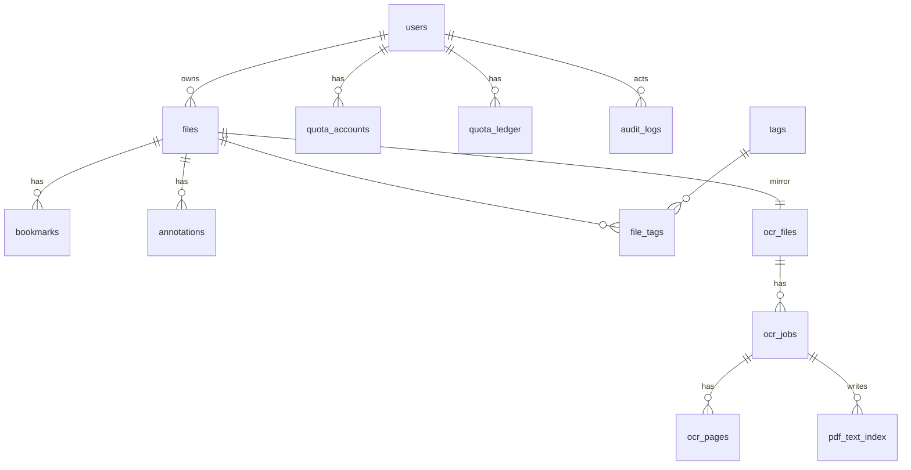

# 数据库设计

> 配套文档：[`er-diagram.mmd`](er-diagram.mmd)（E-R 图，Mermaid）、[`team/database.md`](team/database.md)（表所有权与冻结规则）、[`../pdf_system/docs/DATABASE.md`](../pdf_system/docs/DATABASE.md)（详细设计）
> 数据字典（字段八列定义、JSON 结构、状态枚举）见 [`features.md`](features.md) 第 2.13 节。

## 1. 设计约定

- 引擎 InnoDB、字符集 utf8mb4；主键统一 32 位 UUID（去横线，`models.base.uid()`）
- 时间统一存 UTC 的 `DATETIME`（`models.base.now()`），展示层转换；**禁止自己用 `datetime.now()` / `uuid4()`**
- 金额/配额用整数；软删除用 `deleted_at`；乐观锁用 `revision`/`generation`
- 两个 `DeclarativeBase` 不共用（主系统 9 张 + OCR 模块 5 张，共 14 张）

## 2. E-R 图

E-R 图源码在 [`er-diagram.mmd`](er-diagram.mmd)（Mermaid `erDiagram`，可在 GitHub 直接渲染）。

## 3. 表清单（14 张）

### 3.1 主系统表（`backend/models/`）

| 表 | 作用 | 主责 |
|---|---|---|
| `users` | 账号、角色（user/viewer/admin）、禁用状态 | 陈 |
| `files` | 文件元数据（storage_key、media_type、sha256、page_count、软删除、版本） | 岳 |
| `tags` / `file_tags` | 标签与多对多关联 | 岳 |
| `bookmarks` | 书签（file_id、page_no、title） | 岳 |
| `annotations` | 批注（kind、payload JSON，坐标左上原点归一化，契约 C4） | 岳 |
| `quota_accounts` | 月配额（pages_reserved / pages_used） | 陈 |
| `quota_ledger` | 配额流水（正=占用、负=退还，ref_id 对账） | 陈 |
| `audit_logs` | 操作审计（只插不改） | 陈 |

### 3.2 OCR 模块表（`pdf_ocr_module/ocr_service/db.py`）

| 表 | 作用 | 主责 |
|---|---|---|
| `ocr_files` | 文件镜像（id 与 `files.id` 同值，契约 C2） | 黄 |
| `ocr_jobs` | 识别任务（租约 lease_token/lease_until、代次 generation） | 黄 |
| `ocr_pages` | 页结果（revision 乐观锁、result JSON） | 黄 |
| `pdf_text_index` | 全文索引（与页结果同事务写入，陈的检索直接 SQL join） | 黄 |
| `ocr_audit_log` | OCR 侧审计 | 黄 |

完整字段清单（含主责、依赖方、改错症状）见 [`team/database.md`](team/database.md)。

## 4. 关键完整性约束

- `ocr_files.id` == `files.id`（镜像同值，契约 C2）
- `ocr_pages`：`(job_id, page_no)` 唯一；`revision ≥ 0`
- `pdf_text_index`：`(file_id, page_no)` 唯一；MySQL ngram 全文索引
- `ocr_jobs`：联合索引 `(status, available_at, lease_until)` 支撑队列扫描；attempts 0–3
- `quota_accounts`：user_id + month 复合主键；剩余量非负（429 拦截）
- 越权/已删统一 404（`principal.owned_file`），按 `deleted_at IS NULL` 过滤

## 5. 数据量与保留策略

- 估算：1000 文件 × 30 页 ≈ 3 万页；元数据表 < 100 MB，索引表约 60 MB，页图约 5 GB/1000 文件
- 回收站保留 30 天、日志 180 天、失败任务中间态清理 7 天
- 备份：每日全量 + binlog；清理任务不得破坏正在使用的租约

完整的数据字典与容量规划见 [`features.md`](features.md) 第 2.13 节。
