<div align="center">

# 基于本地 OCR 的 PDF 文件显示与管理系统

**系统设计文档**

（Software Design Document · 概要设计说明书）

</div>

<br>

| 项目 | 内容 |
|:---:|:---|
| **课程名称** | 软件工程课程设计 |
| **题目** | 基于本地 OCR 的 PDF 文件显示与管理系统 |
| **小组名称** | 第 27 组 |
| **小组成员** | 陈浩然（组长，2024141460570）、黄俞富（2024141460074）、岳浩睿（2024141460114） |
| **文档版本** | V1.0 |
| **编写日期** | 2026 年 11 月 12 日 |
| **文档状态** | 评审稿（供指导教师审阅） |
| **密级** | 课程作业，内部使用 |

---

# **修订记录**

**表 0-1 文档修订记录**

| 版本 | 日期 | 修订人 | 修订内容 | 影响章节 |
|---|---|---|---|---|
| V1.0 | 2026-11-12 | 陈浩然、黄俞富、岳浩睿 | 建立系统设计基线：总体架构与决策、模块与处理流程、数据结构与对象模型、用户界面与接口、运行维护设计 | 全文 |

本文档定义系统的设计基线。功能需求编号（FR-\*）与非功能需求编号（NFR-\*）仅作为追溯标识在附录 A 中引用，其条目内容不在本文档重复。设计、实现与验证之间出现偏差时，应按配置管理流程更新本文档或修正实现，不保留静默偏离。

# **目录**

- 第 1 章 引言
  - 1.1 编写目的与文档范围
  - 1.2 术语与缩略语
  - 1.3 引用资料与规范依据
- 第 2 章 任务概述
  - 2.1 系统目标与功能概述
  - 2.2 运行环境
  - 2.3 开发工具
  - 2.4 设计约束
  - 2.5 假设与依赖
- 第 3 章 总体设计
  - 3.1 总体架构
    - 3.1.1 设计目标与原则
    - 3.1.2 系统上下文与分层结构
    - 3.1.3 进程视图与部署结构
    - 3.1.4 架构决策与权衡
    - 3.1.5 模块依赖规则与契约
  - 3.2 系统主要功能和模块设计
    - 3.2.1 模块划分
    - 3.2.2 模块职责
    - 3.2.3 处理流程与关键算法
    - 3.2.4 对象模型
- 第 4 章 数据设计
  - 4.1 数据结构（数据表、数据库）设计
    - 4.1.1 设计约定
    - 4.1.2 逻辑结构
    - 4.1.3 数据字典
    - 4.1.4 JSON 字段结构与校验规则
    - 4.1.5 索引、状态枚举与完整性约束
  - 4.2 类的设计
  - 4.3 物理结构设计
  - 4.4 数据结构与程序的关系
- 第 5 章 接口与界面设计
  - 5.1 界面设计原则
  - 5.2 界面清单与需求追溯
  - 5.3 界面原型
    - 5.3.1 登录与注册
    - 5.3.2 文件库
    - 5.3.3 上传
    - 5.3.4 回收站
    - 5.3.5 PDF 阅读器
    - 5.3.6 识别任务
    - 5.3.7 结果校对
    - 5.3.8 表格还原
    - 5.3.9 结果导出
    - 5.3.10 全文检索
    - 5.3.11 用户与角色
    - 5.3.12 配额与统计
    - 5.3.13 操作日志
    - 5.3.14 分享与协作
    - 5.3.15 游客只读访问
    - 5.3.16 范围外能力的降级
  - 5.4 交互与易用性
  - 5.5 软件接口（REST API）
  - 5.6 内部接口与数据口径
  - 5.7 界面错误反馈
- 第 6 章 运行与维护设计
  - 6.1 运行设计
  - 6.2 出错处理设计
  - 6.3 安全保密设计
  - 6.4 性能与可靠性设计
  - 6.5 维护设计
- 附录
  - 附录 A 需求追踪矩阵
  - 附录 B 图表索引

# **第 1 章 引言**

## **1.1 编写目的与文档范围**

本文档是《基于本地 OCR 的 PDF 文件显示与管理系统》的概要设计说明书，定义系统的实现方案，作为开发、联调、测试、部署与维护的统一技术依据。文档回答四组问题：系统采用何种体系结构与进程划分；功能模块如何划分、协作并完成关键处理；数据、对象模型与用户界面如何组织；运行、出错、安全、性能与维护如何保障。

本文档给出架构图、模块职责、处理流程、数据字典、接口清单、界面原型、错误模型、运行参数与维护规则，可独立阅读。文中模块名、表名、接口路径与类名采用可对应的命名（清单中路径参数作简写），便于设计与实现的双向核查；各项实现限制与后续演进统一见表 6-7；实现与设计出现偏差时，按 6.5 的变更流程更新文档或修正实现。

文档边界：需求条目、验收指标与业务规则的定义不属于本文档范围，仅在附录 A 中以需求编号建立追溯关系；具体算法的模型训练、第三方组件内部实现与部署脚本源码不在本文档展开。

实现状态标注：文中「已实现」指当前仓库代码具备该能力；「设计目标」指约定的指标、策略或运维要求，尚无对应实现；「待办」指已识别但未完成的工作。**未显式标注的条目为设计约定，不代表已经落地**；实现状态以文档各处的显式标注为准。5.3 全章为原型设计，描述交互目标而非实现状态；6.4 表 6-6 的性能指标均为设计目标。

预期读者与配套文档：本文档面向指导教师评审、后端与前端开发、联调测试、部署运维四类读者；第 3～4 章供架构与数据结构核对，第 5 章供前端与接口联调核对，第 6 章供部署运维核对。需求条目与验收指标以《需求分析文档》为准，界面交互细节以《界面原型设计》为准，接口在线定义以运行时 `/docs` 与 `/openapi.json` 为准，本文档不重复其内容，仅在附录 A 建立需求追溯。文档沿用课程模板的「概要设计说明书」命名，同时按模板要求覆盖数据表、类、物理结构与算法流程等详细设计内容，定位为涵盖概要与详细两个层次的软件设计说明书。

## **1.2 术语与缩略语**

**表 1-1 术语与缩略语**

| 术语 / 缩略语 | 含义 |
|---|---|
| OCR | Optical Character Recognition，光学字符识别；本系统采用 PaddleOCR（PP-OCRv5 检测与识别、CTC 解码）本地 CPU 推理 |
| PDFium / pdf.js | 服务端 PDF 渲染引擎（pypdfium2）与浏览器端 PDF 渲染库 |
| JWT | JSON Web Token，HS256 无状态鉴权令牌；声明包含 `sub / role / iss / aud / iat / exp / jti` |
| Principal | 鉴权层解析出的调用主体，仅暴露 `user_id / role / is_admin` |
| 租约（Lease） | Worker 领取任务后获得的有时限独占权，由 `lease_token` 与 `lease_until` 标识，默认 120 s，心跳续租，过期可被接管 |
| CAS | Compare-And-Set，队列以条件更新（`WHERE … AND attempts = …`）实现并发互斥 |
| 代次（Generation） | 文件每次新建识别任务递增的序号，用于丢弃旧代次结果 |
| 修订号（Revision） | 页结果的乐观锁版本号；校对携带 `expected_revision`，不一致时拒绝写入 |
| 镜像表 | `ocr_files` 是 `files` 的只读镜像，两者主键同值 |
| 归一化坐标（bbox） | 左上原点、`[left, top, right, bottom]`、取值 0～1 的矩形坐标，用于 OCR 文本层、批注与检索命中 |
| ngram 全文索引 | MySQL 8 的 `FULLTEXT … WITH PARSER ngram` 中文索引，默认分词长度 2；SQLite 退化为 LIKE 子串匹配 |
| StrictModel | OCR 模块 Pydantic 基类，配置 `extra="forbid"`，拒绝未知键与非有限浮点 |
| 三段式记账 | 配额的预留（reserve）、结算（settle）、退还（release），流水落在 `quota_ledger` |
| 软删除 / 彻底删除（Purge） | 软删除仅置 `files.deleted_at`；彻底删除按固定顺序清理 OCR 侧数据与物理文件 |
| 降级 | OCR 模块未挂载时主系统多数功能可用，但 `GET /search` 返回 `backend=ocr_not_ready` 与空结果集、`/ocr-host/*` 返回 409；OCR 相关能力不可用（见 6.1） |
| SKIP LOCKED | InnoDB 的 `FOR UPDATE SKIP LOCKED` 行锁跳过策略，多 Worker 领取任务时避免互相阻塞 |
| Blob 下载 | 前端以带鉴权的请求取得二进制响应后创建对象 URL 下载，避免在链接中暴露 JWT |
| 上传与识别参数 | MIME（内容类型声明）、DPI（渲染分辨率，72～240）、EXIF（图像方向元数据）、SHA256（流式落盘时计算的内容摘要） |
| Range / Swagger / OpenAPI | 原文件按字节区间读取 / 在线交互文档 / 机器可读接口定义 |
| FR / NFR | 功能需求编号 / 非功能需求编号，用于附录 A 的追溯 |

## **1.3 引用资料与规范依据**

**表 1-2 规范依据**

| 规范 | 用途 |
|---|---|
| ISO/IEC/IEEE 12207:2017 软件生命周期过程 | 设计、实现、维护过程的活动划分 |
| ISO/IEC 25010:2011 系统与软件质量模型 | 性能、可靠性、安全性、可维护性等质量属性分类 |
| IEEE Std 830-1998 软件需求规格说明规范 | 需求编号与追溯矩阵的表示方式 |

**表 1-3 技术资料**

| 资料 | 用途 |
|---|---|
| FastAPI、SQLAlchemy 2.0、Pydantic 官方文档 | 后端框架、ORM 与请求模型 |
| PaddleOCR 与 paddlepaddle 3.0.0 文档 | 识别引擎、模型权重与 Python 版本约束 |
| Mozilla pdf.js 文档 | 前端 PDF 渲染、文本层与页内查找 |
| MySQL 8.0 全文索引（ngram）手册 | 中文全文检索实现 |
| Mermaid ER 图语法、PlantUML 建模约定 | 建模图的源码与成图规范 |

上述规范与技术资料用于统一术语和质量属性口径；系统行为以本文档定义的设计为准。运行期产物（接口机器定义、建库脚本与配置项）按 6.5 的配置管理流程与本文档保持同步。

# **第 2 章 任务概述**

## **2.1 系统目标与功能概述**

系统面向纸质档案与扫描件的本地数字化处理，目标是构建一个纯本地部署、可离线运行、中文优先的 PDF 管理与 OCR 全文检索系统：用户上传 PDF 或图片后在浏览器中在线阅读，异步 OCR 为每页补充文本层，识别结果可校对、可还原规则表格、可导出五种格式、可按中文关键词全文检索并跳页定位；文件支持分类打标与只读分享，配额、用量与操作日志可追溯。

**表 2-1 功能模块与实现映射**

| 功能模块 | 需求编号区间 | 实现功能点 | 主要实现模块 |
|---|---|---|---|
| 用户与权限 | FR-USER-01～07 | 注册登录、角色权限 | `backend/modules/auth/`、`core/security.py`、`core/principal.py` |
| 分享与协作 | FR-SHR-01～04 | 分享链接签发、撤销、访问统计 | `backend/modules/share/`、`core/principal.share_access` |
| 配额、日志与统计 | FR-LOG-01～06 | 配额管理、操作日志、使用统计 | `backend/modules/quota/`、`core/audit.py`、`features/stats/` |
| 文件管理 | FR-FILE-01～11 | 上传与列表、分类与标签、生命周期 | `backend/modules/files/`、`models/file.py` |
| PDF 在线阅读器 | FR-READ-01～09 | 在线阅读、书签与批注 | `backend/modules/reader/`、`features/reader/` |
| OCR 识别 | FR-OCR-01～12 | 异步识别任务与队列 | `backend/modules/ocr/`、`ocr_service/{api,queue,worker}.py` |
| 结果校对 | FR-COR-01～06 | 期望修订号校验、块编辑 | `ocr_service/api.py`、`schemas.Correction` |
| 表格还原 | FR-TBL-01～04 | 规则线框表格还原 | `ocr_service/tables.py` |
| 结果导出 | FR-EXP-01～06 | 五格式导出与输出转义 | `ocr_service/exports.py` |
| 全文检索 | FR-SEA-01～07 | 中文全文检索、覆盖层与命中定位 | `backend/modules/search/`、`features/ocr/OcrOverlay.tsx` |

系统边界：不实现手写体专项识别、竖排与无线框表格及合并单元格表格的结构还原、数学公式与图表识别、移动端原生应用、多机分布式部署与消息中间件；无线框表格仅降级为按行聚类纯文本（见 5.3.8），上述内容在界面上仅作风险提示或文本降级，不作为可用功能交付。媒体类型按真实内容判定：PDF 与 Pillow 可解析的图片可上传，非 PNG 图片统一归一为 `image/jpeg`；需求中列示的 BMP / TIFF 不区分为独立媒体类型，也不提供格式保真保证。

## **2.2 运行环境**

系统客户端形态为桌面浏览器 + 单机服务端，不提供 iOS / Android 原生客户端；移动端浏览器仅保证只读浏览可用。按题目约束，课程模板「运行环境」中列示的 iOS / Android 原生客户端不适用，本系统仅以浏览器为客户端形态。模型权重按清单下载并校验 SHA256，不随源码包分发；首次部署完成后即可完全离线运行。

**表 2-2 运行环境**

| 层次 | 项目 | 要求 |
|---|---|---|
| 客户端 | 浏览器 | Chrome / Edge 100+（Firefox ESR 保证只读可用）；需 Canvas、Web Worker、Fetch / Stream |
| 客户端 | 分辨率 | ≥ 1280×720，推荐 1920×1080 |
| 客户端 | 开发期运行库 | Node.js 20 LTS + Vite 5；构建产物为静态文件 |
| 服务端 | 操作系统 | Windows 10/11 或 Ubuntu 22.04+ |
| 服务端 | 硬件 | ≥ 4 核 CPU、≥ 8 GB 内存、≥ 20 GB 磁盘；纯 CPU 推理，无 GPU 依赖 |
| 服务端 | 数据库 | 生产 MySQL 8.0+ / InnoDB / utf8mb4（3306）；开发期 SQLite |
| 服务端 | 模型与文件 | 本地模型权重目录（约 218 MB，由部署命令按清单下载并校验 SHA256，不随源码包分发）、共享存储目录 |
| 网络 | 连通性 | 可完全离线运行；仅本机 8000 / 5173 端口通信，无外网与云端 OCR 通道 |
| 部署 | 形态 | 单机单体：API 进程、OCR Worker 进程、数据库与文件存储同机 |

**表 2-3 进程视图（3 个进程 + 2 个外部依赖）**

| 进程 / 依赖 | 技术栈 | Python | 端口 | 职责 |
|---|---|---|---|---|
| 主系统 API | FastAPI + SQLAlchemy + Uvicorn | 3.12（基线；3.14 需换用备用依赖版本组） | 8000 | 用户权限、文件、阅读器、检索；OCR 的 17 个接口挂载在同一进程内；提供 `/docs`、`/openapi.json`、`/health` |
| OCR Worker | `ocr_service` + PaddleOCR CPU | ≤ 3.13，统一 3.12 | 无 | 轮询数据库领取任务、渲染页、检测识别、表格还原、回写页结果与全文索引 |
| 前端 | React 18 + Vite 5 + pdf.js 4 | — | 5173 | 页面渲染；`/api` 代理到 `127.0.0.1:8000` |
| 数据库 | MySQL 8 / SQLite | — | 3306 / 文件 | 业务数据与任务队列 |
| 文件系统 | 共享存储目录 | — | — | 原文件、页 PNG 与导出缓存 |

OCR 模块不是独立的 Web 服务：`ocr_service.install(app, settings)` 把 `/api/v1/ocr/*` 路由挂进主系统 FastAPI 实例，因此与主系统接口同进程、同端口、同 JWT；真正独立的只有不监听端口的 Worker。

## **2.3 开发工具**

**表 2-4 开发工具与技术栈**

| 类别 | 工具 / 版本 |
|---|---|
| 后端 | Python 3.12（推荐）、FastAPI 0.115.12、Uvicorn 0.34.3、SQLAlchemy 2.0.41、Pydantic ≥ 2.13、PyJWT 2.10.1、PyMySQL 1.1.1、pypdfium2 5.14.0、Pillow |
| OCR | paddlepaddle 3.0.0 CPU、numpy 1.26.4、opencv-python / opencv-python-headless（两者并存的风险见表 6-7 P1）、openpyxl 3.1.5、PaddleOCR PP-OCRv5 |
| 前端 | React 18.3.1、react-router-dom 6.30.1、pdfjs-dist 4.10.38、Vite 5.4.11、TypeScript 5.6.3 |
| 数据库 | MySQL 8.0+（生产）、SQLite（开发）、ngram 全文索引 |
| 测试与持续集成 | pytest（本机：主系统 72 项、OCR 模块 10 项；CI 因跳过契约用例实际执行 67 项）、GitHub Actions（Python 3.12 后端测试 + Node 20 前端类型检查；OCR 测试与主系统契约用例未纳入 CI，口径见 6.5）、Swagger `/docs` |
| 建模与文档 | PlantUML（UML 成图）、Mermaid（E-R 图与流程图）、Markdown、pandoc + python-docx |
| 协作 | Git / GitHub、PR 评审与 CODEOWNERS |

当前开发环境中前端尚未完成集成验证；联调前须执行依赖安装与开发服务器启动，并按 5.5 的接口清单逐项验证。

## **2.4 设计约束**

**表 2-5 设计约束及其影响**

| 编号 | 约束 | 对设计的影响 |
|---|---|---|
| C-01 | 技术栈固定：React + pdf.js、FastAPI + SQLAlchemy、MySQL 8、PaddleOCR 本地 CPU 推理 | 采用分层单体架构，不讨论替代方案 |
| C-02 | 鉴权采用 JWT（HS256），接口无状态 | 统一鉴权入口，令牌失效需黑名单与版本号机制 |
| C-03 | 文件与识别结果不得离开本机，禁止云端识别 | 推理、存储与模型分发全部本地化，运行时不访问外网 |
| C-04 | 日志不得记录正文、密码与令牌 | 审计字段只保存标识与计量信息 |
| C-05 | 第三方组件须采用可商用开源许可 | 维护第三方声明与源码包白名单 |
| C-06 | 单文件 ≤ 20 MiB、≤ 100 页、单页 ≤ 2000 万像素 | 上传与渲染两处实现同一套校验口径 |
| C-07 | 8 GB 内存机器上共存，内存峰值 ≤ 4 GB | Worker 以多进程并发，进程数由部署方按资源决定（无集中并发配置），Paddle 依赖隔离到独立 Python 环境 |
| C-08 | 单机部署、无专职运维、免消息中间件 | 任务队列由数据库表配合租约实现 |
| C-09 | 表格仅支持完整线框，不支持竖排与合并单元格 | 结构不确定时返回空数组并标注未还原，不臆造单元格 |
| C-10 | 三人并行开发，按纵向功能线分工 | 后端业务模块之间通过五份显式契约与一处隐式契约协作（见 3.1.5、4.4）；前端组件层的跨功能引用列为待收敛项 |

## **2.5 假设与依赖**

**表 2-6 假设与依赖**

| 类别 | 内容 |
|---|---|
| 运行假设 | 单机部署、CPU 推理、管理员可信、待识别材料以印刷体中文为主、浏览器支持 Canvas 与 Web Worker |
| 外部依赖 | PaddleOCR 模型权重可本地获取并按清单校验；MySQL 8 的 ngram 解析器可用；pdf.js 版本与前端构建工具兼容；Node.js 20 LTS 可用于前端构建 |
| 版本约束 | Worker 所在 Python 环境 ≤ 3.13（Paddle 3.0.0 无 cp314 wheel）；主系统 API 以 3.12 为基线，3.14 需按 `requirements.txt` 中备用版本组安装，3.13 尚无实测记录；两侧 Python 版本允许不同 |
| 规模假设 | 单机面向 5～30 人团队；存量 1000 个文件、平均 30 页，约 3 万页；日均识别 50～200 页；默认配额 500 页 / 用户 / 月；Worker 以多进程并发，进程数由部署方决定 |
| 指标外推规模 | 全文检索指标按 10 万页规模设定，为设计目标而非当前存量；验证方式为按 3 万页实测外推并复测，尚未实测 |
| 尚未验证 | 前端集成、真实 MySQL 下的并发提交与校对、OCR 准确率与性能指标实测，见 6.5 |

# **第 3 章 总体设计**

## **3.1 总体架构**

### **3.1.1 设计目标与原则**

**表 3-1 架构设计原则**

| 原则 | 说明 |
|---|---|
| 本地离线优先 | 所有推理与存储发生在同一主机，模型权重按清单本地部署，运行时不访问外网 |
| 单一事实来源 | `files` 为文件元数据的事实来源，`ocr_files` 为只读镜像；避免双写不一致 |
| 进程隔离 | OCR 推理依赖与主 API 依赖隔离到两个 Python 环境，通过数据库与共享存储协作 |
| 异步解耦 | 长耗时识别通过数据库队列表与租约异步执行，API 只负责受理与查询 |
| 无状态鉴权 | 所有接口经统一 Principal 解析，越权与资源不存在返回相同响应 |
| 幂等与并发控制 | 关键写入使用条件更新、乐观锁、代次号与结算幂等标记 |
| 降级可用 | OCR 模块缺失时主系统其余功能保持可用，OCR 相关接口返回明确冲突 |
| 可追溯 | 写操作与任务状态迁移留痕，日志只追加不修改 |

### **3.1.2 系统上下文与分层结构**

系统由浏览器端、主系统 API、OCR Worker、数据库与本地存储五部分构成；外部参与者为游客、普通用户（user）、只读用户（viewer）与管理员（admin），外部对象为本机待归档文件与按清单本地部署的模型权重。

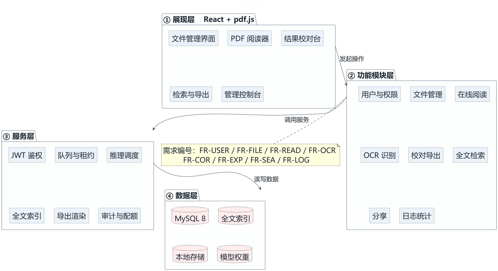{width="5.77in"}

**图 3-1 系统功能结构图**

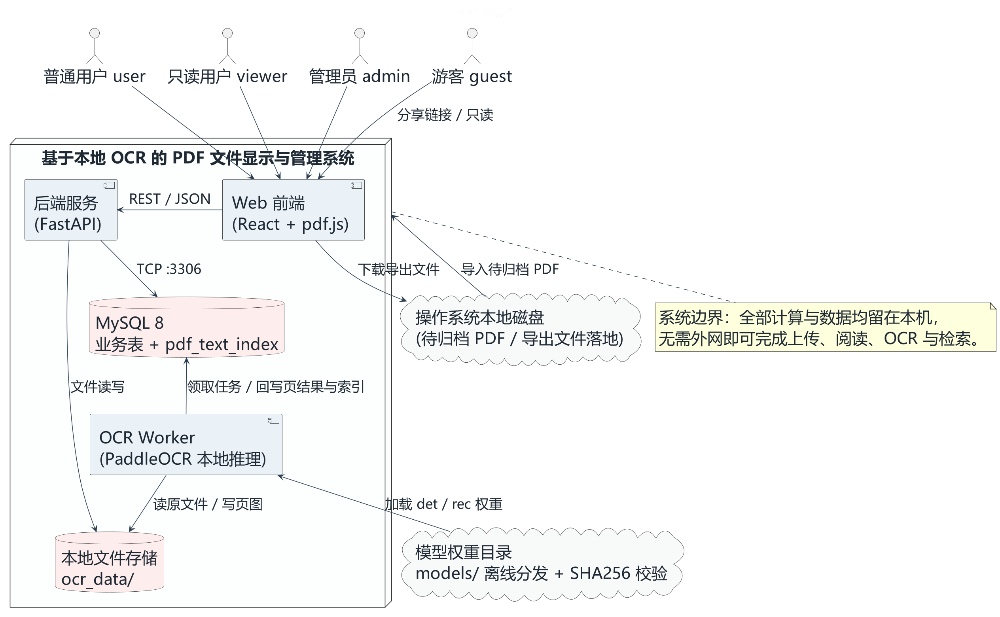{width="5.77in"}

**图 3-2 系统上下文图**

**表 3-2 四层结构及实现落点**

| 层次 | 实现落点 | 职责与约束 |
|---|---|---|
| 展现层 | `frontend/src/app/`、`shared/`、`features/` | React 路由与页面；`shared/http.ts` 为业务请求统一出口（pdf.js 直取原文件流为例外）；`features/*` 以 `app/` 与 `shared/` 为公共依赖，现存前端跨功能引用列为待收敛项 |
| 功能模块层 | `backend/modules/{auth,quota,share,files,reader,ocr,search}/` | 每模块自带 `router.py`、`service.py`、`schemas.py`；三条功能线之间不直接引用 |
| 服务层 | `backend/core/`（config、database、security、principal、errors、audit、media） | 所有写操作必经统一鉴权、错误出口与审计 |
| 数据层 | `backend/models/`（11 张主系统表）、`ocr_service/db.py`（5 张 OCR 表）、共享存储、模型权重 | 两套 `DeclarativeBase` 互不共用；业务表、全文索引、文件与权重生命周期独立 |

图 3-2 中，虚线框内为系统边界，所有推理与存储均发生在同一主机内，这是数据不出本机约束（C-03）的结构依据；游客只能凭分享令牌只读访问，viewer 被鉴权层拒绝一切写操作。

### **3.1.3 进程视图与部署结构**

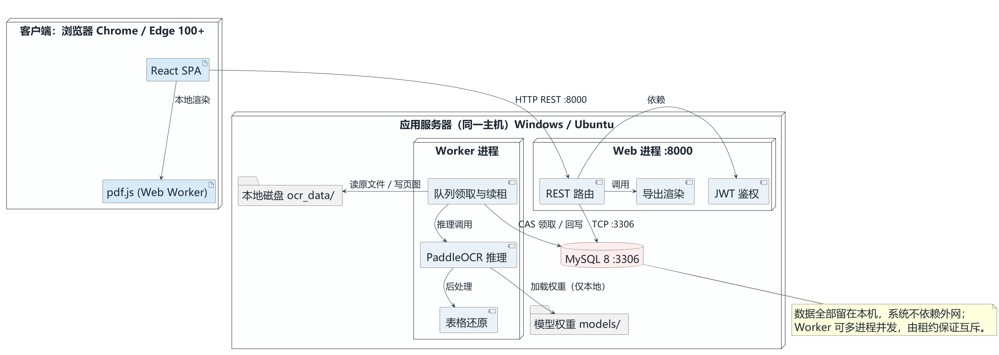{width="5.77in"}

**图 3-3 系统部署图**

所有服务端节点位于同一应用服务器（同一主机）内：Web 进程监听 8000 提供 REST 接口，Worker 进程不监听端口、只与数据库和共享存储交互，因此横向扩容 Worker 只需增加进程而无需改动网络配置；模型权重目录与各进程的连线标注为仅本地。图中不设消息队列节点，队列由数据库表配合租约实现。前端开发期由 Vite 5173 提供页面并把 `/api` 代理到 8000，构建后可作为静态资源部署。

**表 3-3 部署装配与隔离**

| 项 | 主系统 API | OCR Worker |
|---|---|---|
| 解释器 | 3.12（基线；3.14 需备用依赖版本组） | ≤ 3.13，统一 3.12 |
| 依赖清单 | `pdf_system/requirements.txt` | `ocr_service/environment-service-lock.txt` |
| 虚拟环境 | `pdf_system/.venv` | `pdf_ocr_module/.venv-paddle` 或 conda `ocrpaddle` |
| 启动命令 | `uvicorn backend.main:create_app --factory --port 8000` | `python -m ocr_service worker` |
| 进程间耦合 | 仅经共享数据库与共享存储目录 | 同上，无 RPC |

### **3.1.4 架构决策与权衡**

**表 3-4 关键架构决策**

| 决策 | 方案 | 理由 | 代价 |
|---|---|---|---|
| OCR 路由同进程挂载 | `install(app, ocr_settings, before_enqueue=…)` 挂载 `/api/v1/ocr/*` | 复用同一 JWT 与依赖注入，避免二次鉴权与跨服务调用 | API 进程不得在顶层导入 Paddle 依赖 |
| Worker 独立进程 | 独立 Python 环境，仅经数据库与文件通信 | Paddle 3.0、numpy 1.26 与 opencv 同主后端依赖易冲突；进程隔离后可分别重启与扩容 | 需要维护两套依赖清单 |
| 数据库表即队列 | `ocr_jobs` + 租约 + CAS + `FOR UPDATE SKIP LOCKED` | 满足免中间件单机部署约束 | 必须正确处理条件更新的受影响行数，MySQL 与 SQLite 语义存在差异 |
| 文件事实来源唯一 | `files` 为事实来源，`ocr_files` 主键同值镜像 | 避免双写不一致 | 镜像写入需幂等并提供补救接口 |
| 页结果与索引同事务 | `save_page()` 内同步 `write_index()` | 保证检索结果与页结果一致 | 单页事务稍长，需控制结果体大小 |
| 并发控制三要素 | 页级 `revision`、OCR 侧 `ocr_files.generation` / `ocr_jobs.generation`、任务租约 `lease_token` | 分别隔离并发校对、标记任务代次与阻止旧 Worker 覆盖新结果 | 客户端须携带期望修订号并处理冲突；`files` 表不含 `generation` |
| 归一化坐标 | 左上原点、`[left,top,right,bottom]` 0～1 | 覆盖层、批注与检索命中共用一套口径，与像素尺寸解耦 | 用户旋转页面时须重算包围盒 |
| 未挂载降级 | 捕获导入失败并置 `ocr_mounted=false` | 无 Paddle 环境时主系统其余功能可用 | OCR 相关接口统一返回 409 |
| 统一权限口径 | 越权与已删资源返回 404，viewer 写操作返回 403 | 避免通过状态码差探测他人资源 | 前端须区分权限不足与资源不可用文案 |

已知实现约束（P0）：MySQL 下队列领取与校对接口依赖「把字段更新成原值」的条件更新受影响行数，而 MySQL 仅统计实际发生变化的行，可能导致页结果无法提交、校对持续返回 409。生产环境切换到 MySQL 前必须修复，处置方案见表 6-7。

### **3.1.5 模块依赖规则与契约**

后端三条功能线的业务模块之间禁止直接引用，除表 3-5 所列五份显式契约规定的调用外，另有一处隐式契约：检索服务以裸 SQL 直查 `pdf_text_index`（见 4.4、5.6），其字段集合变更与五份显式契约同级别评审；前端组件层的依赖边界另见 5.6。契约内容变更须先修订契约定义并通过评审，再修改实现。

**表 3-5 跨模块契约**

| 契约 | 内容 | 调用方向 | 关键约束 |
|---|---|---|---|
| C1 鉴权 | JWT HS256，声明 `sub / role / iss=pdf-system / aud=ocr-api / iat / exp`；主系统签发并解析，OCR 经依赖覆盖复用 | 用户与权限 → OCR | 密钥 ≥ 32 字符；角色以库内为准；越权 404、viewer 写 403 |
| C2 文件 | `ensure_ocr_file(session, file)` 镜像 8 个字段，`ocr_files.id == files.id` | 文件管理 → OCR | `files` 为事实来源；两侧媒体校验口径一致；不得直接读写对方表 |
| C3 OCR 集成与配额 | `install(app, …, before_enqueue=…)`；入队同事务预留配额，终态结算或退还 | OCR → 配额 | 前置回调不得自行提交事务；超额 429；以 `ref_id=job_id AND reason=job_close` 幂等结算 |
| C4 坐标 | 归一化左上原点 bbox；覆盖层 `x = left × W`、`y = top × H` | OCR → 阅读器 | 阅读器不渲染 OCR 框，OCR 组件不操作 pdf.js 实例 |
| C5 生命周期 | 软删除取消任务，彻底删除按固定顺序清理 | 文件管理 → OCR | 禁止直接删除 OCR 侧表；未挂载时降级为空操作 |

## **3.2 系统主要功能和模块设计**

### **3.2.1 模块划分**

**表 3-6 代码模块划分**

| 端 | 目录 | 内容 | 主责线 |
|---|---|---|---|
| 后端底座 | `backend/core/` | 配置、数据库、安全、主体解析、错误、审计、媒体校验 | 用户与权限线 |
| 后端模型 | `backend/models/` | 11 张主系统表，共用一个 `Base` | 按线分区共管 |
| 后端业务 | `backend/modules/{auth,quota,share,files,reader,ocr,search}/` | 7 组路由与服务；`ocr/` 另含挂载、镜像、配额适配与生命周期 | 三条功能线 |
| 装配 | `backend/main.py` | `create_app()` 挂载 7 个路由、OCR 模块与健康检查 | 用户与权限线 |
| 前端 | `frontend/src/{app,shared,features}/` | 5 条路由、统一请求封装、页面与组件 | 按线划分 |
| OCR 子模块 | `pdf_ocr_module/ocr_service/` | 17 个路由、5 张表、队列、Worker、识别引擎、表格与导出 | OCR 线 |
| 命令行工具 | `ocr_service/__main__.py` | 建库、下载模型、导出 OpenAPI/DDL、签发开发令牌、启动 Worker | OCR 线 |

依赖方向为 `前端 → HTTP /api/v1 → 后端业务模块 → 底座与模型`；文件管理模块经 C2/C5 调用 OCR 适配层，OCR 适配层经 C3 调用配额服务，后端经进程内导入挂载 OCR 路由。检索服务以裸 SQL 直查 `pdf_text_index` 是一处跨模块直接依赖，其字段集合视为隐式契约，详见 4.4。

### **3.2.2 模块职责**

**表 3-7 模块职责、关键函数与数据**

| 模块 | 职责 | 关键函数 / 类 | 主要数据 |
|---|---|---|---|
| M1 认证与权限 | 注册、登录、登出、刷新、改密、角色调整、账号禁用、主体解析 | `hash_password` / `create_access_token` / `decode_token` / `resolve_principal` / `require_editor` / `require_admin` / `owned_file` | `users`、`revoked_tokens` |
| M2 配额与统计 | 月配额预留、结算、退还、流水对账、统计看板 | `reserve / settle / release / usage`、`settle_job / release_job` | `quota_accounts`、`quota_ledger` |
| M3 分享与审计 | 分享链接签发、撤销、访问统计；操作留痕 | `share_access()`、`audit()` | `share_links`、`audit_logs` |
| M4 文件管理 | 上传三重校验、流式落盘、列表筛选、目录树、标签、软删除与彻底删除 | `inspect_media / save_upload / safe_path / ensure_ocr_file / cancel_tasks / purge_file` | `files`、`tags`、`file_tags`、共享存储 |
| M5 在线阅读器 | 原文件 Range 输出、页尺寸、书签与批注接口、覆盖层容器；书签/批注界面与页内查找尚未接入（待办） | `render_page`、`ReaderPage`、`OcrOverlay` | `bookmarks`、`annotations` |
| M6 OCR 任务 | 任务创建（202）、进度查询、取消、重试、能力探测 | `install()`、`JobCreate`、`claim / heartbeat / locked_job / save_page / complete_attempt` | `ocr_files`、`ocr_jobs`、`ocr_pages` |
| M7 识别引擎 | 页渲染、检测识别、置信度过滤、规则表格还原 | `PaddleBackend.recognize`、`ruled_tables / assign_cells` | `ocr_pages.result`、页 PNG |
| M8 校对与导出 | 期望修订号校验、块编辑、索引同步；五格式导出与转义 | `Correction`、`api.correct`、`export_pages`、`spreadsheet_safe` | `ocr_pages`、`pdf_text_index` |
| M9 全文检索 | 中文关键词检索、片段与命中定位、单字降级 | `search/service.py`（索引与文件表连接查询） | `pdf_text_index` |
| M10 生命周期与运维 | 已实现：回收站、健康检查、降级；设计目标（未实现）：数据清理、备份、监控 | `_require_mounted()`、`/health` | 全部业务表与存储目录 |

### **3.2.3 处理流程与关键算法**

系统主要处理流程与关键算法如下，活动图描述业务步骤，顺序图描述模块协作。

**（F1）文件上传与三重校验**（图 3-4、图 3-6）
`POST /api/v1/files` → 扩展名白名单 → MIME 与文件头魔数（`%PDF-` / Pillow 真实类型）→ 内容解析（页数 1～100、20 MiB、单页 ≤ 2000 万像素、加密 PDF 拒绝、EXIF 方向纠正、解压炸弹告警转错误）→ 流式落盘并计算 SHA256，`safe_path()` 防路径穿越 → 写 `files` 并在同一事务内调用 `ensure_ocr_file()` 写镜像。主系统上传校验失败统一返回 422（参数或内容不合法），且不残留磁盘文件；OCR 模块独立上传接口对大小超限返回 413，415 由统一错误出口保留给不支持的媒体类型。

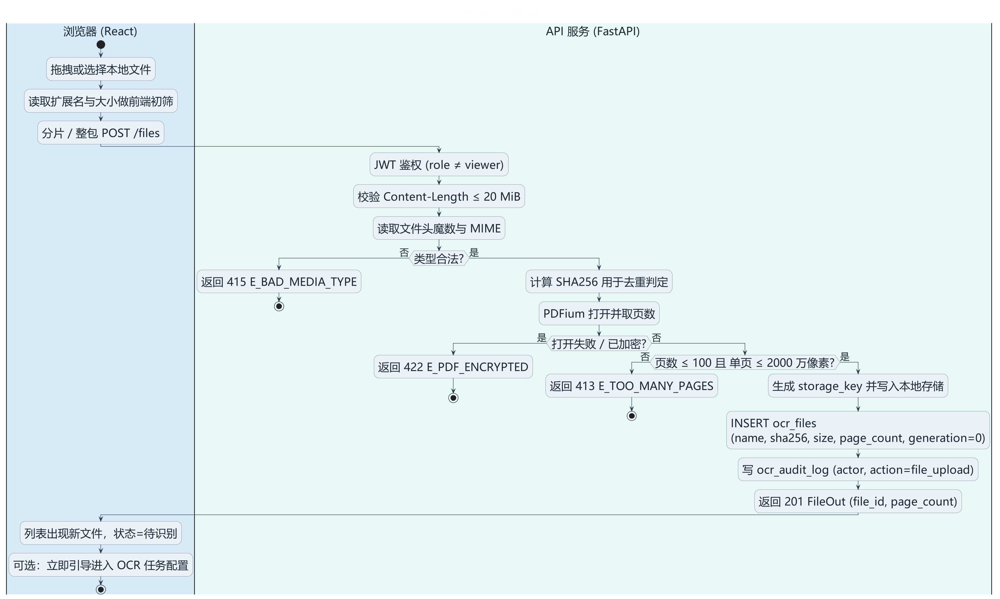{width="5.77in"}

**图 3-4 文件上传与校验活动图**

**（F2）任务创建、配额预留与入队**（图 3-5、图 3-6）
`POST /api/v1/ocr/jobs` 的请求模型严格校验 32 位十六进制 `file_id`、页码列表、`mode`、`dpi`（72～240）、`tables` 与 `min_confidence`；系统检查文件无活动任务（否则 409）、将 `ocr_files.generation` 递增 1，在同一事务内执行前置回调 `quota.reserve(页数)`（超额 429），写入 `ocr_jobs(status=queued, options)` 及每页 `ocr_pages(status=pending)`，返回 202。前置回调不得自行提交事务，以保证任务与配额同时生效或同时回滚。

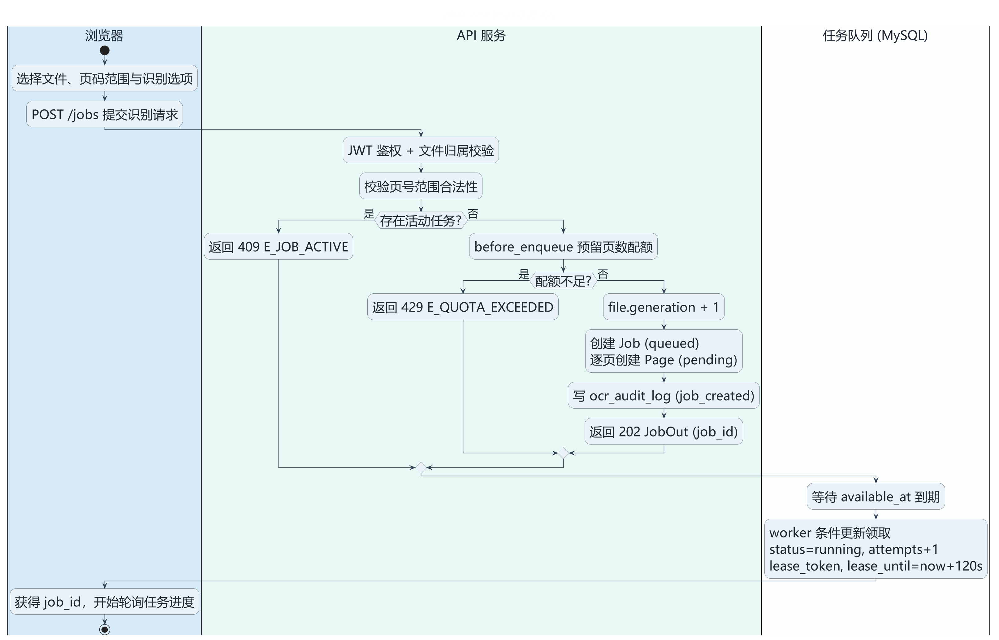{width="5.77in"}

**图 3-5 OCR 任务创建与入队活动图**

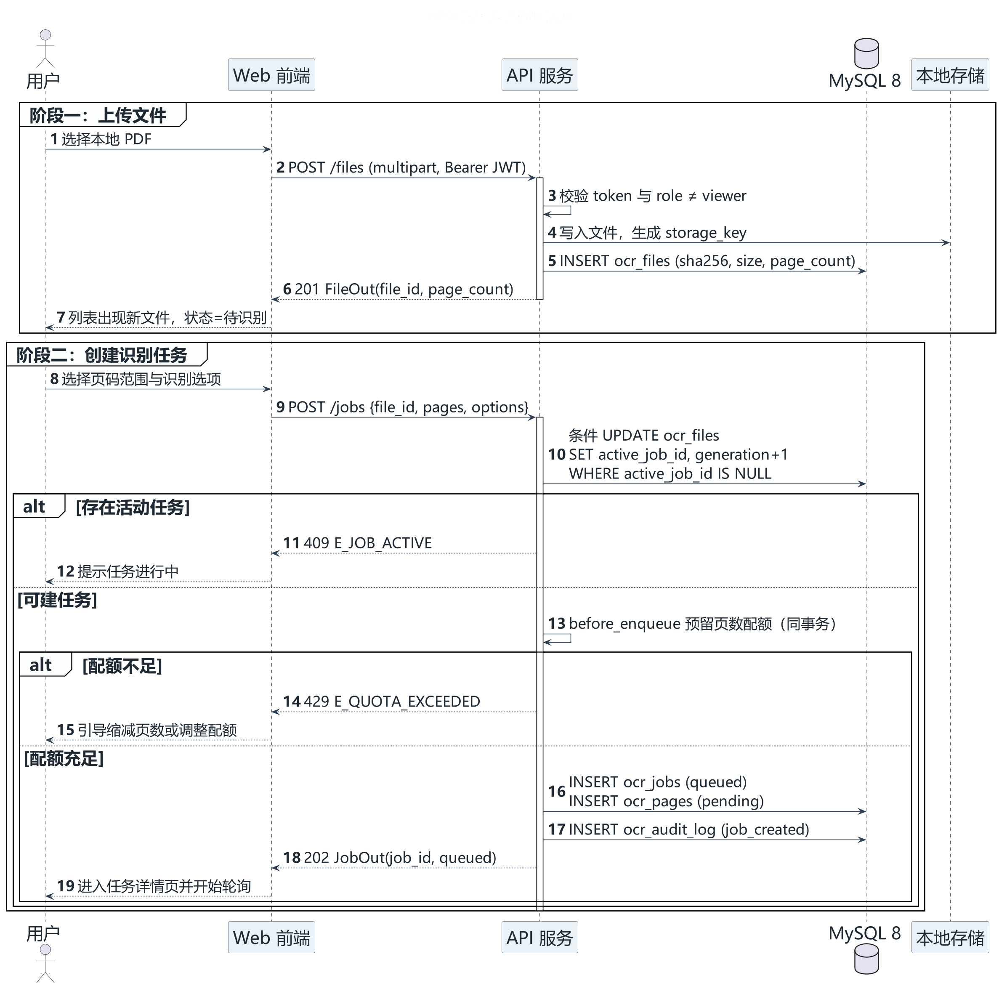{width="5.77in"}

**图 3-6 文件上传与任务创建顺序图**

**（F3）任务领取与租约算法**（图 3-7、图 3-8）
`Worker.run_once()` 调用 `claim()` 在事务中筛选 `(status ∈ {queued, retry_wait} AND available_at ≤ now) OR (status = running AND lease_until < now)`，MySQL 下加 `FOR UPDATE SKIP LOCKED`；以条件更新把 `status` 置为 `running`、`attempts+1`、写入新 `lease_token` 与 `lease_until = now + 120 s`，受影响行数为 0 时放弃本次竞争；`attempts ≥ 3` 时收敛为终态。领取成功后启动心跳线程，每 40 s 续租；心跳失败或条件更新失配即停止后续页处理。空闲时轮询间隔 2 s。

**（F4）逐页识别、结果回写与索引同步**（图 3-7、图 3-8）
对任务内 `status != succeeded` 的页按页号升序执行：按 `options.dpi` 渲染（PDFium 全局锁）→ 检测、方向判断、识别与置信度过滤（低于阈值标 `needs_review`，不删除文本）→ 按需执行规则表格还原 → 将渲染页 PNG 存为 `pages/{job_id}/{lease_token}-{page_no}.png`（令牌化文件名防止旧 Worker 覆盖新预览），结果写入 `image_key` 与 `coordinate_system` → `save_page()` 在同一事务内校验租约、更新 `ocr_pages(result, revision+1, status=succeeded)` 并 upsert `pdf_text_index` → 失败页写 `error`（`ocr_inference_failed` / `worker_lease_expired` / `render_pixel_limit`），不清空已有索引 → `complete_attempt()` 依据成功页数把任务收敛为 `succeeded / partial_success / failed`，或置 `retry_wait` 并按 15 s、30 s 指数退避，最后写入尝试完成审计。

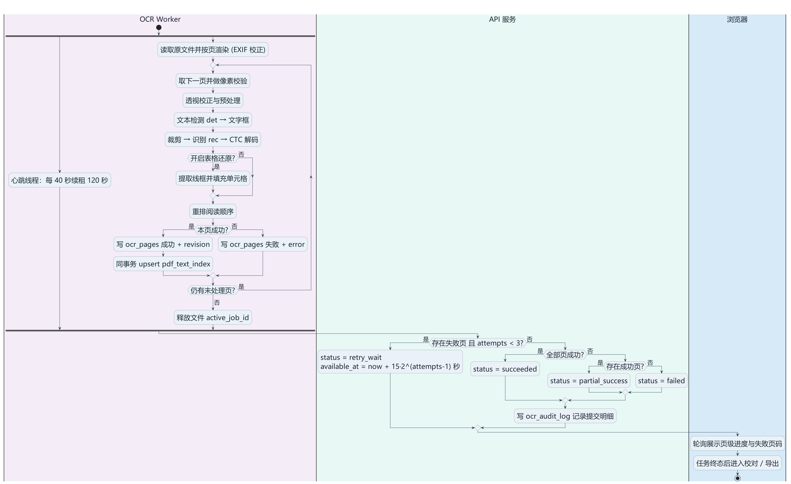{width="5.77in"}

**图 3-7 OCR 逐页识别与结果回写活动图**

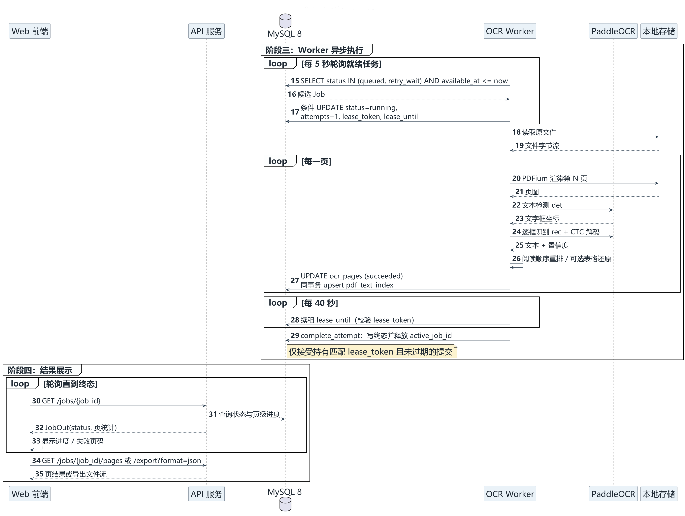{width="5.77in"}

**图 3-8 Worker 执行与结果回写顺序图**

**（F5）校对与乐观锁**（图 3-9、图 3-14）
`PATCH /api/v1/ocr/jobs/{id}/pages/{n}` 提交 `Correction{expected_revision, blocks}`：请求模型拒绝未知键，bbox 满足 0～1 且 `left < right, top < bottom`，块 ID 互不重复，单块 ≤ 10000 字、全页 ≤ 200000 字、最多 2000 块；服务端比对 `expected_revision` 与库中 `revision`，不一致或任务仍活动返回 409；一致则重排文本、置 `corrected=true`、`revision+1`，并在同一事务内同步全文索引（空块列表会清空该页索引）。表格单元格按框中心重新归位；人工校对后的 `confidence` 沿用输入值，不再代表模型评分。

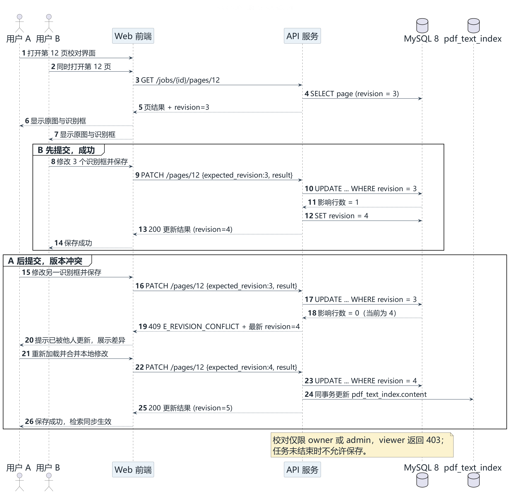{width="5.77in"}

**图 3-9 识别结果校对与并发冲突顺序图**

**（F6）规则表格还原算法**
灰度化 → 自适应二值化 → 横纵形态学开运算提取线段 → 轮廓检测（过滤小于 60×60 像素的区域）→ 合并相邻 2 像素内的线段为中心线 → 仅当分隔线覆盖整表 ≥ 90% 且纵线 3～51 条、横线 3～101 条时接受 → 若仍存在覆盖 ≥ 20% 的部分分隔线则拒绝还原，避免合并单元格被臆造 → 按文本块中心点落入网格赋值，输出 `strategy=ruled_grid`、`needs_review=true`、`x_lines`、`y_lines`、`cells`。无线框表格降级为按行聚类纯文本并标注未还原。

**（F7）导出与输出安全**
`GET /api/v1/ocr/jobs/{id}/export?format=…` 支持 `txt / json / csv / html / xlsx`；默认仅完整成功任务可导出，部分成功须 `allow_partial=true` 且至少一页成功，响应头 `X-OCR-Exported-Pages` 与 `X-OCR-Total-Pages` 标明范围；HTML 使用 `html.escape()` 转义，CSV 与 XLSX 通过 `spreadsheet_safe()` 去除控制字符并对以 `= + - @` 开头的值前补单引号，防止公式注入；前端使用带鉴权的 Blob 下载，不使用无法携带 JWT 的裸链接。

**（F8）全文检索**（图 3-10）
主系统 `GET /api/v1/search` 以 `pdf_text_index` 与 `files` 连接查询，前置过滤 `deleted_at IS NULL` 与 `owner_id`，返回 `file_id / page_no / snippet / job_id / revision`；MySQL 使用 ngram 自然语言全文匹配（关键词长度 ≥ 2），单字与 SQLite 退化为 LIKE 子串（参数绑定并转义通配符），响应以 `backend: mysql_ngram | substring | ocr_not_ready` 标明实际检索后端，第三值表示 OCR 模块未挂载、结果集为空；结果按索引更新时间倒序，前端以文本节点渲染片段；命中后按 C4 跳页并加载覆盖层。

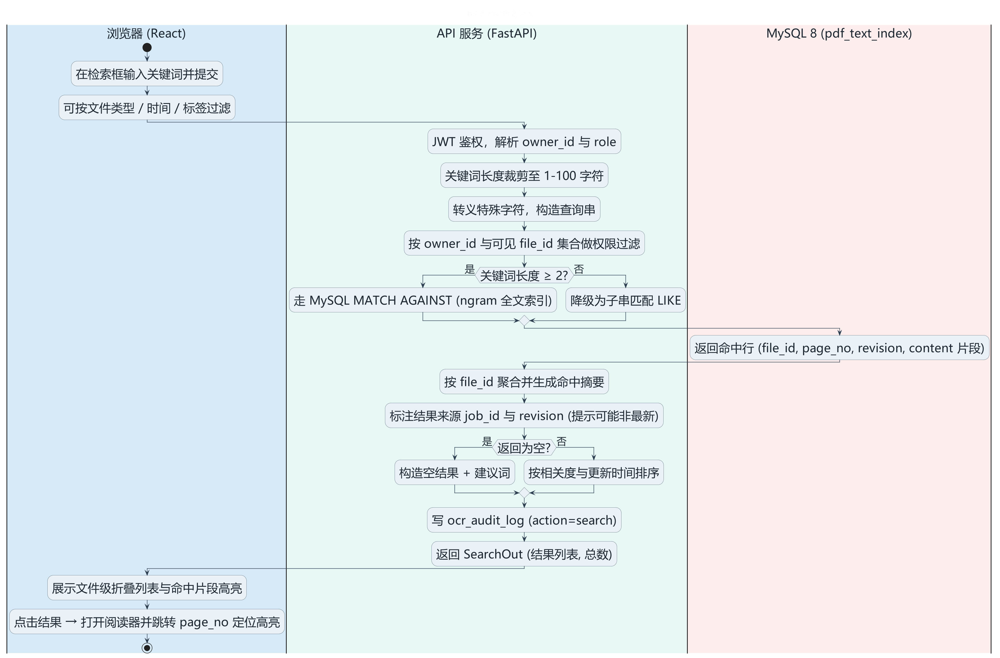{width="5.77in"}

**图 3-10 全文检索活动图**

**（F9）文件生命周期与清理**（图 3-11、图 3-12）
软删除置 `deleted_at`，取消未终态任务并释放 `active_job_id`，保留 OCR 结果与索引以供还原；还原清空 `deleted_at`；彻底删除按“索引 → 页结果 → 任务 → 页 PNG → 镜像行 → 物理文件”顺序清理，分享链接由外键级联清除。分享链接访问流程见图 3-12。

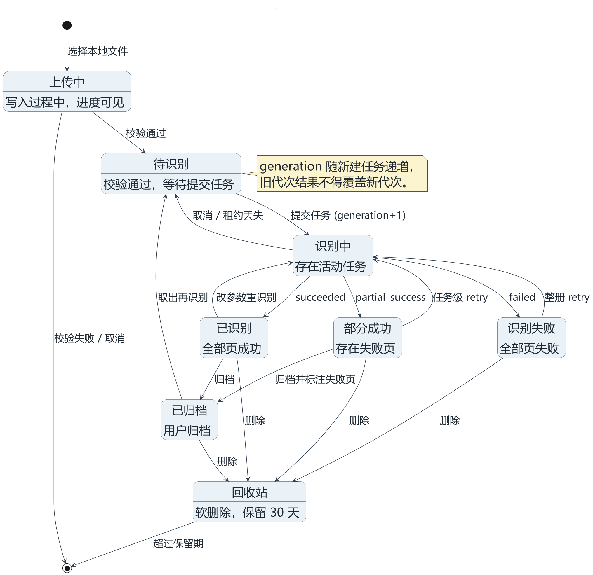{width="5.77in"}

**图 3-11 文件生命周期状态图**

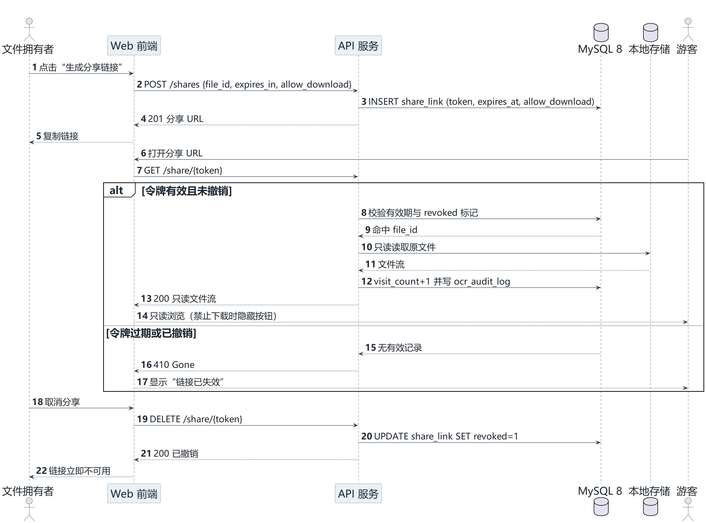{width="5.77in"}

**图 3-12 分享链接访问顺序图**

**（F10）任务状态、配额记账与索引同步状态**
任务 7 态与页面 3 态的迁移分别见图 3-13、图 3-14。配额采用三段式记账：入队时 `reserve` 增加 `pages_reserved` 并写正数流水；终态 `settle` 把成功页转为 `pages_used`；失败或取消时 `release` 写负数流水退还。`settle_job()` 以 `ref_id = job_id AND reason = job_close` 保证幂等，避免重复结算。

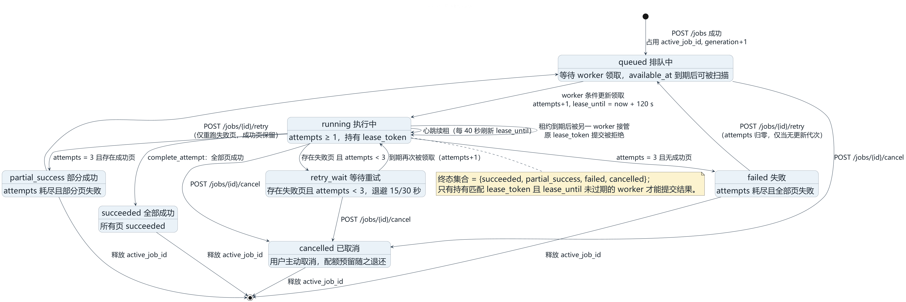{width="5.77in"}

**图 3-13 OCR 任务状态图**

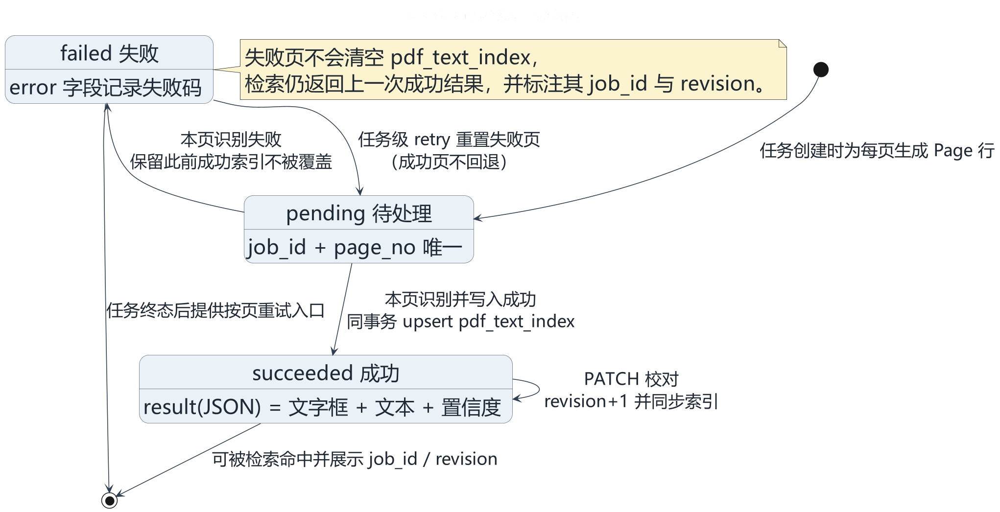{width="5.77in"}

**图 3-14 页面与全文索引同步状态图**

### **3.2.4 对象模型**

领域类图分两张：文档域描述文件、任务、页结果、索引与标签之间的关系；账号权限记账域描述用户、角色、配额与审计。

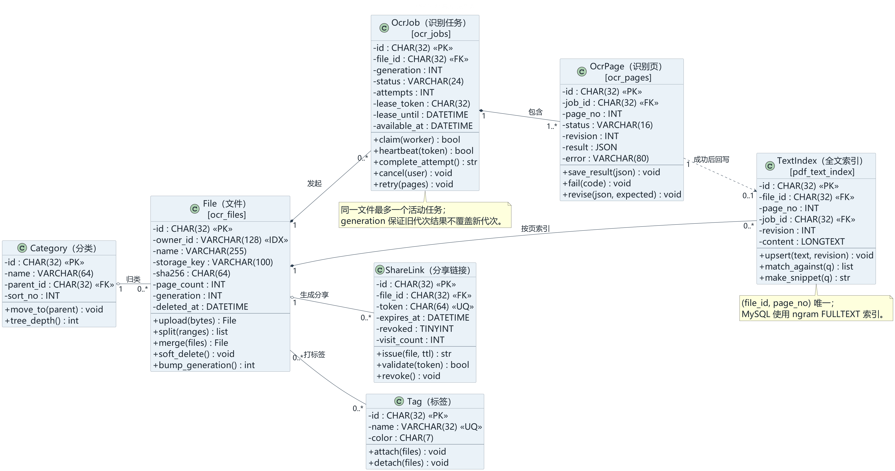{width="5.77in"}

**图 3-15 领域类图（文档域）**

文件与任务为组合关系，任务不能脱离文件独立存在；页结果与全文索引为依赖关系，索引可被后续代次覆盖，因此失败页不清空已有索引；文件与标签为多对多，实现上通过 `file_tags` 关联表建立联系（概念模型中的关联实体）；分类为一对多并通过父节点自引用实现层级。任务的 `claim / heartbeat / complete_attempt` 对应租约机制的三个步骤。

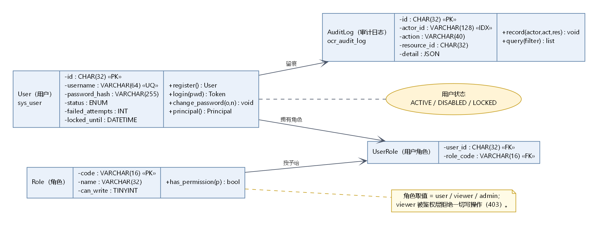{width="5.77in"}

**图 3-16 账号、权限与记账类图**

角色仅有 user / viewer / admin 三个实例，`can_write` 决定鉴权放行逻辑；配额账户的 `reserve / release / settle` 对应三段式记账；审计日志只提供记录与查询，应用不提供修改与删除接口。类图是概念模型，实现类清单见 4.2；实现中角色简化为用户表的枚举列，分类简化为文件路径字段。

# **第 4 章 数据设计**

## **4.1 数据结构（数据表、数据库）设计**

### **4.1.1 设计约定**

**表 4-1 数据设计约定**

| 项 | 约定 |
|---|---|
| 引擎与字符集 | 生产 MySQL 8 / InnoDB / utf8mb4（utf8mb4_unicode_ci）；开发期 SQLite |
| ORM | 两套 `DeclarativeBase` 互不共用：主系统 11 张表 + OCR 模块 5 张表，共 16 张 |
| 主键 | 业务实体表以 32 位十六进制字符串（UUID 去连字符）为主键，由应用层 `uid()` 生成；`revoked_tokens.jti` 为 VARCHAR(64)，`quota_accounts` 与 `file_tags` 使用复合主键 |
| 时间 | UTC `DATETIME`（不带时区），统一 `now()`；展示层转换本地时间 |
| 计数 | 配额、页数、尝试次数一律整数 |
| 软删除 | `files.deleted_at`，只置位不物理删除；彻底删除才按 C5 清理链执行 |
| 并发控制 | `ocr_pages.revision`、`ocr_files.generation` / `ocr_jobs.generation`、`ocr_jobs.lease_token` + 条件更新 |
| JSON | 未知键一律拒绝（请求模型 `extra="forbid"`）；结构见 4.1.4 |
| 坐标 | 所有 bbox 归一化 0～1、左上原点（C4） |
| 审计 | `audit_logs` / `ocr_audit_log` 只追加，不记录正文、密码与令牌 |

### **4.1.2 逻辑结构**

分域 E-R 图给出实体联系模型；三张图之间通过文件镜像与用户实体的节选表示建立关联。

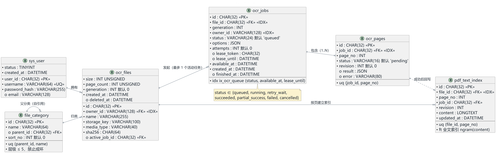{width="5.77in"}

**图 4-1 文档与 OCR 域 E-R 图**

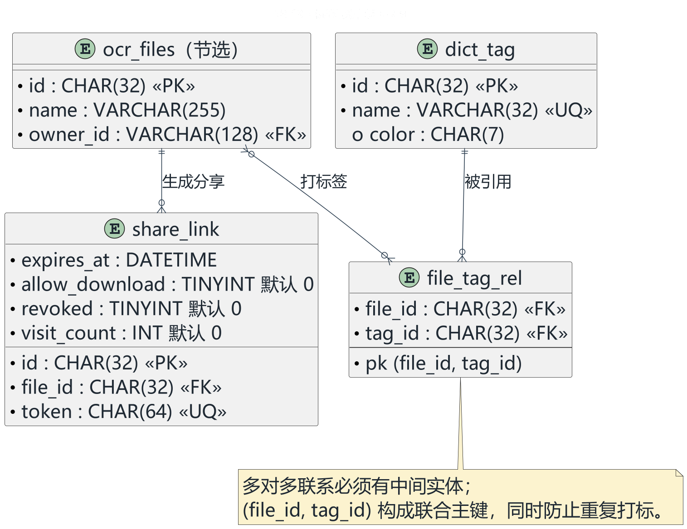{width="5.77in"}

**图 4-2 标签与分享域 E-R 图**

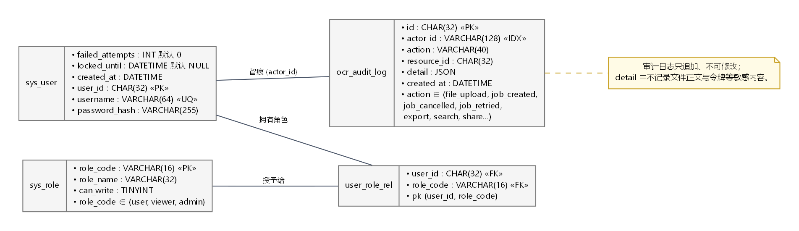{width="5.77in"}

**图 4-3 账号、权限与记账域 E-R 图**

用户与文件为一对多且文件必须归属某一用户；文件与任务为一对多但受“最多一个活动任务”约束；任务与页记录以 `(job_id, page_no)` 唯一；文件与全文索引以 `(file_id, page_no)` 唯一，页成功回写时更新索引，失败页保留旧索引；文件与标签为多对多，通过 `file_tags` 关联表实现；用户与配额账户按账期一对一；审计日志只追加。三张分域 E-R 图共同覆盖全部实体关系，成图清单见附录 B。

**表 4-2 数据实体总览（16 张表 / 15 个条目）**

| 归属 | 表 | 业务含义 | 主要写入方 |
|---|---|---|---|
| 主系统 | `users` | 账号、角色、禁用状态、令牌版本 | 认证模块 |
| 主系统 | `quota_accounts` | 按用户按月的配额账户 | 配额模块 |
| 主系统 | `quota_ledger` | 配额流水与结算幂等标记 | 配额模块 |
| 主系统 | `audit_logs` | 主系统操作审计 | `core/audit.py` |
| 主系统 | `share_links` | 分享链接与访问计数 | 分享模块 |
| 主系统 | `revoked_tokens` | JWT 吊销黑名单 | 认证模块 |
| 主系统 | `files` | 文件元数据（事实来源）、软删除、版本 | 文件模块 |
| 主系统 | `tags` / `file_tags` | 标签与文件多对多关联 | 文件模块 |
| 主系统 | `bookmarks` | 书签 | 阅读器模块 |
| 主系统 | `annotations` | 批注（种类 + payload JSON） | 阅读器模块 |
| OCR 模块 | `ocr_files` | `files` 的只读镜像，主键同值 | 文件镜像适配层 |
| OCR 模块 | `ocr_jobs` | 识别任务与队列租约 | `ocr_service/api.py`、`queue.py` |
| OCR 模块 | `ocr_pages` | 逐页结果、修订号、错误码 | `queue.save_page` |
| OCR 模块 | `pdf_text_index` | 页级全文索引 | `queue.write_index` |
| OCR 模块 | `ocr_audit_log` | OCR 侧操作审计 | `ocr_service/db.audit()` |

### **4.1.3 数据字典**

以下逐表给出字段定义。列含义：PK 主键、FK 外键、UQ 唯一、IDX 索引、NN 非空。主键未特别说明者均为 `VARCHAR(32)` 的 `uid()`；时间均为 UTC `DATETIME`。表 4-3 至表 4-17 共 15 个表条目覆盖 16 张表，其中 `tags` 与 `file_tags` 合并描述。

**表 4-3 `users`（账号）**

| 字段 | 类型 | 约束 | 说明 |
|---|---|---|---|
| id | VARCHAR(32) | PK | 用户标识 |
| email | VARCHAR(190) | UQ, IDX, NN | 登录名，统一小写 |
| display_name | VARCHAR(64) | | 昵称 |
| password_hash | VARCHAR(255) | NN | `pbkdf2_sha256$轮数$salt$digest`，20 万轮加盐 |
| role | VARCHAR(16) | 默认 `user` | `user / viewer / admin` |
| disabled | TINYINT | 默认 0 | 停用后令牌立即失效 |
| token_version | INT | 默认 0 | 改密自增，旧令牌全失效 |
| login_count | INT | 默认 0 | 登录次数 |
| created_at / last_login_at | DATETIME | | 注册 / 最近登录时间 |

**表 4-4 `files`（文件事实来源）**

| 字段 | 类型 | 约束 | 说明 |
|---|---|---|---|
| id | VARCHAR(32) | PK | 与 `ocr_files.id` 同值 |
| owner_id | VARCHAR(32) | IDX, NN | 归属者 |
| name / folder | VARCHAR(255) | NN / 默认 `/` | 显示名 / 分类目录路径 |
| storage_key | VARCHAR(100) | NN | 相对存储根路径；写入前由 `safe_path()` 判定规范化路径是否越出存储根目录 |
| media_type | VARCHAR(40) | NN | `application/pdf` / `image/png` / `image/jpeg` |
| sha256 | VARCHAR(64) | IDX | 内容摘要，由流式落盘时计算并写入，写入后不再变更 |
| size / page_count / version | INT | NN | 字节数 ≤ 20 MiB / 页数 1～100 / 版本号 |
| replaced_from | VARCHAR(32) | 可空 | 指向被替换的旧文件 |
| deleted_at | DATETIME | 可空 | 软删除标记 |
| created_at | DATETIME | NN | 上传时间 |

**表 4-5 `tags` / `file_tags`（标签与关联）**

| 表 | 字段 | 约束 | 说明 |
|---|---|---|---|
| tags | id, owner_id, name | PK(id)、IDX(owner_id) | 标签按归属者隔离 |
| file_tags | file_id, tag_id | 联合 PK；FK→files / tags 且级联删除 | 多对多，联合主键防重复打标 |

**表 4-6 `bookmarks`（书签）**

| 字段 | 类型 | 约束 | 说明 |
|---|---|---|---|
| id | VARCHAR(32) | PK | 书签标识 |
| file_id / owner_id | VARCHAR(32) | FK / IDX | 文件 / 归属者 |
| page_no | INT | NN, ≥ 1 | 页号 |
| title | VARCHAR(120) | 默认 `""` | 书签标题 |
| created_at | DATETIME | | 创建时间 |
| — | — | UQ(file_id, owner_id, page_no) | 每人每页至多一个书签 |

**表 4-7 `annotations`（批注）**

| 字段 | 类型 | 约束 | 说明 |
|---|---|---|---|
| id | VARCHAR(32) | PK | 批注标识 |
| file_id / owner_id / page_no | VARCHAR(32) / INT | FK / IDX | 定位到页 |
| kind | VARCHAR(16) | NN | `highlight / note / ink` |
| payload | JSON | NN | `{text, bbox}`，bbox 与 C4 同口径 |
| created_at / updated_at | DATETIME | | 创建 / 更新时间 |

**表 4-8 `quota_accounts`（月配额账户）**

| 字段 | 类型 | 约束 | 说明 |
|---|---|---|---|
| user_id + month | VARCHAR(32) + VARCHAR(7) | 复合 PK | month = `YYYY-MM` |
| pages_reserved | INT | ≥ 0 | 已预留未结算页数 |
| pages_used | INT | ≥ 0 | 已计费页数 |
| updated_at | DATETIME | | 最后记账时间 |
| — | — | `reserved + used ≤ 500` | 由 `quota.reserve` 强制，上限可配置 |

**表 4-9 `quota_ledger`（配额流水）**

| 字段 | 类型 | 约束 | 说明 |
|---|---|---|---|
| id / user_id / month | VARCHAR(32) / VARCHAR(7) | PK / IDX | 流水标识与账期 |
| pages | INT | 正负整数 | 正为占用、负为退还 |
| reason | VARCHAR(40) | NN | 5 值（穷举）：`reserve / settle_reserve / settle_used / release / job_close` |
| ref_id | VARCHAR(32) | 可空 | 关联任务标识；`job_close` 用于结算幂等 |
| created_at | DATETIME | | 记账时间 |

**表 4-10 `audit_logs`（主系统审计）**

| 字段 | 类型 | 约束 | 说明 |
|---|---|---|---|
| id | VARCHAR(32) | PK | 日志标识 |
| actor_id | VARCHAR(128) | IDX | 操作者 |
| action | VARCHAR(40) | NN, IDX | 当前写入 19 值（穷举）：`user_registered / user_logged_in / user_logged_out / token_refreshed / user_password_changed / user_disabled / user_enabled / user_role_changed / file_uploaded / file_updated / file_trashed / file_restored / file_purged / bookmark_created / bookmark_deleted / annotation_created / annotation_deleted / share_created / share_revoked`；`share_visited` 为设计待办，当前未写入审计 |
| resource_id | VARCHAR(32) | | 被操作资源 |
| detail | JSON | 默认 `{}` | 只保存标识与计量，禁记正文、令牌与密码 |
| created_at | DATETIME | | 只追加，保留 180 天 |

**表 4-11 `share_links`（分享链接）**

| 字段 | 类型 | 约束 | 说明 |
|---|---|---|---|
| id | VARCHAR(32) | PK | 记录标识 |
| file_id | VARCHAR(32) | FK→files 级联删除, IDX | 被分享文件 |
| owner_id | VARCHAR(32) | IDX | 分享者 |
| token | VARCHAR(64) | UQ, IDX | 分享 URL 随机令牌 |
| expires_at | DATETIME | 可空 | NULL 表示永不过期 |
| access_code | VARCHAR(32) | 可空 | 提取码；NULL 表示无需提取码 |
| allow_download | TINYINT | 默认 1 | 是否允许下载 |
| visit_count | INT | 默认 0 | 访问计数 |
| created_at | DATETIME | | 创建时间 |

取消分享即删除该行；文件彻底删除时由外键级联清除。`revoked_tokens` 由主体解析逻辑按 `jti` 查询，过期行可定时清理，当前规模下不强制。

**表 4-12 `revoked_tokens`（令牌黑名单）**

| 字段 | 类型 | 约束 | 说明 |
|---|---|---|---|
| jti | VARCHAR(64) | PK | 被吊销令牌的 `jti` 声明 |
| user_id | VARCHAR(32) | IDX | 所属用户 |
| expires_at | DATETIME | 可空 | 原令牌过期时间，供清理使用 |
| revoked_at | DATETIME | | 吊销时间 |

**表 4-13 `ocr_files`（文件镜像）**

| 字段 | 类型 | 约束 | 说明 |
|---|---|---|---|
| id | VARCHAR(32) | PK | 等于 `files.id` |
| owner_id | VARCHAR(128) | IDX, NN | 归属者；与主系统 `files.owner_id` 的 VARCHAR(32) 长度不同，镜像时须保证标识不超过 32 字符 |
| name | VARCHAR(255) | NN | 显示名 |
| storage_key | VARCHAR(100) | NN | 复用主系统存储键 |
| media_type | VARCHAR(40) | NN | 合法 MIME |
| sha256 | VARCHAR(64) | NN | 内容摘要 |
| size / page_count | INT | NN | 字节数 / 页数 |
| active_job_id | VARCHAR(32) | 可空 | 非空即禁止新建任务 |
| generation | INT | 默认 0 | 重识别代次 |
| created_at | DATETIME | NN | 创建时间 |

**表 4-14 `ocr_jobs`（识别任务 / 队列表）**

| 字段 | 类型 | 约束 | 说明 |
|---|---|---|---|
| id | VARCHAR(32) | PK | 任务标识 |
| file_id | VARCHAR(32) | FK→ocr_files, IDX | 所属文件 |
| generation | INT | NN | 等于文件当前代次 |
| owner_id | VARCHAR(128) | IDX, NN | 发起人 |
| status | VARCHAR(24) | 默认 `queued`, IDX | 7 值枚举，见表 4-20 |
| options | JSON | NN | 识别选项，结构见表 4-18 |
| attempts | INT | 默认 0 | 0～3，超出收敛终态 |
| lease_token | VARCHAR(32) | 可空 | 租约令牌，提交结果时校验 |
| lease_until | DATETIME | 可空, IDX | 租约到期时间 |
| available_at | DATETIME | 默认 now, IDX | 可领取时间，退避时顺延 |
| created_at | DATETIME | 默认 `now()` | 创建时间，由 ORM 写入 |
| finished_at | DATETIME | 可空 | 进入终态的时间 |
| — | — | IDX `ix_ocr_queue(status, available_at, lease_until)` | 队列扫描核心索引 |

**表 4-15 `ocr_pages`（页识别结果）**

| 字段 | 类型 | 约束 | 说明 |
|---|---|---|---|
| id | VARCHAR(32) | PK | 页记录标识 |
| job_id | VARCHAR(32) | FK→ocr_jobs, IDX | 所属任务 |
| page_no | INT | NN, ≥ 1 | 页号从 1 开始 |
| status | VARCHAR(16) | 默认 `pending` | `pending / succeeded / failed` |
| revision | INT | 默认 0 | 乐观锁，校对后 +1 |
| result | JSON | 可空 | 成功时写页结果，结构见表 4-18 |
| error | VARCHAR(80) | 可空 | 页级错误码 |
| — | — | UQ(job_id, page_no) | 防重复页，支撑按页重试 |

**表 4-16 `pdf_text_index`（全文索引）**

| 字段 | 类型 | 约束 | 说明 |
|---|---|---|---|
| id | VARCHAR(32) | PK | 索引记录标识 |
| file_id | VARCHAR(32) | FK→ocr_files, IDX | 所属文件 |
| page_no | INT | NN | 页号 |
| job_id | VARCHAR(32) | FK→ocr_jobs | 来源任务 |
| revision | INT | NN | 对应页修订号，判定是否过期 |
| content | LONGTEXT / TEXT | NN, FULLTEXT(ngram) | 页全文，仅 MySQL 建全文索引 |
| updated_at | DATETIME | NN | 更新时间，检索排序依据 |
| — | — | UQ(file_id, page_no) | 一页一条，支撑 upsert |

**表 4-17 `ocr_audit_log`（OCR 侧审计）**

| 字段 | 类型 | 约束 | 说明 |
|---|---|---|---|
| id | VARCHAR(32) | PK | 日志标识 |
| actor_id | VARCHAR(128) | IDX | 操作者或 `worker` |
| action | VARCHAR(40) | NN | 当前写入 7 值（穷举）：`file_uploaded / job_created / job_cancelled / job_retried / page_corrected / result_exported / attempt_completed`；前六项由 API 写入，`attempt_completed` 由 Worker 写入 |
| resource_id | VARCHAR(32) | NN | 资源标识 |
| detail | JSON | 默认 `{}` | 附加信息，禁记正文与令牌 |
| created_at | DATETIME | NN | 发生时间 |

### **4.1.4 JSON 字段结构与校验规则**

**表 4-18 JSON 字段结构定义**

| 字段 | 键 | 类型 | 必填 | 取值与限制 |
|---|---|---|---|---|
| `ocr_jobs.options` | file_id | string | 是 | 32 位十六进制（建任务请求字段） |
| `ocr_jobs.options` | pages | array\<int\> \| null | 否 | 1～100 项，缺省为整册 |
| `ocr_jobs.options` | mode | string | 否 | `general / handwriting`，默认 general |
| `ocr_jobs.options` | recognition_model | string | 否 | `official / custom`，默认 official |
| `ocr_jobs.options` | dpi | int | 否 | 72～240，默认 144 |
| `ocr_jobs.options` | tables | bool | 否 | 默认 false |
| `ocr_jobs.options` | min_confidence | float | 否 | 0～1，默认 0.5 |
| `ocr_pages.result` | width / height | int | 是 | OCR 渲染图像素尺寸 |
| `ocr_pages.result` | text | string | 是 | 全页拼接文本，全页上限 20 万字 |
| `ocr_pages.result` | blocks[] | array\<object\> | 是 | 最多 2000 块；每块 `{id≥1, text≤10000 字, confidence 0～1, bbox[4] 0～1, needs_review}` |
| `ocr_pages.result` | tables[] | array\<object\> | 否 | `{id, strategy: ruled_grid, needs_review, x_lines[], y_lines[], cells[][]}` |
| `ocr_pages.result` | corrected | bool | 是 | 是否人工校对 |
| `ocr_pages.result` | image_key | string | 是 | `pages/{job_id}/{lease_token}-{page_no}.png` |
| `ocr_pages.result` | coordinate_system | string | 是 | `normalized_top_left_display_page` |
| `ocr_pages.result` | mode / recognition_model / warnings | string / array | 否 | 模式、模型与告警 |
| `annotations.payload` | text / bbox | string / array\<float\> | 否 | bbox 与 C4 同口径 |
| `audit_logs.detail`、`ocr_audit_log.detail` | 计量键 | 简单类型 | 否 | 如 `status / attempt / bytes / pages / reason`；严禁正文、密码与令牌 |

校验规则：请求模型继承 `StrictModel`（`extra="forbid"`、`allow_inf_nan=False`），未知键返回 422；bbox 必须满足 `0 ≤ left < right ≤ 1` 且 `0 ≤ top < bottom ≤ 1`；校对请求的 `expected_revision ≥ 1`、块 ID 互不重复、全页文本 ≤ 20 万字；空块列表表示确认清空该页文本并同步清空索引；表格坐标使用 OCR 图像像素，文本块坐标使用归一化坐标。

### **4.1.5 索引、状态枚举与完整性约束**

**表 4-19 索引清单与用途**

| 索引 | 表 | 列 | 用途 |
|---|---|---|---|
| `ix_ocr_files_owner_id` | ocr_files | owner_id | 文件列表按归属筛选 |
| `ix_ocr_jobs_owner_id` | ocr_jobs | owner_id | 我的任务列表 |
| `ix_ocr_jobs_file_id` | ocr_jobs | file_id | 按文件查任务与级联清理 |
| `ix_ocr_queue` | ocr_jobs | (status, available_at, lease_until) | 队列扫描与租约过期接管 |
| `ix_ocr_pages_job_id` | ocr_pages | job_id | 按任务取页结果与进度 |
| UQ(job_id, page_no) | ocr_pages | job_id, page_no | 防重复页 |
| UQ(file_id, page_no) | pdf_text_index | file_id, page_no | 一页一条，支撑 upsert |
| `ft_pdf_text_content` | pdf_text_index | content（ngram） | 中文全文检索，仅 MySQL |
| `ix_ocr_audit_log_actor_id` | ocr_audit_log | actor_id | 审计按人追溯 |
| UQ token | share_links | token | 分享链接查找与唯一性 |
| UQ email | users | email | 登录名唯一 |
| PK(jti) | revoked_tokens | jti | 每请求黑名单命中查询 |
| UQ(file_id, owner_id, page_no) | bookmarks | 三列 | 每页一个书签 |

索引原则：只为支撑查询与队列扫描的列建索引；不为低选择性的状态列单独建单列索引；全文索引仅在 MySQL 建立，SQLite 退化为 LIKE 子串匹配，验收以 MySQL 为准。数据库模型由 `create_all()` 建立，不迁移已存在的表结构。

**表 4-20 状态枚举定义**

| 归属 | 取值 | 说明 |
|---|---|---|
| 任务 | `queued / running / retry_wait / succeeded / partial_success / failed / cancelled` | 前 3 为非终态，后 4 为终态 |
| 页面 | `pending / succeeded / failed` | 校对后仍为 `succeeded`，仅 `revision` 递增 |
| 文件状态 | 待识别 / 识别中 / 已识别 / 部分成功 / 识别失败 | 由图 3-11 生命周期派生，不单独存状态列 |
| 角色 | `user / viewer / admin` | 主体解析的三种角色 |
| 账号 | `active / disabled` | 由 `disabled` 与登录策略驱动 |
| 批注 | `highlight / note / ink` | `annotations.kind` |
| 媒体类型 | `application/pdf / image/png / image/jpeg` | 按文件真实内容判定；非 PNG 图片归一为 `image/jpeg`，见 2.1 |
| 配额流水 | `reserve / settle_reserve / settle_used / release / job_close` | `quota_ledger.reason` |
| 检索后端 | `mysql_ngram / substring` | 检索响应中的实际后端标识 |

**表 4-21 完整性约束**

| 类别 | 约束 |
|---|---|
| 实体完整性 | 业务实体表以 32 位十六进制为主键；`revoked_tokens.jti` 为 VARCHAR(64) 主键，`quota_accounts(user_id, month)` 与 `file_tags(file_id, tag_id)` 为复合主键；`email`、`token` 唯一；`ocr_pages(job_id,page_no)`、`pdf_text_index(file_id,page_no)`、`bookmarks(file_id,owner_id,page_no)` 唯一 |
| 参照完整性 | `ocr_files.id == files.id`；任务、页与索引以外键引用镜像与任务；标签关联与分享链接级联删除 |
| 取值域完整性 | 20 MiB / 100 页 / 2000 万像素上限；配额 `reserved + used ≤ 月配额`；`attempts ≤ 3`；`revision ≥ 0`；`generation ≥ 0`；bbox 0～1；状态枚举；越权与已删资源统一 404 |
| 事务完整性 | 上传与写镜像同一事务；配额预留、建任务、生成页记录与代次递增同一事务；页结果与全文索引同一事务；校对与索引同步同一事务 |

## **4.2 类的设计**

领域类图见图 3-15 与图 3-16。下表给出实现类与关键方法，作为对象模型到代码的映射。

**表 4-22 核心类与函数清单**

| 层 | 类 / 函数 | 关键方法 / 签名 | 职责 | 对应数据 |
|---|---|---|---|---|
| 底座 | `Settings`（主系统 / OCR 各一套） | `validate()`、`get_settings()` | 环境变量与密钥长度校验 | 配置 |
| 底座 | `Principal` | `user_id / role / is_admin` | 唯一鉴权主体 | `users`、`revoked_tokens` |
| 底座 | `core.security` | `hash_password / create_access_token / decode_token` | 加盐哈希、令牌签发与解码 | `users` |
| 底座 | `core.principal` | `resolve_principal / require_editor / require_admin / owned_file / share_access` | 鉴权、越权处理、分享旁路 | `users`、`share_links` |
| 底座 | `core.media` | `inspect_media / save_upload / safe_path / render_page` | 三重校验、落盘、渲染、路径防护 | `files`、存储目录 |
| 底座 | `core.errors` / `core.audit` | `bad_request / not_found / conflict / quota_exceeded / unsupported`、`audit()` | 统一错误出口与审计 | `audit_logs` |
| 主系统 | `quota.service` | `reserve / settle / release / usage` | 三段式记账 | 配额两表 |
| 主系统 | `ocr.bridge / lifecycle / mount` | `ensure_ocr_file / cancel_tasks / purge_file / mount_ocr` | 镜像、生命周期、挂载降级 | `ocr_files`、`ocr_jobs` |
| 主系统 | `search.service` | 索引与文件表连接查询 | 全文检索与权限过滤 | `pdf_text_index`、`files` |
| OCR | `ocr_service.db.Base` 及 `File / Job / Page / TextIndex / Audit` | `uid()`、`now()`、`database()`、`audit()` | 5 张表 ORM 与会话工厂 | OCR 五表 |
| OCR | `queue` | `claim / heartbeat / locked_job / save_page / write_index / complete_attempt / finish_exhausted` | 队列租约、结果回写、失败收敛 | 任务、页、索引 |
| OCR | `Worker` | `run_once()`、`main(once=False)` | 领取任务、心跳、逐页识别 | OCR 五表、页 PNG |
| OCR | `PaddleBackend` | `strict_load / recognize / recognize_crop / general_boxes / handwriting_boxes` | 检测、识别与置信度过滤 | 模型权重 |
| OCR | `tables` | `ruled_tables / assign_cells` | 规则线框表格还原 | `result.tables` |
| OCR | `exports` | `export_pages / spreadsheet_safe` | 五格式导出与输出安全 | `ocr_pages.result` |
| OCR | `schemas.StrictModel` | `JobCreate / Block / Correction` 等请求模型（`extra="forbid"`、`allow_inf_nan=False`）；响应模型继承 `BaseModel` | 请求严格校验、响应序列化 | 全部 JSON 字段 |
| 前端 | `AuthProvider`、`shared/http.ts` | `api<T>() / apiBlob() / downloadBlob()` | 业务请求统一出口与鉴权状态（pdf.js 直取原文件流为例外） | JWT |
| 前端 | `ReaderPage`、`OcrPanel`、`OcrOverlay` | props 注入 `blocks / width / height / activeId / onPick` | 阅读器容器与 OCR 覆盖层 | C4 坐标 |

## **4.3 物理结构设计**

生产库采用 MySQL 8 / InnoDB / utf8mb4_unicode_ci，开发库为 SQLite 文件。主系统与 OCR 模块两套 `DeclarativeBase` 建在同一库中，表前缀区分：主系统无前缀，OCR 表为 `ocr_`（`pdf_text_index` 沿用模块原名）。建表入口为 `python -m backend.scripts.init_db`；MySQL DDL 可由 `python -m ocr_service mysql-ddl` 导出。

仅 MySQL 建立全文索引：`Index("ft_pdf_text_content", TextIndex.content, mysql_prefix="FULLTEXT", mysql_with_parser="ngram").ddl_if(dialect="mysql")`。`content` 在 MySQL 使用 `LONGTEXT`，在 SQLite 使用 `TEXT`。`create_all()` 不做结构迁移，字段变更按 6.5 的冻结流程执行。

文件与权重的物理结构（路径相对仓库根）：

```text
pdf_system/data/
├── dev.sqlite3                    开发期数据库（生产改用 MySQL 8）
└── storage/
    ├── uploads/                   原文件，按 storage_key 相对路径存放
    └── pages/{job_id}/            渲染页 PNG：{lease_token}-{page_no}.png
pdf_ocr_module/ocr_service/
├── models/                        本地模型权重（约 218 MB）与 manifest.json 清单 + SHA256，不入库
└── configs/                       detector.yml、recognizer.yml 模型结构配置
```

`safe_path()` 以规范化路径是否越出存储根目录判定路径穿越，`storage_key` 与磁盘路径一一对应；模型权重由部署命令按 `models/manifest.json` 下载并校验 SHA256，推理运行时不访问外网。

**表 4-23 容量与保留策略**

| 类别 | 估算 / 保留期 | 物理设计对策 |
|---|---|---|
| 元数据表 | 1000 文件 × 30 页 ≈ 3 万页，< 100 MB | 主键定长 32 字符；仅对查询列建索引 |
| 文本与索引表 | 约 60 MB | `content` LONGTEXT + ngram FULLTEXT；按页 upsert |
| 文件本体与页图 | 约 5 GB / 1000 文件，20 GB 可容约 4000 文件 | 页 PNG 保留 7 天；磁盘 80% 告警、90% 拒绝上传（507） |
| 回收站文件 | 30 天 | 软删只置 `deleted_at`；到期按 C5 顺序清理 |
| 审计日志 | 180 天 | 只追加、按月归档删除；不记录正文 |
| 终态任务记录 | 90 天 | 供统计与追溯；失败任务中间态 7 天 |
| 备份 | 每日全量 + binlog，全量保留 7 天 | RPO 24 h / RTO 2 h（目标值） |

表 4-23 的保留期与清理策略为设计目标。落地时清理操作须先排除仍持有有效租约的任务与仍被活动任务引用的文件，低峰执行、单批不超过 500 条，并自身留痕。

## **4.4 数据结构与程序的关系**

**表 4-24 表 → 程序 → 接口映射**

| 数据表 | 写入方 | 读取方 | 主要接口 |
|---|---|---|---|
| `users` / `revoked_tokens` | 认证模块 | 主体解析（每请求） | `/auth/register`、`/auth/login`、`/auth/me`、`/auth/refresh` |
| `files` | 文件模块 | 列表、阅读器、检索连接查询、分享 | `/files*`、`/files/{id}/content`、`/search` |
| `tags` / `file_tags` | 文件模块 | 列表筛选 | `/files/tags`、`GET /files?tag=` |
| `bookmarks` / `annotations` | 阅读器模块 | 阅读器页面 | `/files/{id}/reader/*` |
| `quota_accounts` / `quota_ledger` | 配额模块（唯一） | 统计看板 | `GET /quota`、`/quota/overview`、`/ocr-host/jobs/{id}/settle` |
| `audit_logs` / `ocr_audit_log` | 审计函数 | 统计与追溯 | `/ocr/audit` |
| `share_links` | 分享模块 | 分享旁路校验 | `/share*`、`/share/token/{token}` |
| `ocr_files` | 文件镜像适配层 | OCR 模块、Worker | `/ocr/files/{id}`、`/ocr-host/files/{id}/sync` |
| `ocr_jobs` / `ocr_pages` | OCR 接口与队列 | Worker、进度轮询、校对、导出 | `/ocr/jobs*`、`/ocr-host/files/{id}/jobs` |
| `pdf_text_index` | 索引写入函数、校对 | 检索服务 | `/search`、`/search/suggest`、`/ocr/search` |

三项关键关系：其一，同事务边界包括“页结果 + 全文索引”“配额预留 + 任务 + 页记录 + 代次递增”“文件 + 镜像”；其二，`files.id == ocr_files.id` 是镜像与检索连接查询的前提；其三，彻底删除必须按“索引 → 页结果 → 任务 → 页 PNG → 镜像行 → 物理文件”顺序执行，否则会留下孤儿任务或无法命中的索引。

跨模块直接依赖：`search/service.py` 以裸 SQL 直查 `pdf_text_index`，OCR 侧修改该表结构会使主系统检索失效，且错误不指向根因。该表的 `file_id / page_no / content / job_id / revision` 字段集合视为隐式契约，变更须与 C1～C5 同级别评审。此外主系统 `/search` 与 OCR 模块 `/ocr/search` 是两条检索路径，前端应固定使用其中一条，避免结果口径不一致。

# **第 5 章 接口与界面设计**

## **5.1 界面设计原则**

用户界面采用单页应用组织，覆盖用户与权限、文件管理、在线阅读、OCR 识别、结果校对、表格还原、结果导出、全文检索、分享与协作、配额与统计十类功能。界面遵循以下原则：

- 一致性：统一卡片、标签、按钮与圆角风格，导航与面包屑位置固定；
- 可预期：删除、整册重试、撤销分享、彻底删除等破坏性操作二次确认；
- 进度可见：上传、识别与批量操作显示进度与结果汇总；
- 可执行反馈：错误提示附下一步建议，不只显示状态码；
- 可读性：中文优先字体栈，焦点可见、对比度达标、图形辅以文字标签；
- 权限可视化：游客视图显示只读横幅与置灰写操作，不隐藏功能入口但禁止操作。

## **5.2 界面清单与需求追溯**

**表 5-1 界面清单与需求追溯**

| 界面 | 对应需求 | 主要功能点 | 图号 |
|---|---|---|---|
| 登录与注册 | 2.2 | FR-USER-01～05 | 图 5-1 |
| 文件库 | 2.3 / 2.3.5 | FR-FILE-01～11 | 图 5-2 |
| 上传 | 2.3 / 2.5 | FR-FILE-01、FR-OCR-03/07 | 图 5-3、5-4 |
| 回收站 | 2.3 / 2.3.5 | FR-FILE-04 | 图 5-5 |
| PDF 阅读器 | 2.4 | FR-READ-01～09 | 图 5-6、5-7 |
| 识别任务 | 2.5 | FR-OCR-01～12 | 图 5-8、5-9 |
| 结果校对 | 2.6 | FR-COR-01～06 | 图 5-10、5-11 |
| 表格还原 | 2.7 | FR-TBL-01～04 | 图 5-12、5-13 |
| 结果导出 | 2.8 | FR-EXP-01～06 | 图 5-14 |
| 全文检索 | 2.9 | FR-SEA-01～07 | 图 5-15 |
| 用户与角色 | 2.2 | FR-USER-06/07 | 图 5-16 |
| 配额与统计 | 2.11 | FR-LOG-01/02/05 | 图 5-17 |
| 操作日志 | 2.11 | FR-LOG-03/04/06 | 图 5-18 |
| 分享与协作 | 2.10 | FR-SHR-01～04 | 图 5-19 |
| 游客只读访问 | 1.2.2 / 2.10 | 只读浏览约束 | 图 5-20 |

共 15 个界面、20 张截图；上传、阅读器、识别任务、结果校对、表格还原 5 个界面含上下两屏。状态标签、错误提示、空态与加载态均依据业务规则与异常边界设计。

## **5.3 界面原型**

本节 15 个界面均为高保真原型，描述交互目标与异常边界，**不代表实现状态**，对应 20 张截图。当前 React 前端实现 5 个页面路由（`/login`、`/files`、`/files/:fileId`、`/search`、`/stats`），回收站、用户与角色、操作日志、分享、游客访问等尚无独立页面，相关能力以组件或原型形态存在。本节描述与当前实现的差距统一见表 6-7，不逐项标注。

#### **5.3.1 登录与注册**

{width="5.2in"}

无侧边栏全屏界面。登录名为邮箱，密码至少 8 位且含字母与数字；登录签发访问令牌（默认 120 分钟）并支持刷新令牌轮换；改密后旧令牌全部失效；注册默认分配 `user` 角色。

#### **5.3.2 文件库**

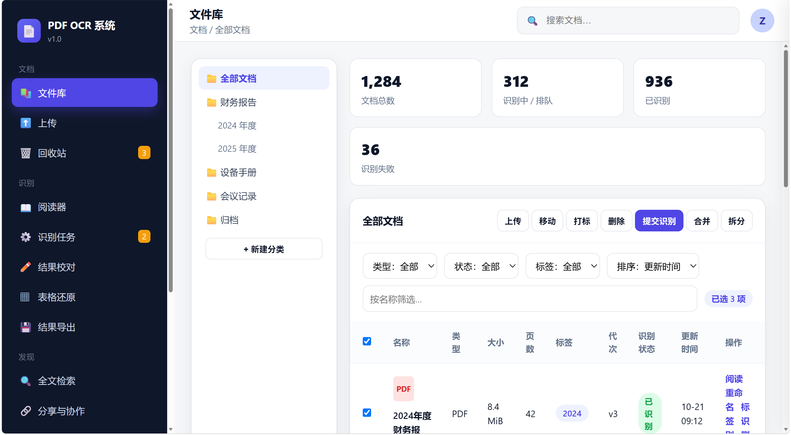{width="5.2in"}

左侧分类目录树，顶部按名称、时间、大小、状态排序并按类型、状态、标签筛选；列表含名称、类型、大小、页数、标签、代次、识别状态、更新时间与操作入口；工具栏提供上传、移动、打标、删除、提交识别等批量操作，批量结果以“成功 N 项、失败 M 项及原因”汇总；文件详情抽屉展示 SHA256、分类与标签。

#### **5.3.3 上传**

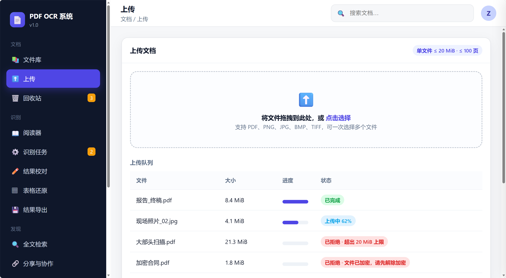{width="5.2in"}

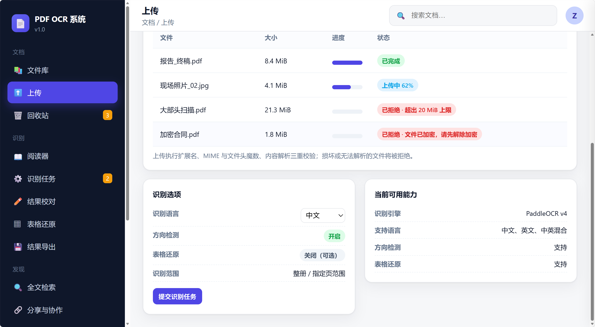{width="5.2in"}

点击或拖拽多文件，上传前本地预判大小；服务端执行扩展名、MIME 与魔数、内容解析三重校验；单文件 ≤ 20 MiB、≤ 100 页，超限分别返回 413、422，加密 PDF 提示先解除加密；下方为识别选项（模式、识别模型、DPI、表格还原、最低置信度）与能力探测结果。

#### **5.3.4 回收站**

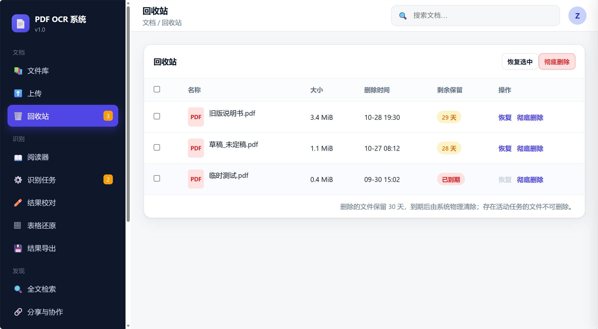{width="5.2in"}

软删除文件保留 30 天并显示剩余天数，支持还原与彻底删除；到期由清理任务按 C5 顺序物理清除。

#### **5.3.5 PDF 阅读器**

{width="5.2in"}

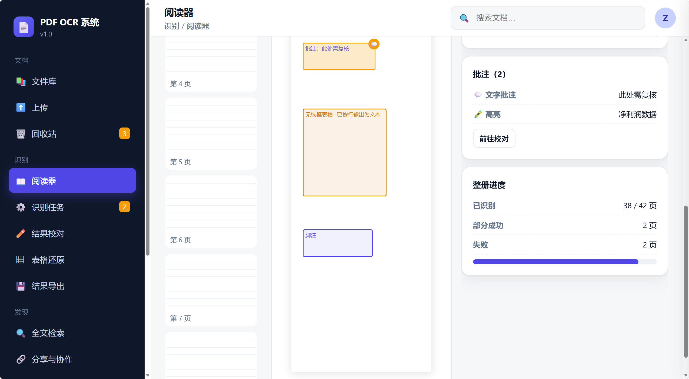{width="5.2in"}

单页与连续滚动、缩放 50%～400%、翻页跳页、缩略图侧栏、目录大纲、页内搜索高亮、书签与阅读位置记忆；页面叠加可选中复制的 OCR 文本层，支持原文与识别文本双视图；右侧面板展示页信息、批注与整册进度。覆盖层按 C4 归一化坐标渲染。

#### **5.3.6 识别任务**

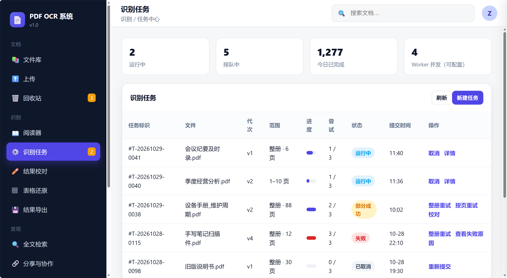{width="5.2in"}

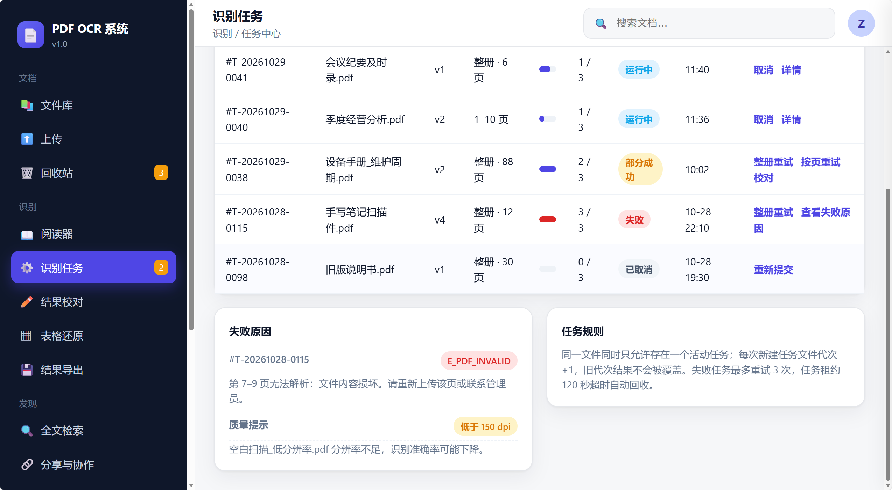{width="5.2in"}

异步任务列表含任务标识、文件、代次、范围、进度、尝试次数（上限 3）、状态与操作；支持取消、整册重试与按页重试；失败以可解释错误码展示，低分辨率提示质量风险。同一文件仅允许一个活动任务，新建任务代次 +1，旧代次结果不覆盖新结果。

#### **5.3.7 结果校对**

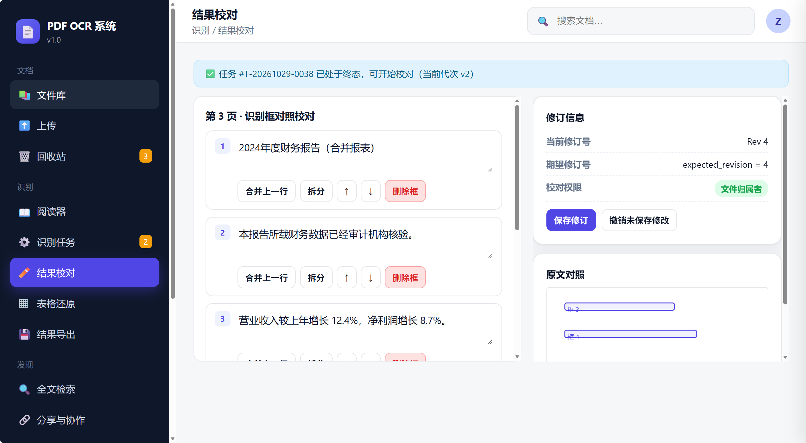{width="5.2in"}

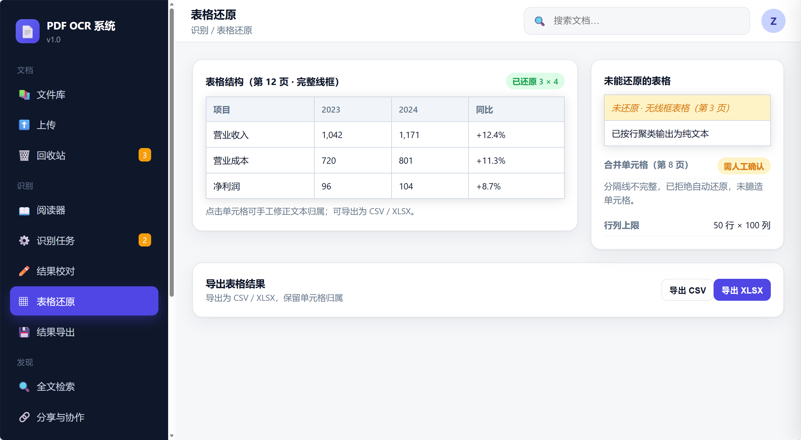{width="5.2in"}

左侧原图与识别框对照，支持逐框改字、合并拆分文本行、删除误检框、调整顺序；保存携带 `expected_revision`，成功则修订号 +1 并同步全文索引；并发冲突返回 409 并回传最新修订号；仅文件归属者与 admin 可校对，viewer 写入被拒。

#### **5.3.8 表格还原**

{width="5.2in"}

{width="5.2in"}

完整规则线框表格输出单元格结构，支持预览、手工修正与导出 CSV / XLSX；分隔线覆盖不足 90% 或存在合并单元格时拒绝还原并提示人工确认；无线框表格不还原结构，仅输出按行聚类纯文本并标注未还原（处理规则见 3.2.3 F6）。

#### **5.3.9 结果导出**

{width="5.2in"}

TXT / JSON / CSV / HTML / XLSX 五种格式；默认仅完整成功任务可导出，部分成功须 `allow_partial=true`；失败页不进入结果并单独列出；HTML 与 XLSX 做转义并防公式注入。页范围选择、包含/去除坐标开关、文件名含原名与时间戳、超 100 页分批为原型设计，尚未实现。

#### **5.3.10 全文检索**

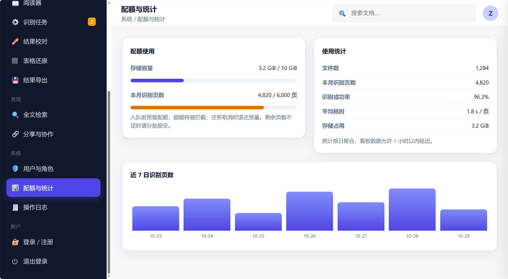{width="5.2in"}

结果按文件聚合展示命中页数与片段并高亮，支持类型、时间、标签过滤与检索历史重跑；结果标注来源任务与修订号，可能过时的结果予以提示；单字关键词降级为子串匹配并提示；仅返回有权访问的文档；命中跳页 `/files/{fileId}?page={n}`。

#### **5.3.11 用户与角色**

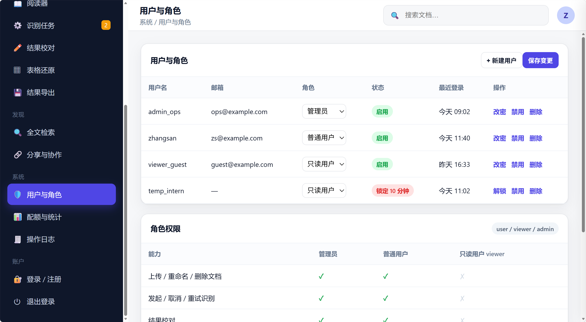{width="5.2in"}

用户列表支持 `user / viewer / admin` 角色调整、启用禁用与改密；下方角色权限矩阵列示能力差异，viewer 一切写操作被拒绝。

#### **5.3.12 配额与统计**

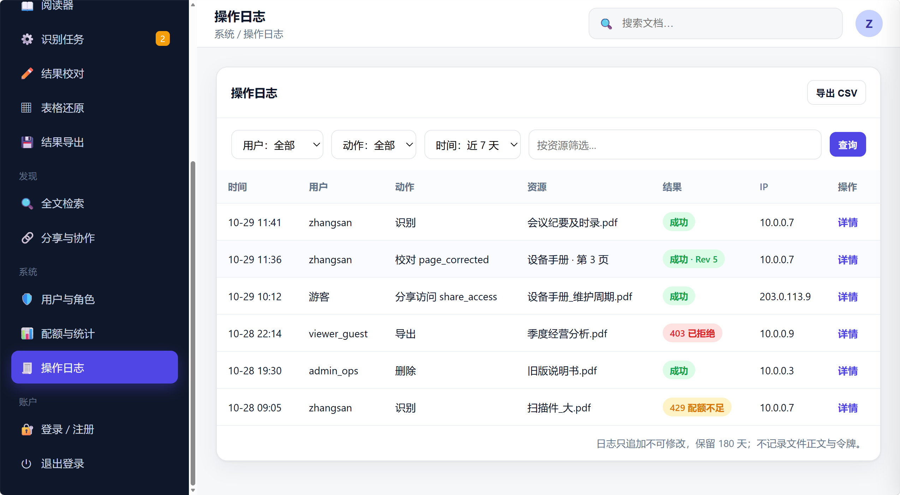{width="5.2in"}

存储容量与本月识别页数双配额进度条，超额拦截（429）；统计看板含文件数、识别页数、成功率、平均耗时与存储占用、近 7 日识别页数图表，数据源为 `GET /quota/overview`。

#### **5.3.13 操作日志**

{width="5.2in"}

按用户、动作、时间筛选与导出；日志含时间、用户、动作、资源、结果与来源，覆盖账号、文件、书签、批注与分享等动作（当前写入的动作取值域见表 4-10），并体现 403 / 429 边界；只追加不可修改、保留 180 天、不记录正文与令牌。

#### **5.3.14 分享与协作**

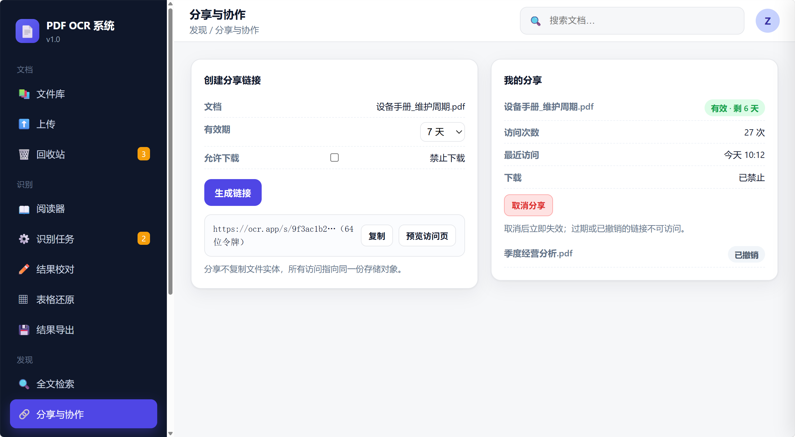{width="5.2in"}

生成分享链接，可设有效期（1 / 7 / 30 天）、提取码与是否允许下载；取消分享立即失效；访问统计展示访问次数与最近访问时间；分享不复制文件实体。

#### **5.3.15 游客只读访问**

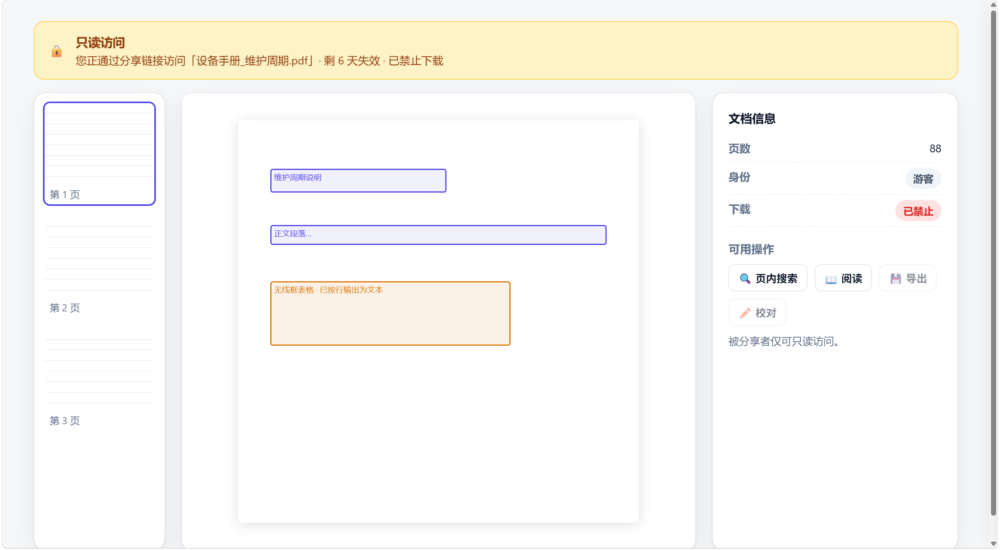{width="5.2in"}

凭令牌只读浏览，不可导出、校对或下载；以只读横幅、游客身份标签与置灰写操作呈现。令牌无效、过期或提取码不符统一返回 404，避免泄露分享是否存在。

#### **5.3.16 范围外能力的降级**

手写体按印刷体模型尽力识别并标黄提示；竖排、无线框表格、公式与图表不还原；界面为桌面布局，不含移动应用、多机部署与消息中间件入口。这些能力只作提示，不实现为可用功能。

## **5.4 交互与易用性**

**表 5-2 易用性要求与界面落实**

| 要求 | 界面落实 |
|---|---|
| 交互一致性 | 全站统一组件与导航结构 |
| 关键操作二次确认 | 删除、整册重试、撤销分享、彻底删除 |
| 进度可见 | 上传、识别、批量操作的进度与汇总 |
| 错误提示可执行 | 413 / 422 / 429 / 409 附操作建议 |
| 中文字体与排版 | 中文优先字体栈，文本层级清晰 |
| 快捷键 | 阅读器翻页、搜索、取消等快捷键提示 |
| 空态与骨架屏 | 列表、搜索、回收站的空态与加载态文案 |
| 无障碍基础 | 焦点可见、对比度达标、图形辅以文字标签 |

## **5.5 软件接口（REST API）**

接口设计约定：统一前缀 `/api/v1`；所有业务接口要求 `Authorization: Bearer <JWT>`，分享令牌访问接口除外；请求与响应使用 UTF-8，资源标识为 32 位十六进制字符串，页码从 1 开始，支持分页的列表接口使用 `limit / offset`（当前为 `GET /files`、`GET /search`），其余列表接口返回全量；时间为不带时区后缀的 UTC ISO 字符串，客户端按 UTC 解析；业务错误响应为 `{"detail": "..."}`，参数校验错误为结构化数组，完整错误模型见 6.2。在线交互文档由 `/docs` 提供，机器可读定义为 `/openapi.json`。

**表 5-3 接口分组统计**

| 分组 | 数量 | 前缀 | 说明 |
|---|---|---|---|
| 系统级 | 1 | `/health` | 部署自检，无 `/api/v1` 前缀 |
| 用户与权限、配额、分享 | 17 | `/auth/*`、`/quota/*`、`/share/*` | 认证、管理与协作 |
| 文件管理与阅读器 | 17 | `/files/*`、`/files/{id}/reader/*` | 上传、列表、阅读器 |
| OCR 宿主能力与检索 | 7 | `/ocr-host/*`、`/search*` | 主系统侧适配与检索 |
| OCR 模块挂载接口 | 17 | `/ocr/*` | 与主系统同进程同端口 |
| 合计 | **59** | 统一 `/api/v1` | 按去重别名的「路径 + 方法」统计，`""` 与 `"/"` 兼容别名及 `include_in_schema=False` 的重复注册不另计；运行期以 `/openapi.json` 为准 |

**表 5-4 关键接口清单（按用途分组，省略 `/api/v1` 前缀；与表 5-3 的前缀统计口径不同）**

| 组 | 方法 + 路径 | 权限 | 用途 |
|---|---|---|---|
| 认证 | `POST /auth/register`、`/auth/login`、`/auth/logout`、`/auth/refresh`、`/auth/change-password`；`GET /auth/me` | 公开 / 用户 | 注册、登录、令牌管理与当前用户 |
| 管理 | `PATCH /auth/users/{id}/role`、`/auth/users/{id}/disabled`；`GET /auth/_admin/check` | 管理员 | 角色调整、账号启停、自检 |
| 文件 | `POST /files`、`GET /files`、`GET /files/folders`、`/files/tags`、`GET /files/{id}`、`GET /files/{id}/content`（Range）、`GET /files/{id}/pages`、`PATCH /files/{id}`、`DELETE /files/{id}`、`POST /files/{id}/restore`、`DELETE /files/{id}/purge` | 用户 / 编辑 | 上传、查询、原文件读取、生命周期 |
| 阅读器 | `GET/POST /files/{id}/reader/bookmarks`、`DELETE .../bookmarks/{id}`；`GET/POST /files/{id}/reader/annotations`、`DELETE .../annotations/{id}` | 用户 / 编辑 | 书签与批注 |
| 配额与统计 | `GET /quota`、`GET /quota/overview` | 用户 | 配额查询与统计看板 |
| 分享 | `POST /share`、`GET /share`、`GET /share/{id}`、`DELETE /share/{id}`、`GET /share/{id}/stats`、`GET /share/token/{token}?code=` | 用户 / 公开令牌 | 分享管理与只读访问 |
| OCR 宿主 | `GET /ocr-host/capabilities`、`/ocr-host/usage`、`GET /ocr-host/files/{id}/jobs`、`POST /ocr-host/files/{id}/sync`、`POST /ocr-host/jobs/{id}/settle` | 用户 / 编辑 | 能力探测、镜像补救、配额结算 |
| OCR 任务 | `POST /ocr/jobs`（202）、`GET /ocr/jobs`、`GET /ocr/jobs/{id}`、`POST /ocr/jobs/{id}/cancel`、`.../retry`（202）、`GET .../pages`、`.../pages/{n}`、`.../pages/{n}/image`、`PATCH .../pages/{n}` | 用户 / 编辑 | 任务、页结果与校对 |
| 导出与检索 | `GET /ocr/jobs/{id}/export?format=`、`GET /ocr/search`、`GET /search`、`GET /search/suggest` | 用户 | 导出与全文检索 |
| OCR 辅助 | `GET /ocr/capabilities`、`POST /ocr/files`、`GET /ocr/files/{id}`、`GET /ocr/files/{id}/content`、`GET /ocr/usage`、`GET /ocr/audit` | 用户 | 能力探测、镜像补救、统计与审计 |
| 系统 | `GET /health` | 公开 | 部署自检（无前缀） |

`POST /api/v1/ocr/files` 是上表 17 个挂载接口之一，供 OCR 模块独立运行与测试使用；集成部署时前端统一走主系统 `POST /api/v1/files`，由镜像适配层写入 `ocr_files`，镜像补救接口为 `POST /api/v1/ocr-host/files/{id}/sync`。后续迭代拟补充合并、拆分、批量操作与批注修改接口，当前不计入 59 个接口。除表中标注者外，创建类接口按装饰器返回 201（如 `POST /files`、`POST /share`、`POST /auth/register`），删除类接口返回 204（如 `POST /auth/logout`、`DELETE /files/{id}/purge`）。

## **5.6 内部接口与数据口径**

`frontend/src/shared/http.ts` 是业务请求的统一出口：`api<T>(path)` 自动补 `/api/v1` 并附带 `Authorization: Bearer`；`apiBlob(path)` 用于导出与带鉴权的 Blob 下载；`downloadBlob(blob, filename)` 触发下载；令牌存于 `localStorage["pdf_system_token"]`。pdf.js 读取原文件流时自行发起带 `Authorization` 头的请求，是该出口的例外。401 由 `http.ts` 抛出 `ApiError`，`AuthProvider` 仅在获取 `/auth/me` 失败时清除令牌，跳转登录由路由守卫在无令牌时完成，当前不存在全局 401 拦截器。前端路由为 `/login`、`/files`、`/files/:fileId`、`/search`、`/stats`（另有布局路由与通配重定向）。

组件边界按 C4：阅读器页面提供容器与页尺寸，不渲染 OCR 框；`OcrOverlay` 接收 `blocks / width / height / activeId / onPick` 并渲染覆盖层，不操作 pdf.js 实例（绝对定位由外层样式提供）。覆盖层换算为 `x = left × W`、`y = top × H`、`宽 = (right-left) × W`、`高 = (bottom-top) × H`。前端组件目录以 `app/` 与 `shared/` 为公共依赖，但当前阅读器与文件库页面对 `features/ocr/` 存在直接引用；页面旋转 90 / 180 / 270 度的包围盒换算亦仅留有设计注释。两项均为待办。

## **5.7 界面错误反馈**

界面按错误模型统一反馈：401 提示重新登录（令牌清除与跳转由鉴权上下文和路由守卫完成）；403 禁用对应写操作并提示权限不足；404 统一提示资源不可用，不区分资源是否存在；409 刷新状态或提示合并修改；413 / 422 给出上限与修正建议；429 展示配额剩余与重置提示；500 保留操作上下文并提示联系维护者，不做无限重试。507 分支尚未实现。错误语义、触发条件与服务端处理见 6.2。

# **第 6 章 运行与维护设计**

## **6.1 运行设计**

**表 6-1 启动顺序与运行控制**

| 步骤 | 操作 | 检查点 |
|---|---|---|
| 1 | 配置数据库 URL、存储目录与 JWT 密钥（≥ 32 字符） | 启动期校验密钥长度 |
| 2 | 确认 `PDF_OCR_PACKAGE_DIR` 指向的目录下存在 `ocr_service/`，再执行 `python -m backend.scripts.init_db` | 主系统 11 张表始终建立；OCR 5 张表仅在该目录存在时建立，否则日志提示跳过 |
| 3 | 启动主系统 API（`uvicorn backend.main:create_app --factory --port 8000`） | `/health` 返回状态、挂载标志与数据库类型 |
| 4 | 在 Python 3.12 独立环境安装 Paddle 依赖并下载模型权重 | 按清单校验 SHA256 |
| 5 | 在独立环境启动 Worker（数据库、存储与密钥由主系统注入，无需重复配置） | 任务由 `queued` 转为 `running` |
| 6 | 安装前端依赖并启动开发服务器（5173），或部署静态构建产物 | `/api` 代理到 8000 |
| 7 | 全链路自检：注册 → 上传 → 建任务 → 回写 → 校对 → 导出 → 检索 | 依次验证 C2、C3、C4 与同事务回写 |

部署一致性要求：主系统在挂载 OCR 模块（及初始化数据库）前由 `settings.ocr_env()` 覆盖写入 `OCR_DATABASE_URL`、`OCR_STORAGE`、`OCR_JWT_SECRET`、`OCR_DEVICE` 四项，部署方只需配置主系统侧 `PDF_*`；手工设置的同名 `OCR_*` 不会生效。两侧 `jwt_issuer` / `jwt_audience` 必须一致，OCR 侧当前为配置模块中的代码常量（默认 `pdf-system` / `ocr-api`），调整主系统侧 `PDF_JWT_ISSUER` / `PDF_JWT_AUDIENCE` 时须同步修改代码并重新部署；两侧 Python 版本允许不同。任一一致性项不满足的典型症状见 6.5 表 6-8。

**表 6-2 配置项清单**

表中「类别」区分配置的来源与生效方式；所列变量为当前实现的配置面，其余为代码常量或包内路径，不影响部署口径。

| 类别 | 变量 | 作用 | 约束 |
|---|---|---|---|
| 部署必配（主系统） | `PDF_DATABASE_URL` | 主系统数据库连接 | 生产为 MySQL 8 / utf8mb4；开发期 SQLite |
| 部署必配（主系统） | `PDF_STORAGE_DIR` | 主系统共享存储根目录 | 与 OCR 侧共用同一目录 |
| 部署必配（主系统） | `PDF_JWT_SECRET` | JWT 签发密钥 | ≥ 32 字符，启动期校验；两侧相同 |
| 部署必配（主系统） | `PDF_JWT_ISSUER` / `PDF_JWT_AUDIENCE` | JWT 签发方与受众 | 默认 `pdf-system` / `ocr-api`；必须与 OCR 侧常量一致（见 6.1） |
| 部署必配（主系统） | `PDF_OCR_ENABLED` / `PDF_OCR_PACKAGE_DIR` | 是否挂载 OCR 模块及其包目录 | 包目录下须存在 `ocr_service/`；决定 6.1 运行降级 |
| 可选覆盖（主系统） | `PDF_API_PREFIX` | 接口统一前缀 | 默认 `/api/v1` |
| 可选覆盖（主系统） | `PDF_MONTHLY_PAGE_QUOTA` | 每用户每月识别页数上限 | 默认 500 |
| 可选覆盖（主系统） | `PDF_JWT_EXPIRE_MINUTES` / `PDF_DATABASE_ECHO` / `PDF_APP_NAME` | 令牌有效期、SQL 回显与应用名 | 默认 120 分钟 / `false` / 系统名 |
| 可选覆盖（主系统） | `PDF_MAX_UPLOAD_BYTES` / `PDF_MAX_PAGES` / `PDF_MAX_PIXELS` | 单文件上传限制 | 默认 20 MiB / 100 页 / 2000 万像素 |
| 可选覆盖（主系统） | `PDF_OCR_STORAGE` / `PDF_OCR_DEVICE` | OCR 侧存储与推理设备 | 默认与主存储同目录 / `cpu` |
| 主系统自动注入 | `OCR_DATABASE_URL` / `OCR_STORAGE` / `OCR_JWT_SECRET` / `OCR_DEVICE` | OCR 侧数据库、存储、密钥与设备 | 由 `settings.ocr_env()` 覆盖写入，部署方无需且不应手工设置 |
| 可选覆盖（OCR 模块） | `OCR_DET_WEIGHTS` / `OCR_REC_WEIGHTS` | 检测与识别模型权重路径 | 默认指向包内 `models/` |
| 可选覆盖（OCR 模块） | `OCR_CUSTOM_REC_WEIGHTS` / `OCR_HANDWRITING_WEIGHTS` | 自定义识别与手写体检测权重路径 | 仅为预留钩子，不构成功能交付（见 2.1） |
| 可选覆盖（OCR 模块） | `OCR_TORCH_PYTHON` | 独立推理解释器路径 | 默认包内 `.venv-torch/Scripts/python.exe` |
| 代码常量（OCR 模块） | `jwt_issuer` / `jwt_audience` | OCR 侧令牌校验方与受众 | 固定 `pdf-system` / `ocr-api`，不可经环境变量覆盖 |
| 代码常量（OCR 模块） | `lease_seconds` / `max_attempts` / `retry_delay_seconds` | 租约、最大尝试次数与退避基数 | 120 s / 3 次 / 15 s；取值见表 6-3 |
| 代码常量（OCR 模块） | `max_upload_bytes` / `max_pages` / `max_pixels` | OCR 侧上传限制 | 与主系统默认一致；调整需修改代码并重新部署 |

主系统配置经 `PDF_*` 环境变量注入并为各字段提供默认值；OCR 侧四项一致性配置由主系统自动注入并覆盖，其余可经 `OCR_*` 覆盖的仅为模型权重与解释器路径。租约、重试、上传上限与令牌校验方为配置模块中的代码常量，调整需修改代码并重新部署。密钥、数据库文件与模型权重不得进入版本库。

**表 6-3 运行参数**

| 参数 | 取值 | 作用 |
|---|---|---|
| 租约时长 | 120 s | Worker 崩溃后任务可被接管的上界 |
| 心跳周期 | 40 s | 后台线程续租，失败即停止后续页处理 |
| 自动重试 | 最多 3 次，按 15 s 基数指数退避（15 s / 30 s / 60 s） | 由 `available_at` 控制 |
| 空闲轮询 | 2 s | Worker 无任务时休眠 |
| Worker 并发 | 多进程并发，进程数由部署方决定 | 无集中并发配置；由租约与 `SKIP LOCKED` 约束并发，MySQL 下的已知限制见表 6-7 P0 |
| 单文件上限 | 20 MiB / 100 页 / 2000 万像素 | 上传与渲染双重校验 |
| 月配额 | 默认 500 页 / 用户 / 月 | 由配额服务强制 |
| 磁盘阈值 | 80% 告警、90% 拒绝上传（507） | 容量保护（设计目标，当前未实现，见表 6-7） |

运行降级：未安装 Paddle 环境时挂载函数捕获导入失败，`ocr_mounted=false`，`/ocr-host/*` 统一返回 409；主系统其余功能可用，但 `GET /search` 返回 `backend=ocr_not_ready` 与空结果集，前端应提示识别能力不可用而非「检索无命中」。健康检查的 `ocr_mounted: true` 仅表示路由挂载成功，不代表推理引擎可用；未启动 Worker 时任务保持 `queued`。

运行监控与日志（当前现状）：系统未建立集中监控、运行指标采集与告警组件。可观测性依赖四类入口：`GET /health` 返回进程状态、OCR 挂载标志与数据库类型；主系统 API 与 Worker 通过 `logging` 输出运行日志（Worker 以 INFO 级别初始化）；`GET /ocr-host/capabilities` 探测识别能力；业务操作与配额变动写入 `audit_logs`、`quota_ledger` 供审计追溯。常见故障定位入口见表 6-8，集中监控与告警属后续演进项，见表 6-7。

## **6.2 出错处理设计**

主系统业务模块的错误出口为 `backend/core/errors.py`，提供 `bad_request(422) / not_found(404) / conflict(409) / quota_exceeded(429) / unsupported(415)`（`unsupported` 当前未被调用）；鉴权层 `core/principal.py` 与独立 OCR 模块 `ocr_service/api.py` 直接抛出 `HTTPException`，产生 401 / 403 / 413 / 404 / 409 / 422 等状态。二者对外均只暴露 `{"detail": "..."}`，内部异常不回显路径与堆栈。Worker 侧以 `logging` 文本日志记录任务号与页号，模型详细异常只进入日志。

**表 6-4 错误语义与处理**

表中 `E_*` 为设计侧错误标识，用于统一错误语义与界面文案；当前运行时错误响应只有 `{"detail": "<自然语言>"}`，尚无机器可读的错误码字段，客户端分支判断须以 HTTP 状态码为准。表中各行为的落地状态见表 6-7，未单独标注者不表示已实现；状态码口径与需求文档表 3-2 不同的行已在行内说明，尚未闭环的偏离另在表 6-7 登记。

| 错误标识（设计侧） | HTTP | 触发条件 | 处理方式 |
|---|---|---|---|
| `E_UPLOAD_TOO_LARGE` | 413 | OCR 模块独立上传接口文件超过 20 MiB；主系统上传校验失败统一为 422（见 3.2.3 F1） | 提示拆分或压缩 |
| `E_TOO_MANY_PAGES` / `E_PDF_INVALID` / `E_PDF_ENCRYPTED` | 422 | 页数超限 / 文件损坏 / 文件加密 | 分批识别 / 重新导出 / 先解密 |
| `E_JOB_ACTIVE` | 409 | 文件已有活动任务 | 提供查看任务入口 |
| `E_QUOTA_EXCEEDED` | 429 | 月配额不足 | 展示剩余量与重置时间 |
| `E_LEASE_LOST` | 409 | 租约过期或令牌不匹配 | 停止旧 Worker 提交，任务被接管 |
| `E_REVISION_CONFLICT` | 409 | 校对时修订号不一致 | 重新读取并提示合并，禁止自动重试 |
| `E_SHARE_EXPIRED` | 404 | 分享令牌无效、过期、已撤销或提取码不符 | 统一提示资源不可用，防止分享存在性探测；需求文档表 3-2 约定 410 Gone，本文档按实现统一为 404，偏离登记见表 6-7 |
| `E_NO_SPACE` | 507 | 磁盘空间不足 | 提示清理回收站 |
| OCR 模块未挂载 | 409 | `ocr_mounted=false` | 提示能力不可用 |
| 页级错误 | — | 单页推理 / 租约 / 像素超限 | `ocr_inference_failed` / `worker_lease_expired` / `render_pixel_limit` |

容错与恢复机制：按页落库，断点续跑时已成功页不重复处理；失败页不清空已有全文索引；租约、条件更新与 `SKIP LOCKED` 旨在保证任务不丢失且不被并发处理（MySQL 下该机制受表 6-7 的 P0 条件更新问题限制）；配额结算以任务标识与关闭标记幂等；取消任务不强行中断单页推理，但其后续结果提交会被拒绝；未挂载时生命周期相关调用降级为空操作；审计日志按约定只追加，保留期策略见表 4-23。统一 HTTP 错误语义为：401 认证失败、403 角色权限不足、404 资源不可用、409 状态冲突、413 体积超限（仅 OCR 独立上传接口）、415 不支持的媒体类型（当前未触发）、422 参数或内容不合法、429 配额不足、500 未处理异常、507 磁盘不足（设计目标，当前未实现）。

## **6.3 安全保密设计**

**表 6-5 安全措施**

| 领域 | 措施 |
|---|---|
| 认证 | JWT HS256，声明含 `iss=pdf-system / aud=ocr-api / iat / exp`；密钥来自环境变量且 ≥ 32 字符，启动期校验；OCR 侧强制校验签发者与受众 |
| 授权 | `current_user / require_editor / require_admin` 三层依赖；角色以库内值为准，不信任令牌内角色；viewer 写操作 403 |
| 越权防护 | 越权与已删资源统一返回 404；列表与检索按归属者及 `deleted_at IS NULL` 前置过滤 |
| 密码与令牌 | PBKDF2-HMAC-SHA256 20 万轮加盐；`token_version` 使改密后旧令牌全部失效；`jti` 与吊销黑名单支持登出与刷新；账号停用即时生效 |
| 输入安全 | 扩展名、MIME 与魔数、内容解析三重校验；路径穿越防护；解压炸弹告警转错误；请求模型拒绝未知键；SQL 参数绑定与通配符转义 |
| 输出安全 | HTML 转义；CSV / XLSX 控制字符过滤与公式前缀中和；检索片段以文本节点渲染；页预览须经鉴权接口获取 |
| 数据安全 | 全链路本地 CPU 推理，禁止云端识别与外网依赖；模型权重按 `models/manifest.json` 本地部署并校验 SHA256 |
| 日志脱敏 | 审计字段只保存标识与计量，不记录文件正文、密码与令牌 |
| 审计 | 写操作与任务状态迁移留痕；按约定只追加，当前无数据库层防篡改约束 |
| 分享安全 | 令牌唯一、有效期、提取码、下载开关；撤销即删除记录；错误统一 404；访问计数留痕；不复制文件实体 |

## **6.4 性能与可靠性设计**

**表 6-6 性能指标与设计对策**

| 指标 | 目标 | 设计对策 |
|---|---|---|
| 页面接口响应时间 | P95 ≤ 300 ms（不含文件传输） | 查询列建索引、分页查询、避免跨模块 RPC |
| 100 页 PDF 首屏渲染 | ≤ 2 s | pdf.js 按需渲染、原文件 Range 传输、页尺寸预取 |
| 翻页响应 | ≤ 300 ms | 页级渲染与缓存、Web Worker 解析 |
| 单页 OCR 处理时延 | ≤ 3 s（CPU、A4、300 dpi） | 异步队列、按页并行、DPI 可配置 |
| 全文检索响应 | P95 ≤ 1 s（10 万页规模） | ngram 全文索引、按页 upsert、结果限量返回 |
| 并发上传 | 10 路 | 流式落盘、文件大小上限、独立请求无共享状态 |
| Worker 并发 | 多进程并发，进程数由部署方决定（NFR-PERF-07 要求默认 3 个进程且可配置，当前无对应配置项，见表 6-7） | 无集中并发配置；由部署方启动多个 Worker 进程，租约与 `SKIP LOCKED` 互斥 |
| 内存峰值 | ≤ 4 GB（全部进程） | 依赖隔离、逐页释放图像、限制推理并发 |
| 任务排队等待 | 空闲时 ≤ 5 s | 2 s 轮询与复合队列索引 |
| 导出 50 页结果 | ≤ 5 s 返回首字节 | 按页读取、流式响应 |

以上为设计目标：页面类指标建立于表 2-6 的存量规模假设，全文检索指标为 10 万页规模的外推目标（验证方式为按 3 万页实测外推并复测）；尚未完成实测的项见 6.5。可靠性机制包括：任务队列基于数据库表，领取与提交均为条件更新，按设计应保证同一任务不被并发处理（MySQL 下的已知限制见表 6-7 P0）；Worker 异常退出后任务在租约到期（120 s）后可被接管；按页落库支持断点续跑；失败返回可解释错误码；页结果与索引、配额预留与任务创建等关键操作处于同一事务；备份 RPO 24 h、RTO 2 h 为设计目标；单机场景月度可用时间比例目标 ≥ 99%（允许维护窗口）。

兼容性设计：客户端支持 Chrome / Edge 100+，Firefox ESR 保证只读；服务端支持 Windows 10/11 与 Ubuntu 22.04+；主系统 API 以 Python 3.12 为基线，3.14 需按 `requirements.txt` 中备用版本组安装；Worker 经验证环境为 3.12，≤ 3.13 为理论可用上界（3.13 尚无实测记录，3.14 因 Paddle 3.0.0 无 cp314 wheel 不可用）；两侧 Python 版本允许不同；数据库支持 MySQL 8（生产）与 SQLite（开发），单字检索在 ngram 不可用时退化为子串匹配；推理不依赖 GPU。

## **6.5 维护设计**

配置与变更管理：主系统配置经环境变量注入并为新增项提供默认值，OCR 侧一致性配置由主系统自动注入、队列参数为代码常量（见 6.1 表 6-2）；共享底座、模型基类、应用装配、前端共享目录有明确所有权，改动须经评审；五份跨模块契约的变更遵循“先修订契约定义、评审通过后再修改实现”的顺序。

数据模型冻结：建表使用 `create_all()`，不迁移已存在的表结构；设计阶段调整字段时须重建开发库，验收环境变更另写一次性 SQL 并纳入版本管理；`pdf_text_index` 被检索服务直接查询，其字段变更按契约变更处理。

测试与持续集成：后端测试覆盖主流程与跨模块契约（本机当前 72 项），OCR 模块测试覆盖队列、导出与坐标（本机当前 10 项）；持续集成使用 Python 3.12 执行后端测试、Node 20 执行前端类型检查，因未安装 cv2，`backend/tests/test_ocr_contract.py` 的 5 个跨模块契约用例在 CI 中整体跳过（CI 实际执行后端 67 项），OCR 模块 10 项亦未纳入 CI；两类用例均须在本机 Paddle / cv2 环境手动执行；接口联调以 Swagger 在线文档与全链路自检为准。前端集成验证与 OCR 准确率、性能指标实测尚未完成。

备份与恢复（设计目标）：每日全量备份并保留 binlog，全量保留 7 天；回收站 30 天、日志 180 天、终态任务 90 天、页图 7 天；清理前排除有效租约与活动任务引用，单批 ≤ 500 条。

**表 6-7 当前实现限制与后续演进**

| 优先级 | 限制 / 待办 | 影响与处置 |
|---|---|---|
| P0 | MySQL 下队列锁与校对接口依赖“把字段更新成原值”的条件更新受影响行数，而 MySQL 仅统计实际变化的行 | 生产使用 MySQL 前必须修复，否则结果无法提交、校对持续返回 409；可改为行锁查询或写入变化列 |
| P1 | 前端尚未完成集成验证；原型中的 15 个界面与当前 5 个 React 页面存在差距，书签/批注界面与页内查找尚未接入 | 联调前完成依赖安装、开发服务器启动与接口逐项验证；以 5.3 的原型口径为验收范围，逐项补齐或明确降级 |
| P1 | 磁盘容量阈值与 507 拒绝上传、机器可读错误码、备份脚本与保留期定时任务均未实现；失败与取消任务的页 PNG 只增不减 | 按表 4-23、表 6-3、表 6-4 与 6.5 的策略落地；将彻底删除清理函数接入回收站定时任务 |
| P1 | Paddle 依赖锁文件同时包含两个 opencv 包，可能导致 `cv2` 不可用 | 部署前核对并收敛依赖清单 |
| P2 | 阅读器、文件库页面对 `features/ocr/` 存在跨功能引用；页面旋转包围盒换算仅留设计注释 | 收敛组件依赖并实现旋转坐标换算 |
| P2 | 合并、拆分、批量操作、缩略图、页内搜索、批注修改、手写模式专用权重 | 后续迭代补齐；合并拆分产生新文件标识与版本递增时须重新建立镜像 |
| P2 | OCR 准确率评测集与性能指标实测尚未完成 | 建立标注集与实测报告，现有测试为确定性替身 |
| P2 | 单字检索退化为 LIKE；主系统与 OCR 模块存在两条检索路径 | 固定前端使用其中一条路径并明确结果口径 |
| P2 | 两处取值口径与需求基线不一致：分享失效响应在需求文档表 3-2 与 2.10.3 验收标准中约定 410 Gone、设计与实现统一为 404；NFR-PERF-07 要求默认 3 个 Worker 进程且可配置、当前无集中并发配置项 | 由需求方确认后修订需求基线或补齐实现，经评审闭环，不保留静默偏离 |
| P2 | 集中监控、运行指标采集与告警尚未建立，运行态可见性仅依赖 `/health`、进程日志、能力探测与业务审计表 | 按 6.1 的监控口径补齐指标采集与告警，并与表 6-8 排障速查联动 |
| P3 | 本设计文档 39 张图以 PNG 成图为主，可复现建模源码尚未建立（仓库 `uml/` 下的 PlantUML 源码与 `docs/er-diagram.mmd` 对应需求文档图，非本文档） | 为本文档 39 张图补充可复现的建模源码 |

**表 6-8 部署排障速查**

| 症状 | 可能原因 |
|---|---|
| OCR 接口全部 401 | 两侧 JWT 密钥不一致；或主系统侧 `PDF_JWT_ISSUER` / `PDF_JWT_AUDIENCE` 已调整而 OCR 侧仍为代码常量 |
| 手工配置的 `OCR_*` 未生效 | 主系统挂载 OCR 模块时由 `ocr_env()` 覆盖写入四项一致性配置，属预期行为 |
| 任务一直处于 `queued` | Worker 未启动，或两侧数据库 URL 不一致 |
| Worker 读不到文件 | 两侧存储目录不一致 |
| `ocr_mounted: false` | 缺少 Paddle 环境或模块导入失败，主系统其余功能仍可用 |
| MySQL 下校对持续 409、页结果不回写 | 表 6-7 的 P0 条件更新问题 |
| 检索无命中或 `backend=ocr_not_ready` | Worker 未回写索引、关键词为单字、文件已软删除，或 OCR 模块未挂载（此时返回空结果集，见 6.1） |

# **附录**

## **附录 A 需求追踪矩阵**

**表 A-1 需求编号到设计与实现的映射**

| 需求编号 | 设计章节 | 实现模块 | 验证方式 |
|---|---|---|---|
| FR-USER-01～07 | 3.2.2 M1、4.1.3 表 4-3 / 4-12、6.3 | `modules/auth`、`core/security.py`、`core/principal.py` | `backend/tests/test_auth.py`（注册、登录、令牌、角色与禁用用例） |
| FR-FILE-01～11 | 3.2.3 F1 / F9、4.1.3 表 4-4～4-6、5.3.2～5.3.4 | `modules/files`、`core/media.py` | `backend/tests/test_main_flow.py`（上传、列表、标签、回收站）、`test_ocr_contract.py`（C2 镜像、C5 清理；本机验证，CI 跳过） |
| FR-READ-01～09 | 3.1.5 C4、3.2.2 M5、5.3.5、5.6 | `modules/reader`、`features/reader/` | `backend/tests/test_main_flow.py`（书签、批注、页尺寸）；前端交互与坐标换算单测尚未建立 |
| FR-OCR-01～12 | 3.2.3 F2 / F3 / F4、4.1.3 表 4-13～4-15、6.1 | `modules/ocr`、`ocr_service/queue.py`、`worker.py` | `backend/tests/test_ocr_contract.py`（本机验证，CI 跳过）、`ocr_service/tests/test_inventory_workflow.py`（本机验证，未纳入 CI） |
| FR-COR-01～06 | 3.2.3 F5、4.1.4 表 4-18 | `ocr_service/api.py`、`schemas.Correction` | `ocr_service/tests/test_inventory_workflow.py`（校对驱动检索、代次、字面值） |
| FR-TBL-01～04 | 3.2.3 F6、5.3.8 | `ocr_service/tables.py` | `ocr_service/tests/test_inventory_workflow.py`（`test_inventory_grid_coordinates`、`test_reviewed_spreadsheet_values_are_literal`） |
| FR-EXP-01～06 | 3.2.3 F7、5.3.9、6.3 | `ocr_service/exports.py` | `ocr_service/tests/test_inventory_workflow.py`（`test_document_review_drives_search_and_download`、`test_reviewed_spreadsheet_values_are_literal`） |
| FR-SEA-01～07 | 3.2.3 F8、4.3、4.4、5.3.10 | `modules/search`、`pdf_text_index` | `backend/tests/test_main_flow.py::test_search_returns_200`、`ocr_service/tests/test_inventory_workflow.py::test_document_review_drives_search_and_download` |
| FR-SHR-01～04 | 3.1.5 C1 / C5、图 3-12、4.1.3 表 4-11、5.3.14～5.3.15 | `modules/share` | `backend/tests/test_share.py`、`test_share_model.py` |
| FR-LOG-01～06 | 3.2.3 F10、4.1.3 表 4-8～4-10、5.3.12～5.3.13 | `modules/quota`、`core/audit.py` | `backend/tests/test_quota.py`、`test_main_flow.py::test_quota_and_statistics` |
| NFR-CMP-01～05 | 2.1、2.2 表 2-2、2.3 表 2-4、4.1.5 表 4-20、6.4 | 运行环境与媒体校验 | 无自动化用例；按表 2-2 与 6.4 核对运行环境，格式归一规则见 2.1 |
| NFR-LEG-01～05 | 2.4 C-03 / C-05、6.3 表 6-5 | 本地部署约束与第三方声明 | 无自动化用例；第三方许可与数据不出域按 C-03 / C-05 评审 |
| NFR-MNT-01～06 | 4.3、6.5、表 6-7 | 配置、契约、持续集成 | `.github/workflows/ci.yml`（Python 3.12 后端 pytest、Node 20 类型检查）；OCR 测试未纳入 CI |
| NFR-PERF-01～10 | 6.4、表 6-6 | 全局 | 无自动化用例；性能指标待实测，其中 NFR-PERF-07 的默认进程数与可配置项尚未落地，见表 6-7 |
| NFR-REL-01～07 | 3.1.4 表 3-4、6.2、6.4、表 6-7 | 队列、租约、错误模型 | `backend/tests/test_ocr_contract.py`（本机验证，CI 跳过）、`ocr_service/tests/test_inventory_workflow.py`（本机验证，未纳入 CI；并发租约、旧 Worker 接管、配额原子性） |
| NFR-SEC-01～10 | 6.3、表 6-5 | `core/security.py`、`core/principal.py` | `backend/tests/test_auth.py`（令牌、角色、禁用）、`test_share.py`（令牌、提取码、过期）、`ocr_service/tests/test_inventory_workflow.py`（私有隔离） |
| NFR-USE-01～08 | 5.1、5.4、表 5-2 | `frontend/src/` | 无自动化用例；界面走查待前端集成验证，见表 6-7 P1 |

测试文件位于 `pdf_system/backend/tests/` 与 `pdf_ocr_module/ocr_service/tests/`；表中凡未列出自动化用例者，表示该需求当前仅有设计约定或人工核对，不构成已验证结论；标注「本机验证，CI 跳过」者不计入持续集成覆盖，口径见 6.5。需求编号区间与需求文档逐组对齐。

## **附录 B 图表索引**

**表 B-1 图索引**

| 图号 | 名称 | 类型 | 图源文件 |
|---|---|---|---|
| 图 3-1 | 系统功能结构图 | 结构图 | `fig/image2.png` |
| 图 3-2 | 系统上下文图 | 上下文图 | `fig/image1.png` |
| 图 3-3 | 系统部署图 | 部署图 | `fig/image17.png` |
| 图 3-4 | 文件上传与校验活动图 | 活动图 | `fig/image7.png` |
| 图 3-5 | OCR 任务创建与入队活动图 | 活动图（泳道） | `fig/image4.png` |
| 图 3-6 | 文件上传与任务创建顺序图 | 顺序图 | `fig/image11.png` |
| 图 3-7 | OCR 逐页识别与结果回写活动图 | 活动图（泳道） | `fig/image5.png` |
| 图 3-8 | Worker 执行与结果回写顺序图 | 顺序图 | `fig/image12.png` |
| 图 3-9 | 识别结果校对与并发冲突顺序图 | 顺序图 | `fig/image13.png` |
| 图 3-10 | 全文检索活动图 | 活动图（泳道） | `fig/image8.png` |
| 图 3-11 | 文件生命周期状态图 | 状态图 | `fig/image3.png` |
| 图 3-12 | 分享链接访问顺序图 | 顺序图 | `fig/image14.png` |
| 图 3-13 | OCR 任务状态图 | 状态图 | `fig/image9.png` |
| 图 3-14 | 页面与全文索引同步状态图 | 状态图 | `fig/image10.png` |
| 图 3-15 | 领域类图（文档域） | 类图 | `fig/image15.png` |
| 图 3-16 | 账号、权限与记账类图 | 类图 | `fig/image16.png` |
| 图 4-1 | 文档与 OCR 域 E-R 图 | E-R 图 | `fig/image18.png` |
| 图 4-2 | 标签与分享域 E-R 图 | E-R 图 | `fig/image19.png` |
| 图 4-3 | 账号、权限与记账域 E-R 图 | E-R 图 | `fig/image20.png` |
| 图 5-1 | 登录与注册 | 界面原型 | `../../prototype_img/Snipaste_2026-10-29_16-51-08.png` |
| 图 5-2 | 文件库 | 界面原型 | `../../prototype_img/Snipaste_2026-10-29_16-45-48.png` |
| 图 5-3 | 上传（上） | 界面原型 | `../../prototype_img/Snipaste_2026-10-29_16-47-12.png` |
| 图 5-4 | 上传（下） | 界面原型 | `../../prototype_img/Snipaste_2026-10-29_16-47-47.png` |
| 图 5-5 | 回收站 | 界面原型 | `../../prototype_img/Snipaste_2026-10-29_16-47-56.png` |
| 图 5-6 | 阅读器（上） | 界面原型 | `../../prototype_img/Snipaste_2026-10-29_16-48-02.png` |
| 图 5-7 | 阅读器（下） | 界面原型 | `../../prototype_img/Snipaste_2026-10-29_16-48-11.png` |
| 图 5-8 | 识别任务（上） | 界面原型 | `../../prototype_img/Snipaste_2026-10-29_16-48-22.png` |
| 图 5-9 | 识别任务（下） | 界面原型 | `../../prototype_img/Snipaste_2026-10-29_16-48-28.png` |
| 图 5-10 | 校对（上） | 界面原型 | `../../prototype_img/Snipaste_2026-10-29_16-48-42.png` |
| 图 5-11 | 校对（下） | 界面原型 | `../../prototype_img/Snipaste_2026-10-29_16-48-50.png` |
| 图 5-12 | 表格还原（上） | 界面原型 | `../../prototype_img/Snipaste_2026-10-29_16-48-55.png` |
| 图 5-13 | 表格还原（下） | 界面原型 | `../../prototype_img/Snipaste_2026-10-29_16-49-03.png` |
| 图 5-14 | 结果导出 | 界面原型 | `../../prototype_img/Snipaste_2026-10-29_16-49-16.png` |
| 图 5-15 | 全文检索 | 界面原型 | `../../prototype_img/Snipaste_2026-10-29_16-49-53.png` |
| 图 5-16 | 用户与角色 | 界面原型 | `../../prototype_img/Snipaste_2026-10-29_16-49-38.png` |
| 图 5-17 | 配额与统计 | 界面原型 | `../../prototype_img/Snipaste_2026-10-29_16-49-59.png` |
| 图 5-18 | 操作日志 | 界面原型 | `../../prototype_img/Snipaste_2026-10-29_16-50-56.png` |
| 图 5-19 | 分享与协作 | 界面原型 | `../../prototype_img/Snipaste_2026-10-29_17-01-15.png` |
| 图 5-20 | 游客只读访问 | 界面原型 | `../../prototype_img/Snipaste_2026-10-29_17-01-44.png` |

表 B-1 逐图给出成图文件，路径相对 `docs/design/`，便于按图号定位与版本更新。建模图为设计文档专用副本，已去除需求阶段的图片内嵌编号，图号以本文档图题为准。图宽由 Word 导出脚本统一约束（界面原型 5.2 in，其余图不超过正文可用宽度），需要查看细节时可放大原始成图，或为宽幅图单独设置横向页。

课程模板图件对照：模板「总体架构」要求的总体结构图与数据流程图，由图 3-1 系统功能结构图、图 3-2 系统上下文图及 3.2.3 的 F1～F10 流程与图 3-4、3-5、3-7、3-10 活动图共同承接；模板「模块设计」要求的模块结构图由图 3-1 与表 3-6、表 3-7 承接，协作图由图 3-6、3-8、3-9、3-12 顺序图承接（二者同属 UML 交互图）；部署图为图 3-3，类图为图 3-15、图 3-16，细化构件描述见 3.2.3 与 4.2。

---

**文档结束** · 本文档为系统设计与维护的技术约定基线；设计变更按 6.5 的配置管理流程更新版本。
