

# 基于本地 OCR 的 PDF 文件显示与管理系统

**需求分析文档**

（Software Requirements Specification）

 

| 项目 | 内容 |
|:---:|:---|
| **课程名称** | 软件工程课程设计 |
| **题目** | 基于本地 OCR 的 PDF 文件显示与管理系统 |
| **小组名称** | 第 27 组 |
| **小组成员** | 陈浩然（组长，2024141460570）、黄俞富（2024141460074）、岳浩睿（2024141460114） |
| **文档版本** | V1.1 |
| **编写日期** | 2026 年 11 月 12 日 |
| **文档状态** | 评审修订稿（定稿，供指导教师审阅） |
| **密级** | 课程作业，内部使用 |

---

# **修订记录**

**表 0-1 文档修订记录**

  -------------- -------------- -------------- ---------------------------------------------------- --------------
     **版本**    **日期**       **修订人**     **修订内容**                                         **影响章节**

       V0.1      2026-10-08     陈浩然         依据题目单与 PPT 模板搭建文档骨架，确定三段式结构    全文

       V0.5      2026-10-13     岳浩睿         完成市场与竞品调研，确定差异化定位与范围外清单       1.2、1.3

       V0.7      2026-10-16     黄俞富         完成功能需求条目化与 UML                             2.1～2.12
                                               行为建模（用例、活动、状态、顺序）                   

       V0.9      2026-10-20     陈浩然         补充数据需求（数据实体、E-R 模型、状态枚举、         2.13
                                               容量估算与保留策略）                                 

       V1.0      2026-10-22     全体           统一编号与图题，补充非功能需求、验收标准与追踪矩阵   第 3 章、附录

      V1.1      2026-11-05     全体           按评审意见区分需求与设计：迁出字段级数据字典、        全文（2.12、
                                               JSON 结构、索引策略、类图、部署图与原第 4 章        2.13、附录）
                                               界面原型；增加封面页与目录，修正交叉引用             

  -------------- -------------- -------------- ---------------------------------------------------- --------------

说明：本文档为需求分析阶段交付物，只描述系统"做什么"，不涉及"怎么做"的实现细节；字段级数据字典、JSON
结构定义、索引策略、类图、部署图与界面原型等设计内容不再纳入本文档，见配套《系统设计文档》
（`docs/design/系统设计文档_V2.0.md`）与《界面原型设计》（`docs/design/界面原型设计.md`）。
文中所有需求编号（FR / NFR / DR）在全文内唯一，供 3.10 需求追踪矩阵引用；需求条文为验收目标，
不因当前实现状态而改写，需求与实现的差异集中记录于附录 E。本文档于 2026-11-12 按课程 PPT 模板、
成熟 SRS 规范与仓库代码现状完成一致性校订。

# **目录**

- 第 1 章 概述
  - 1.1 编写目的
  - 1.2 项目背景与系统范围
    - 1.2.1 项目背景
    - 1.2.2 系统边界
  - 1.3 市场情况与相关产品分析
    - 1.3.1 市场趋势
    - 1.3.2 竞品对比
    - 1.3.3 竞品结论与差异化定位
  - 1.4 用户类型和特征
    - 1.4.1 用户角色与权限
    - 1.4.2 用户特征画像
    - 1.4.3 典型使用场景
  - 1.5 操作环境
  - 1.6 设计和实现约束
  - 1.7 术语与缩略语
  - 1.8 参考资料
- 第 2 章 系统主要功能
  - 2.1 系统总体功能结构
  - 2.2 用户与权限管理
  - 2.3 文件管理
  - 2.4 PDF 在线阅读器
  - 2.5 OCR 识别
  - 2.6 识别结果校对
  - 2.7 表格还原
  - 2.8 结果导出
  - 2.9 全文检索
  - 2.10 分享与协作
  - 2.11 配额、日志与统计
  - 2.12 形式化建模
    - 2.12.1 用例建模
    - 2.12.2 行为建模
    - 2.12.3 交互建模
  - 2.13 数据需求
    - 2.13.1 数据实体总览
    - 2.13.2 E-R 模型
    - 2.13.3 状态枚举定义
    - 2.13.4 数据量估算与容量规划
    - 2.13.5 数据保留、备份与清理
- 第 3 章 其他需求
  - 3.1 性能需求
  - 3.2 可靠性与可用性
  - 3.3 安全性需求
  - 3.4 易用性需求
  - 3.5 可维护性与可扩展性
  - 3.6 兼容性需求
  - 3.7 合规与法律需求
  - 3.8 质量属性场景
  - 3.9 假设、依赖与风险
  - 3.10 验收标准与需求追踪
- 附录
  - 附录 A 功能需求清单汇总
  - 附录 B 接口清单
  - 附录 C 图表索引与建模源码
  - 附录 D 需求变更记录
  - 附录 E 需求—实现符合性说明

配套文档：界面原型见《界面原型设计》（`docs/design/界面原型设计.md`）；字段级数据字典、
JSON 结构定义、索引策略、类图、部署图与设计接口规格见《系统设计文档》
（`docs/design/系统设计文档_V2.0.md`）；接口契约以 `docs/api-contract.yaml`（OpenAPI 3.0）为准。
三者与本文档同属本阶段交付物，迁出内容按评审意见不再收入本文档正文。

# **第 1 章 概述**

## **1.1 编写目的**

本文档是《基于本地 OCR 的 PDF
文件显示与管理系统》课程设计项目的需求分析阶段成果，是后续概要设计、编码实现与测试验收的唯一需求基线。文档的读者包括指导教师（评审方）、小组三名成员（开发与自测方），以及后续接手维护本系统的其他同学。

本文档需要回答三个问题：其一，系统要解决什么问题、为谁解决（第 1
章）；其二，系统必须具备哪些功能、这些功能在数据流与状态上如何组织、对应哪些数据实体（第
2 章）；其三，除功能之外系统还必须满足哪些质量与约束要求（第 3 章）。

需求来源共四条：①课程题目单与 PPT 需求文档模板（三段结构：概述 / 系统主要功能 / 其他需求）；
②小组三次需求讨论会（编号 MEET-01～MEET-03，会议记录由组内留存）；③七款同类产品的公开
资料与试用结论；④已有 OCR 模块代码（pdf_ocr_module/ocr_service）、接口契约与建模源码的
走查结果，用于校准状态机、角色、限额、表名与接口路径等可直接落地的细节。

文档边界说明：本文档不描述模块内部算法、类设计与接口实现的细节，也不给出表字段定义、索引设计、
界面布局与原型；上述设计内容按评审意见迁至《系统设计文档》与《界面原型设计》，并在 2.13.1 表 2-4
给出对应索引。本文档对性能、容量、限额等均给出可验证的量化指标，不使用"较快""支持大文件"
等不可验证表述。需求是验收目标（应然），与当前代码（实然）的差异不改写需求条文，统一在附录 E 说明。

## **1.2 项目背景与系统范围**

### **1.2.1 项目背景**

纸质档案与扫描件在数字化后通常以 PDF 形式归档，但相当一部分 PDF
本质是"图片壳"：页面内容以位图形式存在，既不能复制文字，也不能被检索，更无法被结构化利用。要让其变为可检索、可复制、可导出的文档，必须借助
OCR（光学字符识别）为页面补充文本层。

现有解决方案存在两类突出矛盾。第一类是商业套件（如 Adobe Acrobat
Pro、ABBYY
FineReader），识别质量与表格还原能力强，但采用按年订阅的闭源授权，难以嵌入自建业务系统，更关键的是其云端
OCR
通道要求文档出域，不满足涉密材料、个人证照与内部档案"数据不出内网"的合规要求。第二类是开源文档管理系统（如
Paperless-ngx、Mayan
EDMS），具备归档与全文检索能力，但中文识别准确率与表格还原能力弱，且缺少体验完整的在线阅读器与校对界面。

因此本项目要填补的空白点可以概括为一句话：做一个纯本地部署、可完全离线、中文优先，且同时具备阅读器体验、OCR
识别、结果校对、表格还原、五种格式导出与全文检索能力的 PDF
管理与识别系统。

### **1.2.2 系统边界**

图 1-1
给出系统上下文图，用于界定"系统之内"与"系统之外"的边界：系统由浏览器端、API
服务、OCR Worker 进程、MySQL
数据库与本地存储五部分构成，外部只有人（四类用户角色）与两类外部对象（本机磁盘上的待归档
PDF、随安装包分发的模型权重目录）。所有推理与存储均发生在同一台主机之内。

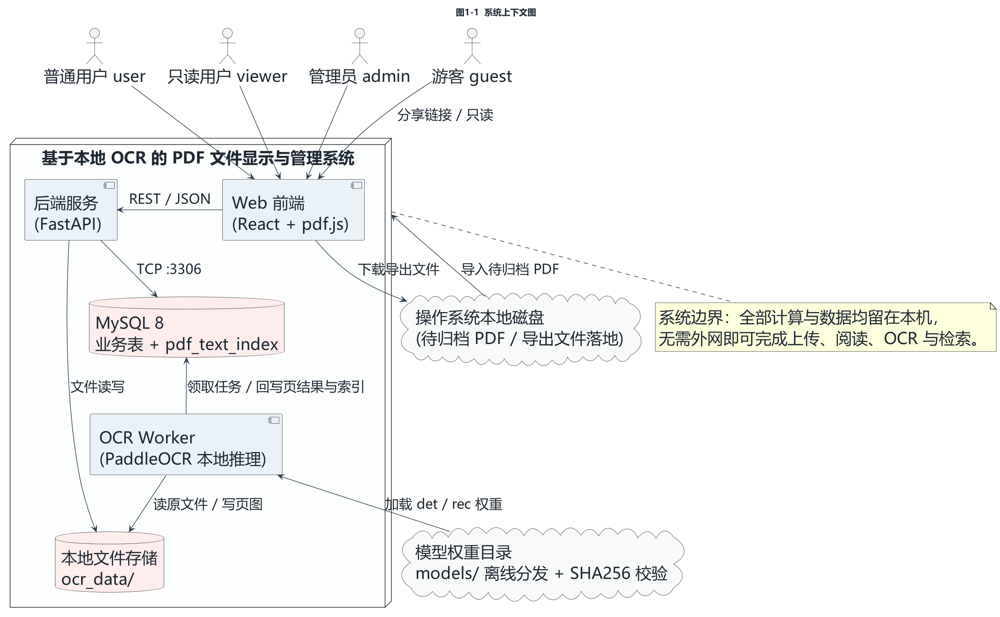{width="5.771527777777778in"
height="3.561111111111111in"}

**图 1-1 系统上下文图**

图 1-1
中，虚线框内为系统边界，框外为外部参与者与外部对象。四类参与者中，游客只能通过分享链接只读访问；只读用户
viewer 被鉴权层拒绝一切写操作。

与外部的两类数据交换分别是：从本机磁盘导入待归档 PDF，以及向本机磁盘导出
TXT / JSON / CSV / HTML / XLSX 结果文件。

需要特别说明的是，云端 OCR 服务被明确划在系统边界之外，这是 1.6
节合规约束
N21（文档与识别结果不得离开本机）的直接结果，也是本系统区别于商业套件的核心特征。

**表 1-1 系统范围内与范围外清单**

  ----------------------- ----------------------- ----------------------------------------------------------
         **类别**         **内容项**              **说明**

          范围内          文件管理                上传、列表、重命名、删除与回收站、分类、标签、合并与拆分

          范围内          在线阅读                pdf.js 渲染、缩放、翻页、缩略图、页内搜索与高亮、批注

          范围内          OCR 识别                图片与 PDF 整册或指定页识别、异步任务、取消与重试

          范围内          校对与导出              逐框校对与乐观锁、TXT/JSON/CSV/HTML/XLSX 五种导出

          范围内          表格还原                完整规则线框表格的结构还原与预览修正

          范围内          全文检索                ngram 全文索引、命中高亮、跳页定位、权限过滤

          范围内          权限、配额、日志        三角色鉴权、月页数与存储配额、操作审计

          范围外          手写体识别              不做专项训练，仅按印刷体模型尽力识别并提示风险

          范围外          竖排与无线框表格        明确不保证，无线框表格降级为按行聚类的纯文本

          范围外          移动端与跨机分布式      不做 App，不做多机部署，不引入消息中间件

          范围外          公式与图表识别          不还原数学公式与统计图表内容
  ----------------------- ----------------------- ----------------------------------------------------------

## **1.3 市场情况与相关产品分析**

### **1.3.1 市场趋势**

无纸化办公持续推进，扫描件与图片型 PDF
在企业、高校与政务场景中的存量不断增长；与此同时，数据安全合规要求（涉密材料不出内网、个人信息最小化采集）逐步收紧。这两股力量叠加，使得"本地推理 +
本地存储"的文档管理工具从可选变为刚需。另一方面，开源中文 OCR
引擎（PaddleOCR
等）的成熟度已经足以支撑实用级别的印刷体识别，为本地化方案提供了技术前提。

### **1.3.2 竞品对比**

表 1-2
从部署方式与数据是否出域、中文识别质量、检索与表格能力、授权与价格、API
与二次开发能力、综合评价六个维度，对七款典型产品与本系统定位进行对比。对比依据为
2026 年 10 月的公开资料与小组实机试用结果。

**表 1-2 竞品对比矩阵**

  ------------------------------- ---------------- -------------- ---------------------- ---------------- -------------- -------------------------------------------
             **产品**             **部署/出域**    **中文识别**   **检索与表格**         **授权与价格**   **API/二开**   **综合评价**

         Adobe Acrobat Pro        本地软件，云 OCR 优             检索好，表格还原好     订阅制，较贵     无开放 API     功能最强但闭源、出域、不可嵌入
                                  通道出域                                                                               

         ABBYY FineReader         本地             优             检索与表格还原优       买断+升级费      有 SDK（收费） 质量标杆，但授权费用高、难定制

          福昕 PDF 编辑器         本地             良             检索可用，表格一般     订阅/买断        有限           编辑器强，OCR 与检索为附加能力

              WPS PDF             本地+云          良             检索可用，表格弱       会员制           无             轻量 convenient，但深度能力不足

           Paperless-ngx          自建服务器       中（依赖外挂   检索好，表格无         开源免费         有 REST API    归档检索强，中文 OCR 弱、无阅读器体验
                                                   OCR）                                                                 

            Mayan EDMS            自建服务器       中（依赖外挂   检索可用，表格无       开源免费         有 REST API    功能重、部署复杂、中文支持一般
                                                   OCR）                                                                 

   扫描类工具（白描/夸克扫描王）  手机端+云        良             仅单图识别，无文档库   免费+增值        无             便捷但不成体系、图片上云

          本系统（定位）          纯本地，可离线   良（目标       检索与有框表格均支持   课程作品，开源   有 REST API    本地推理+阅读体验+中文检索+可嵌入四者兼备
                                                   ≥90%）                                                                
  ------------------------------- ---------------- -------------- ---------------------- ---------------- -------------- -------------------------------------------

### **1.3.3 竞品结论与差异化定位**

由表 1-2
可归纳出三条结论。第一，商业软件在识别与表格还原质量上仍是标杆，但闭源、按年订阅、云端通道出域，且无法嵌入自建业务系统，不满足本项目的合规前提。第二，开源文档管理系统具备归档与检索能力，但中文
OCR
与表格还原弱，且普遍缺少体验完整的阅读器与校对界面。第三，手机扫描类工具便捷，但只有单图识别，既没有文档库也没有检索与导出体系。

由此，本系统的差异化定位确定为四个同时满足：本地推理不出域、阅读与校对体验完整、中文全文检索可用、对外提供可嵌入的
REST API。表 1-3 给出目标用户的四类痛点与本系统的对应对策。

**表 1-3 用户痛点与本系统对策**

  ----------------------- ------------------------------ --------------------------------------
       **典型痛点**       **现有方案的表现**             **本系统对策**

   扫描件无法复制与检索   商业软件可识别但需上传云端     本地 OCR 补文本层，落地 ngram 全文索引

   涉密材料不敢用云 OCR   绝大多数产品无本地通道         纯本地推理，模型随包分发，可完全离线

   识别结果错误无人修正   多数工具只给结果、不提供校对   逐框校对台 + 乐观锁并发保护 +
                                                         校对后同步索引

   识别结果难以二次利用   多为纯文本或 PDF 内嵌层        TXT/JSON/CSV/HTML/XLSX
                                                         五种导出，含坐标

     文档一多就找不到     依赖文件名记忆与目录结构       全文检索 + 分类 + 标签 + 命中高亮跳页
  ----------------------- ------------------------------ --------------------------------------

## **1.4 用户类型和特征**

### **1.4.1 用户角色与权限**

系统共涉及四类参与者：游客（未登录）、普通用户 user、只读用户
viewer、管理员 admin。表 1-4
给出角色与功能权限矩阵，其中"√"表示允许，"×"表示拒绝（越权访问他人资源一律返回
404 而非 403，以避免资源探测）。表中"在线阅读与批注"为合并项：viewer 可在线阅读，
但批注属于写操作，按 2.2.2 的鉴权规则被拒绝（403）；viewer 的可用能力为阅读、检索
与导出三类，与 1.4.2 的只读定位一致。

**表 1-4 用户角色与权限矩阵**

  ------------------------------ -------------- -------------- -------------- --------------
             **功能**            **游客**       **user**       **viewer**     **admin**

       通过分享链接只读浏览      √              √              √              √

             上传文件            ×              √              ×              √

     创建/取消/重试 OCR 任务     ×              √              ×              √

          在线阅读与批注         ×              √              √              √

   结果校对（改字、合并、排序）  ×              √              ×              √

   导出 TXT/JSON/CSV/HTML/XLSX   ×              √              √              √

             全文检索            ×              √              √              √

        生成/撤销分享链接        ×              √              ×              √

         删除与回收站操作        ×              √（自己的）    ×              √（全部）

        查看操作日志与统计       ×              ×              ×              √

          账号与配额管理         ×              ×              ×              √
  ------------------------------ -------------- -------------- -------------- --------------

### **1.4.2 用户特征画像**

普通用户
user：具备基本计算机软件操作能力，以研究生、行政与技术人员为主，使用频率为每周
2～5 次，核心诉求是把手头的扫描 PDF
变成可检索可复制的文档；典型挫败点是识别错误无人纠正、导出格式单一。

只读用户
viewer：多为需要查阅文档但不产生内容的协作方（如项目组的旁听成员），使用频率低，核心诉求是"能看、能搜、能导出"，不需要也不应拥有改变文档内容的权限；若为普通用户则可自助上传，被降级为
viewer 通常出于审计需要。

管理员 admin：由组内指定人员担任，具备一定运维能力，使用频率为每日 1
次左右，核心诉求是掌握系统运行状态（任务成功率、存储占用、配额使用）并能处理异常账号与异常任务。

游客：来自分享链接的访问者，通常只访问一次，无任何账号，诉求是快速打开被分享的文档；其行为被严格限制为只读，且受链接有效期与是否允许下载的双重控制。

### **1.4.3 典型使用场景**

场景一（研究生整理文献）：用户批量上传 40 篇扫描版参考文献
PDF，系统完成整册 OCR
与全文索引；撰写论文时以关键词检索，结果按文件聚合并高亮命中片段，点击直接跳转到原文对应页，随后把需要的段落导出为可编辑文本。

场景二（行政人员归档扫描件）：用户上传一批合同扫描件，按"年份---部门"两级分类并打上"已盖章"等标签；识别完成后进入校对台逐页修正识别错字，确认无误后归档；对外仅需临时查阅时，生成
7 天有效期且禁止下载的分享链接，到期自动失效。

场景三（实验室共享设备手册）：管理员上传设备手册并建立标签体系，组员通过检索定位到"维护周期"相关页面；手册含大量线框表格，系统还原表格结构并允许手工修正单元格归属，最终导出为
XLSX 供台账登记使用。

用户规模与增长假设：单机部署面向 5～30 人团队，日均识别量 50～200
页，文件存量按 1000 个文件、平均 30 页（共约 3 万页）规划。该假设是第 3
章性能指标与 2.13.4 容量估算的共同输入。

## **1.5 操作环境**

**表 1-5 运行环境要求**

  ----------------------- ----------------------- --------------------------------------------------------
         **层次**         **项目**                **要求**

          客户端          浏览器                  Chrome / Edge 100 及以上（Firefox ESR 保证只读可用）

          客户端          显示分辨率              ≥ 1280×720，推荐 1920×1080

          客户端          依赖能力                pdf.js 渲染、Canvas、Web Worker、Fetch / Stream

          服务端          操作系统                Windows 10/11 或 Ubuntu 22.04 及以上

          服务端          硬件                    ≥ 4 核 CPU、≥ 8 GB 内存；纯 CPU 推理，无需 GPU

          服务端          磁盘                    预留 ≥ 20 GB（文件本体 + 页图 + 导出缓存）

          服务端          数据库                  生产 MySQL 8.0+（utf8mb4）；开发期可退化为 SQLite

           网络           连通性                  运行时完全离线；权重按清单首次下载并校验
                                                  SHA256

           部署           形态                    单机单体：API 进程、Worker 进程、数据库同机部署
  ----------------------- ----------------------- --------------------------------------------------------

部署形态说明：单机单体部署，API 进程、Worker 进程与数据库同机运行；
任务队列的内部实现机制属于设计内容，见《系统设计文档》。

## **1.6 设计和实现约束**

表 1-6 记录课程既定的技术、合规、资源与团队前提，是对需求的限制条件，而非概要设计的
方案选择；具体设计决策见《系统设计文档》2.4 设计约束。表中尚未落地的能力按附录 E
登记为设计目标，需求条文不因当前实现状态而改写。

**表 1-6 约束清单**

  ----------------- ----------------- ---------------------------------------------------- --------------------------------------------
      **编号**      **约束类型**      **约束内容**                                         **对需求的影响**

         N11        技术              前端 React + pdf.js；后端 FastAPI +                  技术选型固定，文档中不再讨论替代方案
                                      SQLAlchemy；数据库 MySQL 8                           

         N12        技术              OCR 引擎为 PaddleOCR，本地 CPU 推理，不依赖 GPU      性能目标按 CPU 推理制定（单页 ≤ 3 s）

         N13        技术              鉴权采用 JWT（HS256），接口无状态                    需要令牌刷新与过期处理需求

         N21        合规              文件与识别结果不得离开本机，禁止任何云端 OCR 通道    必须提供能力可离线验证的模型分发与校验方案

         N22        合规              日志不得记录文件正文与令牌明文                       审计日志只记录行为与资源标识

         N23        合规              第三方组件须为可商用开源许可（Apache-2.0/MIT/BSD）   需维护第三方声明与致谢页

         N31        资源              单文件 ≤ 20 MiB、≤ 100 页；单页 ≤ 2000 万像素        上传环节必须做三重校验并给出明确错误码

         N32        资源              模型与依赖须能在 8 GB 内存机器上共存                 内存峰值 ≤ 4 GB，Worker 并发数受限

         N41        进度              课程设计 12 周、3 人，需求阶段 2 周                  按 MoSCoW 裁剪优先级，手写体等列为范围外

         N51        团队              无专职运维，必须"一条命令启动"                       不引入消息中间件，队列用数据库实现

         N61        范围              表格仅支持完整线框；不支持竖排与合并单元格           无线框表格须降级为文本并显式标注"未还原"
  ----------------- ----------------- ---------------------------------------------------- --------------------------------------------

## **1.7 术语与缩略语**

**表 1-7 术语与缩略语**

  ----------------------------------- -----------------------------------------------------------
           **术语 / 缩略语**          **含义**

                  OCR                 Optical Character
                                      Recognition，光学字符识别，将图像中的文字转换为可编辑文本

                  CTC                 Connectionist Temporal
                                      Classification，用于不定长文本序列识别的解码方法

            PDFium / pdf.js           分别为 PDF 渲染引擎与浏览器端 PDF 渲染库

                  JWT                 JSON Web Token，本系统采用的无状态鉴权令牌

            ngram 全文索引            MySQL 8 提供的中文全文索引解析器，最小分词长度为 2

             租约（lease）            Worker 领取任务时获得的有时限独占权，未续租则任务可被其他
                                      Worker 接管

          修订号（revision）          页结果的乐观锁版本号，校对时用于检测并发冲突

          代次（generation）          文件被重新识别的次数序号，用于保证旧代次结果不覆盖新代次

                MoSCoW                需求优先级方法：Must / Should / Could / Won\'t
  ----------------------------------- -----------------------------------------------------------

## **1.8 参考资料**

- 课程题目单与需求文档撰写模板（课程组提供）。

- IEEE Std 830-1998《Recommended Practice for Software Requirements
  Specifications》。

- ISO/IEC 25010:2011 系统与软件质量模型。

- PaddleOCR 官方文档与模型说明。

- Mozilla pdf.js 官方文档。

- MySQL 8.0 Reference Manual（全文索引与 ngram 解析器章节）。

- 小组需求讨论会记录 MEET-01～MEET-03（组内留存，未随代码仓库提交）。

- ISO/IEC/IEEE 29148:2018《系统与软件工程 生命周期过程 需求工程》。

- GB/T 9385-2008《计算机软件需求规格说明规范》。

- 配套《系统设计文档》（`docs/design/系统设计文档_V2.0.md`）与《界面原型设计》（`docs/design/界面原型设计.md`）。

- 接口契约 `docs/api-contract.yaml`（OpenAPI 3.0）与 `docs/architecture.md`。

# **第 2 章 系统主要功能**

本章是全文主体，分为三段：2.1～2.11 按模块逐条给出功能需求，2.12 用 UML
对系统行为做形式化建模，2.13 给出数据需求。每个模块统一按"功能点 →
业务规则 → 异常与边界 → 验收标准"四段式描述，功能需求编号采用
FR-\<模块\>-\<序号\> 形式。

## **2.1 系统总体功能结构**

系统按四层组织：展现层负责界面与交互，功能模块层承载八项业务能力，服务层提供可被各模块复用的横切能力，数据层负责持久化与存储。图
2-1 给出系统功能结构图，表 2-1 给出模块与需求编号的对应关系。

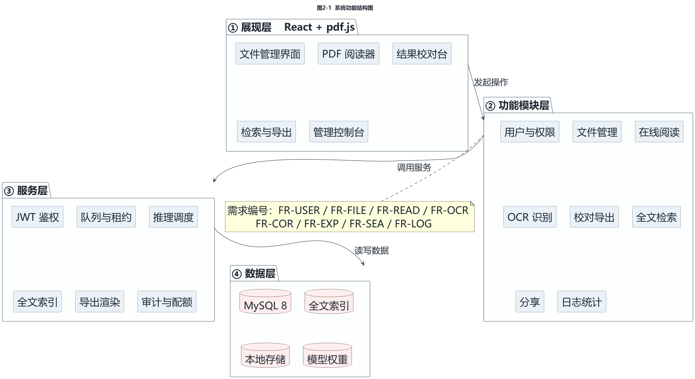{width="5.771527777777778in"
height="3.1479166666666667in"}

**图 2-1 系统功能结构图**

图 2-1
自顶向下分为四层，箭头方向表示依赖方向：上层可以调用下层，下层不得反向依赖上层。

鉴别 JWT
鉴权、审计与配额三项能力被集中在服务层，而非分散在各功能模块内部，目的是保证任何写操作都必然经过统一的权限校验与留痕。

数据层将业务表、全文索引、本地文件存储与模型权重目录并列列出，提示四者的生命周期不同：前两者随业务增长，后两者受磁盘容量约束。

**表 2-1 功能模块与需求编号总表**

  ------------------ ---------------- -------------- -------------- --------------
       **模块**      **编号区间**     **优先级**     **对应章节**   **主责人**

      用户与权限     FR-USER-01～07   Must           2.2            陈浩然

       文件管理      FR-FILE-01～11   Must           2.3            岳浩睿

    PDF 在线阅读器   FR-READ-01～09   Must           2.4            岳浩睿

       OCR 识别      FR-OCR-01～12    Must           2.5            黄俞富

       结果校对      FR-COR-01～06    Must           2.6            黄俞富

       表格还原      FR-TBL-01～04    Should         2.7            黄俞富

       结果导出      FR-EXP-01～06    Must           2.8            黄俞富

       全文检索      FR-SEA-01～07    Must           2.9            黄俞富

      分享与协作     FR-SHR-01～04    Should         2.10           陈浩然

   配额、日志与统计  FR-LOG-01～06    Should         2.11           陈浩然
  ------------------ ---------------- -------------- -------------- --------------

分工约定：每个模块设一名主责人负责该模块需求的采集、编写与后续验收，另两名成员进行交叉评审；评审意见记录在会议记录中，需求变更按附录
D 的流程处理。

## **2.2 用户与权限管理**

### **2.2.1 功能点**

- FR-USER-01 注册：填写用户名、密码与可选邮箱，注册成功后自动分配 user
  角色。

- FR-USER-02 登录：验证凭据后签发 JWT 访问令牌与刷新令牌。

- FR-USER-03 令牌刷新：访问令牌过期前可用刷新令牌换取新的访问令牌。

- FR-USER-04 登出：使当前刷新令牌失效。

- FR-USER-05 修改密码：需提供原密码，修改后原有刷新令牌全部失效。

- FR-USER-06 角色分配：管理员可将账号在 user / viewer / admin 之间调整。

- FR-USER-07 账号禁用：管理员可禁用账号，禁用后其令牌立即失效。

### **2.2.2 业务规则**

- 用户名长度 4～32 字符，仅允许字母、数字与下划线，全库唯一。

- 密码长度 ≥ 8
  位且须同时包含字母与数字；库中只保存加盐哈希，禁止保存明文或可逆加密结果。

- 访问令牌有效期 2 小时，刷新令牌有效期 7
  天；刷新令牌仅可使用一次，使用后立即轮换。

- 同一账号连续 5 次登录失败后锁定 10
  分钟，锁定期间即使凭据正确也拒绝登录。

- viewer 角色的账号在鉴权层被拒绝一切写操作，返回 403。

- 访问他人资源时返回 404 而非 403，避免通过响应差异探测资源是否存在。

- 签名密钥长度 ≥ 32 字符且只能来自环境变量，不得写入代码或配置文件。

### **2.2.3 异常与边界**

- 用户名重复：返回 409 并提示换用其他用户名。

- 令牌过期或签名不合法：返回 401，前端清除本地令牌并跳转登录页。

- 账号被禁用：即使持有未过期令牌也返回 401。

- 越权访问：返回 404，不暴露目标资源是否存在。

- 修改密码时原密码错误：返回 400 且不计入登录失败次数。

### **2.2.4 验收标准**

- Given 数据库中不存在同名账号，When 提交合法注册信息，Then
  注册成功且该账号被赋予 user 角色。

- Given 账号已连续失败 5 次，When 第 6 次使用正确密码登录，Then
  系统拒绝登录并提示锁定剩余时间。

- Given 以 viewer 身份登录后，When 调用任意写接口，Then 返回 403
  且审计日志记录该次越权尝试。

- Given 用户 A 持有有效令牌，When 访问用户 B 的文件标识，Then 返回 404。

## **2.3 文件管理**

### **2.3.1 功能点**

- FR-FILE-01 上传：支持单文件与多文件、点击选择与拖拽上传。

- FR-FILE-02
  列表：分页展示，支持按名称、时间、大小、状态排序，按类型与状态筛选。

- FR-FILE-03 重命名：修改文件显示名。

- FR-FILE-04 删除：软删除进入回收站，保留 30 天，支持还原与彻底删除。

- FR-FILE-05 分类：以目录树组织文件，支持层级 ≤ 5 的分类与移动。

- FR-FILE-06 标签：多对多标签，支持批量打标与按标签筛选。

- FR-FILE-07 批量操作：批量移动、打标、删除与批量提交识别任务。

- FR-FILE-08 合并：将多个 PDF 合并为一个新文件。

- FR-FILE-09 拆分：按页码区间或每 N 页拆分为多个新文件。

- FR-FILE-10
  版本与代次：记录文件被重新识别的代次号，展示时区分新旧结果。

- FR-FILE-11 文件信息：展示大小、页数、SHA256、创建时间与识别状态。

### **2.3.2 业务规则**

- 上传采用三重校验：扩展名 → MIME 与文件头魔数 →
  尝试解析内容，任一不通过即拒绝。

- 单文件 ≤ 20 MiB、≤ 100 页；单页像素 ≤ 2000 万；超限分别返回 413、422。

- 加密 PDF 直接拒绝并提示先解除加密，不做跳过或降级处理。

- 同名文件自动追加序号（如"合同(1).pdf"），不覆盖已有文件。

- 删除前必须先取消该文件上正在进行的任务；存在活动任务时拒绝删除。

- 合并结果总页数不得超过 100 页；拆分生成新文件，原文件保持不变。

- 分类名称在同一父节点下唯一，移动分类时不得形成环，层级上限 5。

- 标签名全库唯一，颜色以 #RRGGBB 存储；同一文件不得重复打同一标签。

### **2.3.3 文件状态**

文件在系统中的生命周期由图 2-2
描述。状态迁移的驱动者有三类：用户操作（上传、归档、删除）、任务系统（入队、识别完成、重试）与定时任务（回收站过期清理）。

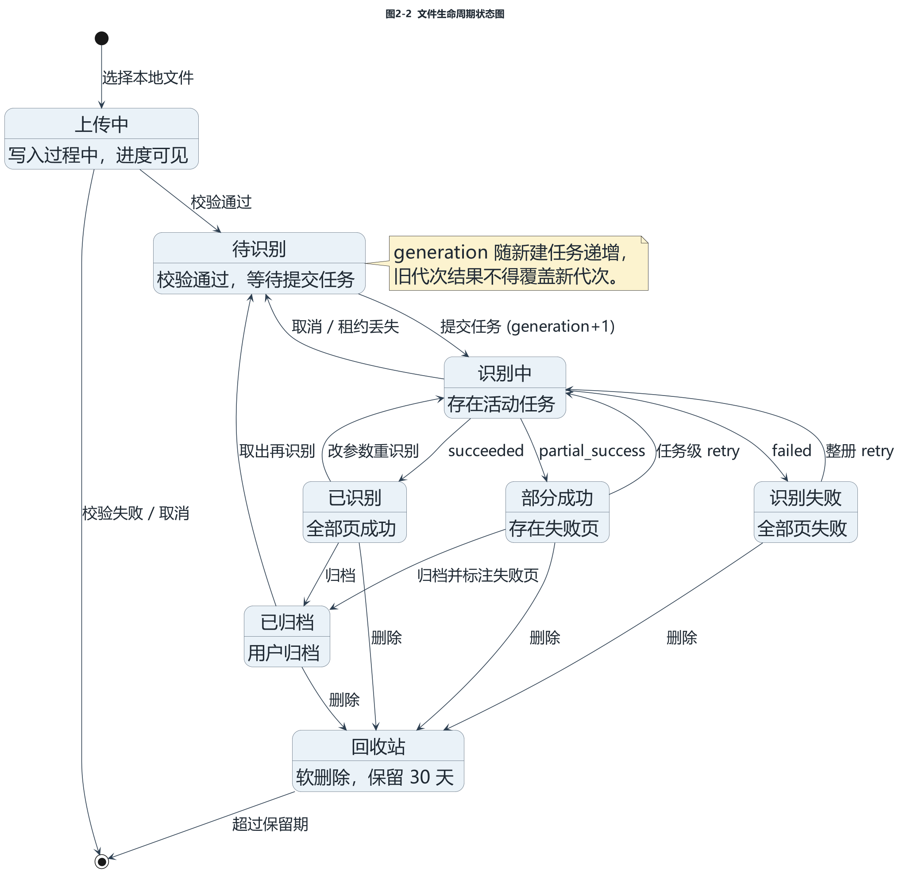{width="5.273611111111111in"
height="5.118055555555555in"}

**图 2-2 文件生命周期状态图**

图 2-2
中"识别中"可迁移到三个终态之一：全部页成功进入"已识别"，部分页失败进入"部分成功"，全部页失败进入"识别失败"。

两条进入"已归档"的路径差异在于：从"已识别"归档的文件可直接对外分享，从"部分成功"归档的文件必须标注失败页码。

代次（generation）机制是本图的关键约束：每次新建识别任务都使代次递增，旧代次的返回结果不得覆盖新代次，避免并行请求互相污染。

### **2.3.4 异常与边界**

- 超大文件：返回 413 E_UPLOAD_TOO_LARGE，前端在上传前先做本地大小预判。

- 页数超限：返回 422 E_TOO_MANY_PAGES。

- 损坏或无法解析的 PDF：返回 422 E_PDF_INVALID。

- 磁盘空间不足：返回 507 E_NO_SPACE 并提示管理员清理回收站。

- 并发同名上传：由唯一索引与应用层序号策略共同处理，保证不覆盖。

### **2.3.5 界面要素与验收标准**

- 列表至少包含：名称、类型、大小、页数、识别状态、创建时间、操作入口。

- 批量操作须显示进度与结果汇总（成功 N 项、失败 M 项及失败原因）。

- 空态、加载态与错误态均须有明确文案，不得留白。

- Given 上传 21 MiB 文件，When 提交上传，Then 返回 413 且前端提示超出 20
  MiB 上限。

- Given 文件存在活动任务，When 执行删除，Then 拒绝删除并提示先取消任务。

- Given 文件已删除 30 天，When 定时任务执行，Then
  文件记录与磁盘文件被物理清除。

## **2.4 PDF 在线阅读器**

### **2.4.1 功能点**

- FR-READ-01 连续滚动与单页两种阅读模式。

- FR-READ-02 缩放：50%～400%，支持适应宽度与适应页面。

- FR-READ-03 翻页、跳页与缩略图侧栏导航。

- FR-READ-04 目录大纲跳转（PDF 内含大纲时）。

- FR-READ-05 页内搜索与命中高亮。

- FR-READ-06 书签与阅读位置记忆。

- FR-READ-07 矩形与文字批注，批注随页面保存。

- FR-READ-08 OCR 文本层叠加显示，可选中复制。

- FR-READ-09 原文视图与识别文本视图的双视图切换。

### **2.4.2 业务规则与性能要求**

- 批注坐标按归一化值存储（相对页面宽高的比例），以适配任意缩放比例。

- 文本层与图像层按页号严格对齐；页面旋转时坐标须做相应变换。

- PDF 原文件不在浏览器之外落地，阅读过程不产生服务端文件复制。

- 100 页文档首屏渲染 ≤ 2 s，翻页响应 ≤ 300 ms（详见 3.1）。

- 识别完成后可点击识别框定位到原文位置，实现图文对照。

## **2.5 OCR 识别**

### **2.5.1 功能点**

- FR-OCR-01 图片识别：支持 PNG / JPG / BMP / TIFF 等格式的图片文件。

- FR-OCR-02 PDF 整册识别与指定页范围识别。

- FR-OCR-03 识别选项：语言、方向检测、是否开启表格还原。

- FR-OCR-04 异步任务提交，返回任务标识；前端轮询获取进度。

- FR-OCR-05 取消任务。

- FR-OCR-06 整册重试与按页重试。

- FR-OCR-07 能力探测：接口返回当前实际可用的模型能力。

- FR-OCR-08 页级结果落库与全文索引同步。

- FR-OCR-09 结果按代次隔离，旧代次不得覆盖新代次。

- FR-OCR-10 失败原因可见，错误码可解释。

- FR-OCR-11 任务并发控制，Worker 数量可配置。

- FR-OCR-12 低分辨率扫描件的质量风险提示。

### **2.5.2 业务规则**

- 同一文件同时只允许存在一个活动任务；新建任务时文件代次
  +1，旧代次的返回被丢弃。

- 任务最多 3 次尝试；失败后按 15 s、30 s
  指数退避重试，超过次数则进入终态。

- Worker 领取任务时获得 120 s 租约，每 40 s
  续租一次；租约过期后任务可被其他 Worker 接管。

- 任务状态为排队中时允许取消；取消即刻释放文件上的活动任务占用并退还页数配额。

- 整册重试只重跑失败页，已成功页不重复计算；新建识别任务则重置全部页并递增代次。

- 页面结果与全文索引在同一事务内写入，保证检索结果与页结果一致。

- 仅接受持有匹配租约令牌且租约未过期的提交，过期提交返回 E_LEASE_LOST。

- 入队前预留页数配额，终态时结算，取消时退还。

### **2.5.3 处理流程**

图 2-3a 与图 2-3b 以带泳道的活动图描述 OCR
处理的完整流程，前者覆盖"提交到入队"，后者覆盖"逐页执行到结果回写"。两图在"Worker
领取任务"处首尾相接。

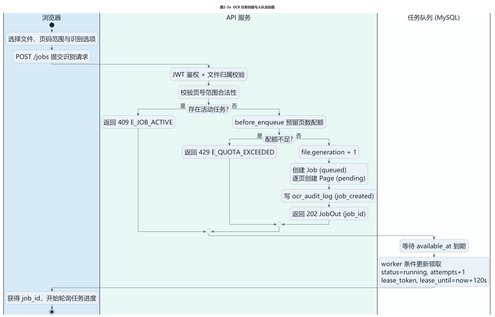{width="5.771527777777778in" height="3.69375in"}

**图 2-3a OCR 任务创建与入队活动图（带泳道）**

图 2-3a 的两个菱形判断是本阶段的关键约束点：存在活动任务时返回
409，配额不足时返回 429。

注意"代次递增""创建任务与页记录""预留配额"三步必须在同一事务内完成，否则会出现页记录缺失或配额漏扣。

任务创建成功后返回 202 Accepted 而非同步返回结果，这是异步处理的前提。

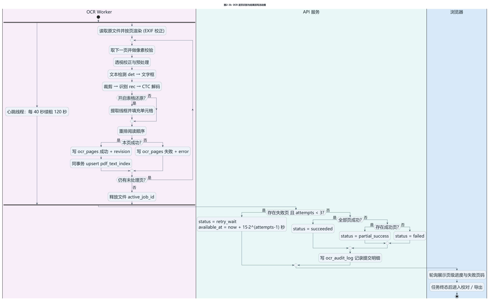{width="5.771527777777778in"
height="3.5340277777777778in"}

**图 2-3b OCR 逐页识别与结果回写活动图（带泳道）**

图 2-3b 中 fork
分支体现了心跳续租线程与逐页处理线程的并发关系：二者共享同一任务的租约，任一方失败都通过租约过期被其他
Worker 接管。

逐页循环中"本页成功则写结果并同步索引，本页失败则只记错误码"的处理约定，保证了失败页不会清空已有的成功索引。

终态判定分三支：存在失败页且尝试次数未满进入等待重试；全部成功进入已识别；否则按是否存在成功页区分为部分成功或失败。

### **2.5.4 处理质量要求与边界**

- 横排印刷体中文字符准确率目标 ≥ 90%（以自建 200 页标注集统计）。

- 识别框坐标以页面左上角为原点归一化返回，与页面尺寸解耦。

- 手写体、竖排、无线框表格与公式不保证效果，属于范围外。

- 扫描件分辨率低于 150 dpi 时提示质量风险，但不阻止识别。

### **2.5.5 验收标准**

- Given 文件无活动任务且配额充足，When 提交识别任务，Then 返回 202
  且文件代次递增 1。

- Given 文件已存在活动任务，When 再次提交，Then 返回 409 E_JOB_ACTIVE。

- Given 任务尝试次数已达 3 次且仍有失败页，When 本次执行结束，Then
  任务进入终态 partial_success 或 failed 并释放文件占用。

- Given Worker 进程在执行中被强制结束，When 租约超过 120 s，Then 其他
  Worker 可接管该任务且不重复处理已成功页。

## **2.6 识别结果校对**

### **2.6.1 功能点与业务规则**

- FR-COR-01 按页展示原图与识别框对照，支持逐框改字。

- FR-COR-02 合并与拆分文本行，删除误检框。

- FR-COR-03 调整阅读顺序，保证导出文本顺序正确。

- FR-COR-04 保存修订，需携带期望修订号 expected_revision。

- FR-COR-05 撤销最近一次未保存修改。

- FR-COR-06 校对后同步更新该页的全文索引内容。

- 规则：任务未结束不允许校对；viewer 不可校对；仅文件归属者与 admin
  可校对。

- 规则：保存时若服务端修订号与期望值不一致，返回 409 E_REVISION_CONFLICT
  并回传最新修订号。

- 规则：每次成功校对使该页修订号 +1，并记录审计日志 page_corrected。

### **2.6.2 验收标准**

- Given 任务已终态，When 打开校对台，Then 可加载该页识别框与原文图像。

- Given 两个用户同时编辑同一页，When 后提交者携带旧修订号保存，Then 返回
  409 且前端提示已被他人更新。

- Given 校对保存成功，When 立即检索该页新文本，Then
  可被命中且结果标注最新修订号。

## **2.7 表格还原**

### **2.7.1 功能点**

- FR-TBL-01 自动识别页面中的完整规则线框表格。

- FR-TBL-02 将识别到的文本块归属到具体单元格。

- FR-TBL-03 输出表格结构数据，供导出为 CSV / XLSX。

- FR-TBL-04 前端表格预览与手工修正单元格归属。

### **2.7.2 业务规则**

- 仅支持完整网格：每条分隔线须覆盖整张表的 90% 以上，否则判定为不完整。

- 存在部分分隔线（疑似合并单元格）时，直接拒绝还原而非臆造矩形单元格。

- 无线框表格采用降级策略：按行聚类输出为纯文本，并在结果中标注"未还原"。

- 表格还原为可选项，默认关闭；开启后单页处理时间增加，需在界面提示。

- 行列数量上限分别为 50 行与 100 列，超出则不作为表格处理。

### **2.7.3 验收标准**

- Given 页面含一张 3×4 完整线框表格，When 开启表格还原识别，Then
  结果中包含该表格且单元格文本归属正确。

- Given 页面表格存在合并单元格，When 识别，Then
  该表格被判定为不完整且标注需人工确认。

- Given 为无线框表格，When 识别，Then 降级为按行文本并标注"未还原"。

## **2.8 结果导出**

### **2.8.1 功能点**

- FR-EXP-01 导出为 TXT：纯文本，按页分页。

- FR-EXP-02 导出为 JSON：含文字框坐标、文本与置信度的结构化结果。

- FR-EXP-03 导出为 CSV：按页一行或按文本块一行，可配置。

- FR-EXP-04 导出为 HTML：保留阅读顺序并可选嵌入图片。

- FR-EXP-05 导出为 XLSX：按页组织，可选输出表格结构。

- FR-EXP-06 支持整册或指定页范围导出，含或不含坐标可选。

### **2.8.2 业务规则**

- HTML 与 XLSX 导出必须做 HTML 转义，防止内容被当作标记解析。

- 防公式注入：以 =、+、-、@ 开头的单元格内容前须补单引号。

- 导出文件名包含原文件名与时间戳，形如 合同_20261022_1530.txt。

- 导出采用流式响应，不在服务端生成长期驻留的大临时文件。

- 导出内容取自当前代次的成功页结果；失败页不出现在导出结果中并单独列出。

- 单次导出页数上限 100 页，超出需分批。

### **2.8.3 验收标准**

- Given 任务已全部成功，When 请求 JSON 导出，Then
  返回含坐标与置信度的结构化数据。

- Given 单元格文本以等号开头，When 导出为 XLSX，Then
  打开时该单元格为文本而非公式。

- Given 导出请求包含 50 页，When 执行导出，Then
  以流式方式返回且不产生服务端临时文件残留。

## **2.9 全文检索**

### **2.9.1 功能点**

- FR-SEA-01 按关键词检索已识别文本。

- FR-SEA-02 结果按文件聚合，展示命中页数与片段。

- FR-SEA-03 命中片段高亮，点击跳转到对应页并定位。

- FR-SEA-04 支持按文件类型、时间范围与标签过滤。

- FR-SEA-05 检索历史记录，可点击重跑。

- FR-SEA-06 结果标注来源任务与修订号，避免展示过期文本。

- FR-SEA-07 仅检索当前用户有权访问的文件。

### **2.9.2 业务规则**

- 中文检索使用 MySQL ngram 全文索引，关键词长度须 ≥
  2，最小分词长度配置为 2。

- 单字符查询或 ngram 不可用时降级为子串匹配，并在响应中标注降级标志。

- 权限过滤必须发生在文本匹配之前，避免先命中后过滤导致的越权信息泄露。

- 关键词长度 \> 100 字符时截断，特殊字符按字面处理。

- 返回结果须标注产生该文本的任务标识与修订号，前端据此提示结果可能过时。

- 性能要求：10 万页规模下检索 P95 ≤ 1 s（详见 3.1）。

### **2.9.3 验收标准**

- Given 页面文本含"验收报告"，When 检索"验收报告"，Then
  命中该页且片段高亮。

- Given 关键词为单字，When 检索，Then 使用子串匹配并在响应中标注降级。

- Given 用户 A 与用户 B 各有文件，When A 检索，Then 结果中不含 B
  的任何文件。

## **2.10 分享与协作**

### **2.10.1 功能点**

- FR-SHR-01 生成分享链接，可设置有效期与是否允许下载。

- FR-SHR-02 取消分享，链接立即失效。

- FR-SHR-03 访问统计，记录访问次数与最近访问时间。

- FR-SHR-04 游客通过链接只读浏览文件。

### **2.10.2 业务规则**

- 分享令牌为 64
  位随机串，全库唯一，同时以数据库记录保存有效期与撤销标记。

- 过期或已撤销的链接返回 410 Gone，不区分具体原因以免信息泄露。

- 被分享者仅可只读访问；是否允许下载由创建者设定，禁止时前端隐藏下载入口且后端拒绝下载请求。

- 分享不复制文件实体，所有访问均指向同一份存储对象。

- 撤销采用标记方式而非删除记录，以保留审计线索。

- 单次访问须记录审计日志，含访问时间与被访问文件标识。

### **2.10.3 验收标准**

- Given 创建了 7 天有效期的分享链接，When 第 8 天访问，Then 返回 410
  Gone。

- Given 拥有者撤销分享，When 立即访问，Then 链接不可用。

- Given 链接设置为禁止下载，When 请求下载，Then 后端拒绝且不返回文件流。

## **2.11 配额、日志与统计**

### **2.11.1 功能点与业务规则**

- FR-LOG-01 存储容量配额：按用户统计已用存储字节数。

- FR-LOG-02 月度识别页数配额：默认按月重置。

- FR-LOG-03 超额拦截：入队前预留，超额返回 429 E_QUOTA_EXCEEDED。

- FR-LOG-04 操作日志：记录谁、何时、对什么资源、做了什么。

- FR-LOG-05 使用统计看板：文件数、识别页数、成功率、平均耗时、存储占用。

- FR-LOG-06 日志查询：管理员可按用户、动作与时间范围筛选。

- 规则：配额采用"预留---结算---退还"三段式记账，任务取消时退还预量。

- 规则：配额账中的预留量不得为负，由数据库约束与应用层双重保证。

- 规则：日志只追加不可修改，保留 180 天；detail
  字段不记录文件正文与令牌。

- 规则：统计按日聚合，看板数据允许 1 小时以内的延迟。

### **2.11.2 验收标准**

- Given 用户当月配额剩余 10 页，When 提交 20 页任务，Then 返回 429
  且不创建任务。

- Given 任务已预留 20 页，When 取消任务，Then 预留量减少 20 页。

- Given 任意写操作执行，When 查询审计日志，Then 存在对应记录且 detail
  不含文件正文。

## **2.12 形式化建模**

本节用 UML 对系统行为做形式化建模。建模工具为
PlantUML（文本化建模语言，源码随文档提交），本文档共 12 张行为建模图：用例图 1
张、活动图 4 张、状态图 3 张、顺序图 4 张，分布于 2.3.3、2.5.3 与 2.12 节；另在
2.13.2 给出 E-R 图 3 张。每张图后均配 3～6
行图形说明，指出图中的关键判断点与业务约束，避免"只贴图不解释"。
结构层面的建模（类图、部署图）属于设计内容，见《系统设计文档》图 3-15、图 3-16 与图 3-3；
原图 2-11 / 2-12 的编号随迁出保留空位，不再使用。

### **2.12.1 用例建模**

图 2-4 为系统用例图。系统共识别 4 个参与者与 22
个用例；其中"文件有效性校验""渲染导出文件""访问权限过滤"为被包含用例（\<\<include\>\>），"表格还原"与"批注"为扩展用例（\<\<extend\>\>），用于表达可选行为。

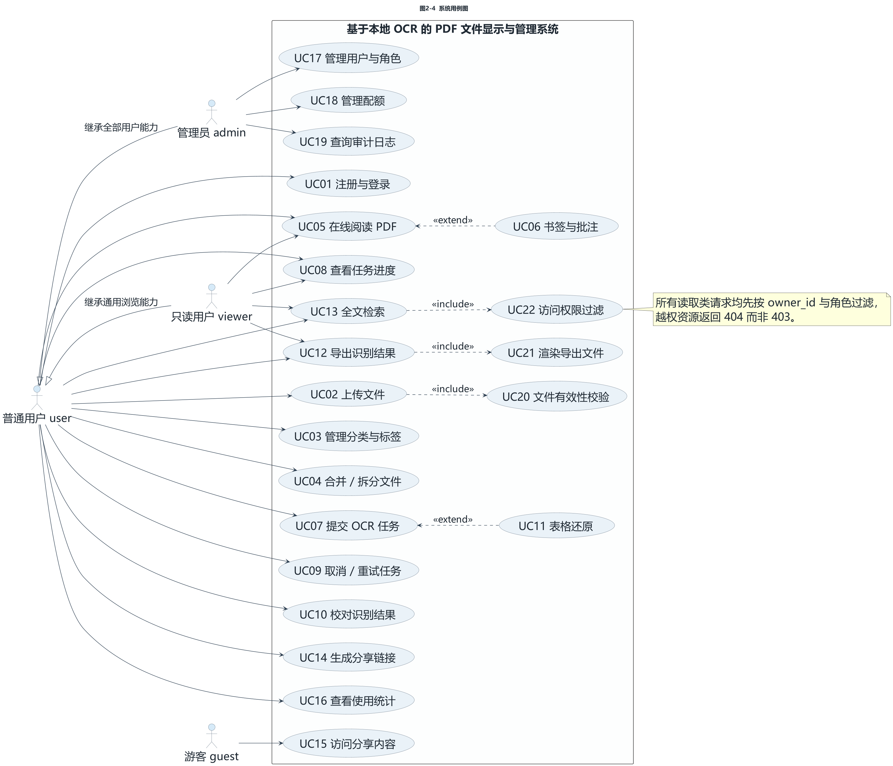{width="5.771527777777778in"
height="4.954166666666667in"}

**图 2-4 系统用例图**

图 2-4 中，只读用户 viewer 与普通用户、管理员之间存在泛化关系：viewer 与
admin 继承 user 的全部用例，再各自裁剪或扩展。viewer
在鉴权层被拒绝一切写操作，因此其可用用例只有查看、检索与导出三类。

被包含用例 UC20"文件有效性校验"被 UC02
上传文件强制包含，表示上传动作不可分割地包含三重校验；UC22"访问权限过滤"被
UC13
全文检索包含，表示权限过滤必须在文本匹配之前完成，而非先命中再过滤。

扩展用例 UC11"表格还原"扩展 UC07 创建 OCR
任务，其扩展点在于用户勾选了表格还原选项；未勾选时该扩展不执行，这也解释了
2.7 节中表格还原默认关闭的需求约定。

管理员侧的 5
个用例（账号管理、角色分配、配额设置、日志查看、统计看板）与其他参与者无任何连线，体现管理功能只对
admin 开放。

下列 4 个核心用例给出完整用例规约，其余用例以 2.1～2.11
节的文字描述为准，不逐一展开。

**表 2-2 核心用例规约**

  -------------- ---------------------- ---------------------- ------------------------------ ----------------------------
     **项目**    **UC02 上传文件**      **UC07 创建 OCR 任务** **UC13 全文检索**              **UC10 校对保存**

      参与者     user / admin           user / admin           user / viewer / admin          user / admin

     前置条件    已登录且角色非 viewer  文件存在且无活动任务   已登录，文件已完成识别         任务已终态，用户为归属者或
                                                                                              admin

      基本流     1 选择文件；2          1 选择页范围与选项；2  1 输入关键词；2 权限过滤；3    1 加载页结果；2
                 三重校验；3            预留配额；3            全文匹配；4                    编辑识别框；3
                 写存储与元数据；4      代次递增；4            结果聚合与片段生成；5 返回     携带期望修订号保存；4
                 返回文件标识           创建任务与页记录；5                                   更新索引
                                        返回 202                                              

      备选流     同名文件自动追加序号   指定页范围识别         关键词为单字时降级为子串匹配   合并与拆分文本行、调整顺序

      异常流     类型不合法             活动任务冲突           无结果返回空集并给出建议       修订号冲突 409；任务未结束
                 415；不可解析          409；配额不足 429                                     409
                 422；超限 413                                                                

     后置条件    文件状态为待识别       任务状态为排队中       记录检索历史                   修订号 +1 且索引同步

     业务规则    FR-FILE-01 系列        FR-OCR-01～12 系列     FR-SEA-01～07 系列             FR-COR-01～06 系列
  -------------- ---------------------- ---------------------- ------------------------------ ----------------------------

### **2.12.2 行为建模**

图 2-5 与图 2-6
为带泳道的活动图，分别描述文件上传与校验、全文检索两条流程。泳道对应真实进程，因此每条泳道上的动作都是该进程可独立完成的最小动作单元。

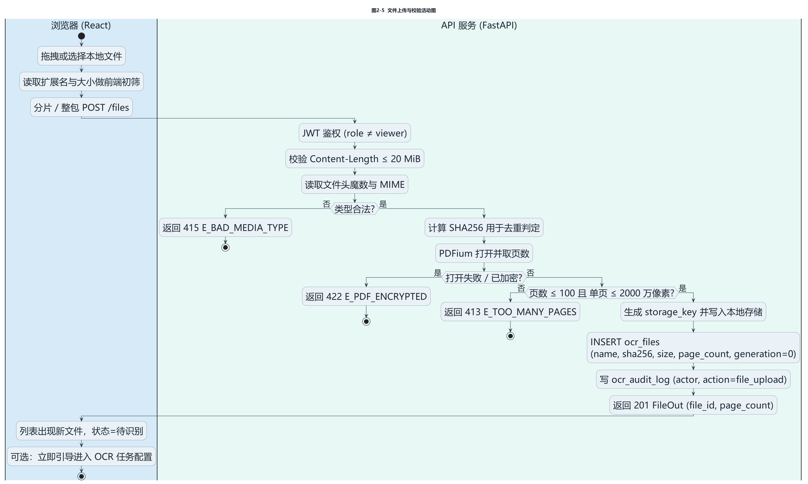{width="5.771527777777778in"
height="3.459722222222222in"}

**图 2-5 文件上传与校验活动图（带泳道）**

图 2-5
的三重校验顺序不可颠倒：先查扩展名（可伪造，仅用于快速拒绝），再查 MIME
与文件头魔数，最后尝试解析内容。只做扩展名校验会导致伪装文件入库。

三个异常出口分别对应不同错误码：415 类型不合法、422
内容不可解析或页数超限、413 大小超限，前端据此给出不同的可执行提示。

文件写入存储与元数据写入数据库必须在同一事务内完成，否则会出现磁盘存在文件而库中无记录（或反之）的不一致。

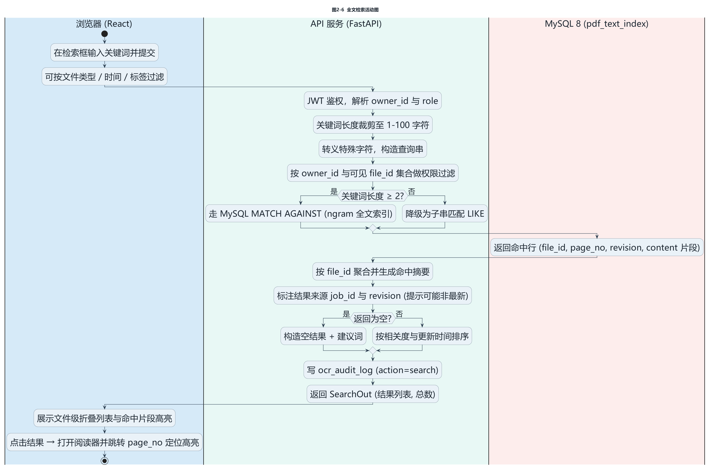{width="5.771527777777778in"
height="3.8027777777777776in"}

**图 2-6 全文检索活动图（带泳道）**

图 2-6 的关键顺序是"权限过滤 →
文本匹配"，若颠倒则会产生越权信息泄露：先匹配可将他人文件纳入候选，再过滤只是不在前端展示。

关键词长度判断决定走哪条通路：≥ 2 个字符使用 MySQL 的 MATCH AGAINST
全文匹配，单字符则降级为子串匹配，并在响应中标注降级标志。

结果须标注来源任务标识与修订号，因为文件可能被多次重新识别，展示时必须能区分文本来自哪一版。

图 2-7a 与图 2-7b 为状态图，分别描述 OCR
任务与页面（含全文索引同步）的状态迁移。任务状态取值与 2.13.3 状态枚举定义一致。

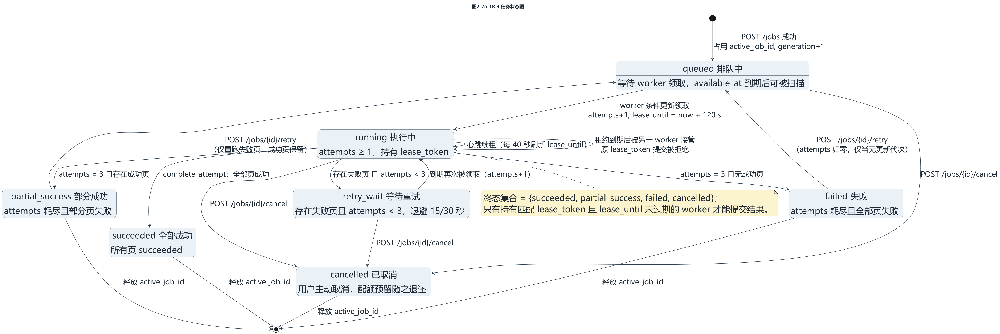{width="9.196527777777778in"
height="3.0722222222222224in"}

**图 2-7a OCR 任务状态图**

图 2-7a 有 7 个状态，其中 succeeded、partial_success、failed、cancelled
为终态；进入终态时文件上的活动任务占用被释放，文件才能再次提交任务。

两条迁入"执行中 running"的迁移含义不同：来自"排队中
queued"的是首次领取或用户手动重试，来自"等待重试
retry_wait"的是自动退避后的重新领取。

两条自反迁移体现租约机制：一是 Worker 每 40 s
的续租心跳；二是租约到期后被另一 Worker
接管（原持有者此后的提交会因令牌不匹配被拒绝）。

手动重试的必要条件是代次未变：若期间已有更新的代次任务存在，旧任务的重试请求必须被拒绝，否则旧结果会覆盖新结果。

等待重试的可用时间为当前时间加 15×2\^(attempts-1) 秒，即 15 s 与 30 s
两级退避；尝试次数上限 3，超过后不再进入等待重试而是直接进入终态。

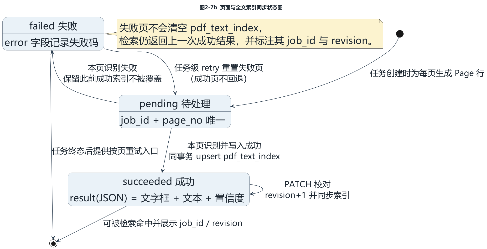{width="5.771527777777778in" height="2.95625in"}

**图 2-7b 页面与全文索引同步状态图**

图 2-7b
描述单页结果的三个状态。注意失败并不清除已有的全文索引：这样即使本次识别失败，检索仍可返回上一次成功的结果，可用性优先于一致性。

整册重试只把失败页重置为待处理，已成功页不回退；这保证重试不会让已经完好的页面重新排队。

校对保存会使修订号递增并同步更新索引内容，因此索引中始终携带修订号，供检索结果标注使用。

### **2.12.3 交互建模**

图 2-8a 与图 2-8b 为 OCR 全链路顺序图，因篇幅拆为"上传与建任务""Worker
执行与回写"两张，消息编号在两图之间连续；图 2-9、图 2-10
分别描述校对并发冲突与分享链接访问。

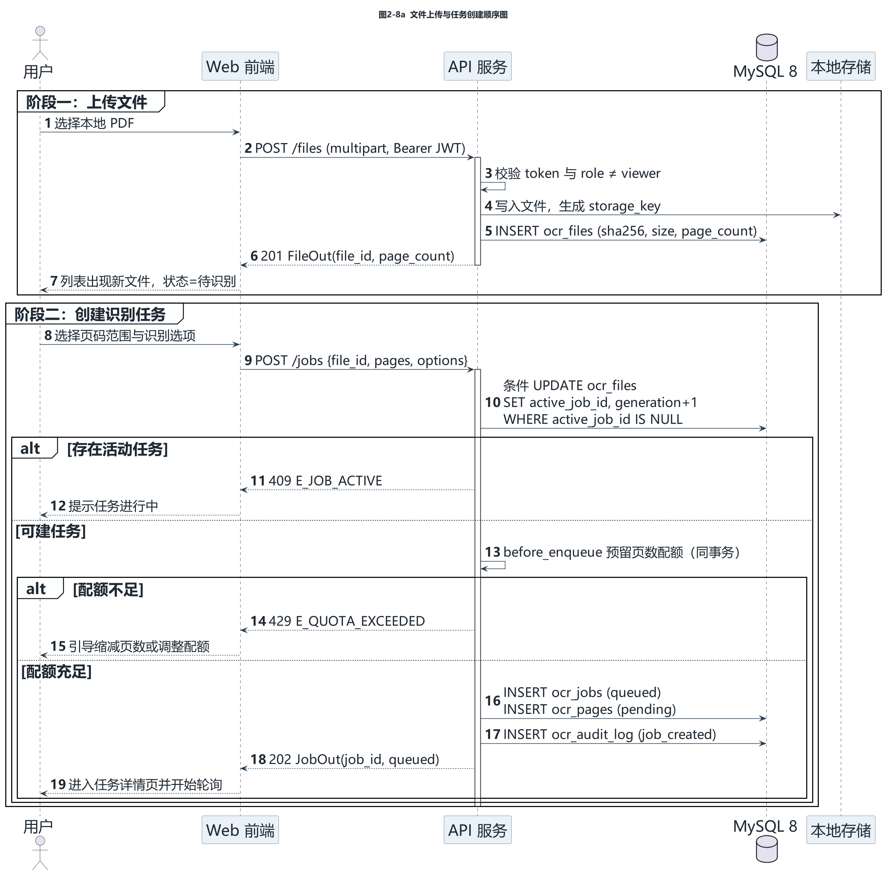{width="5.185416666666667in"
height="5.118055555555555in"}

**图 2-8a 文件上传与任务创建顺序图**

图 2-8a 中第 7
步的条件更新是并发安全的核心：更新语句要求活动任务字段为空才成功，从而保证同一文件不会被创建两个活动任务。

配额预留必须发生在创建任务与页记录之前，且在同一个事务内；否则会出现任务已创建但配额未扣、或配额已扣但任务未创建的偏差。

返回 202 Accepted
表示请求已被接受但尚未完成，前端随即进入轮询；这是异步处理与同步处理的分界。

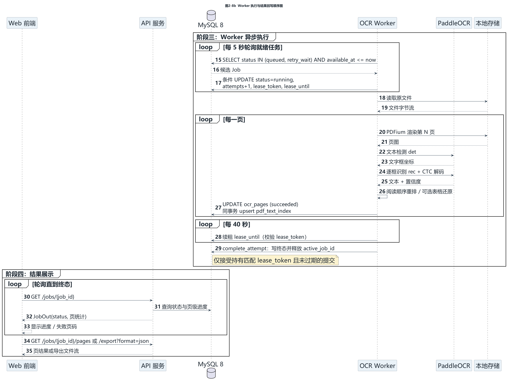{width="5.771527777777778in"
height="4.345833333333333in"}

**图 2-8b Worker 执行与结果回写顺序图**

图 2-8b 的三个 loop 片段分别表达：每 5 s 扫描就绪任务、逐页循环处理、每
40 s 续租。轮询周期 5 s 与续租周期 40 s 的取值依据是租约时长 120
s，保证在单次租约内至少完成 3 次续租。

\"页面结果写入\"与\"全文索引写入\"在同一事务内完成，这是 2.5.2
节业务规则在图上的直接体现。

提交结果时必须校验租约令牌与租约到期时间，二者任一不符即返回
E_LEASE_LOST，防止过期 Worker 覆盖新持有者的结果。

前端轮询到终态后即可进入校对或导出，说明轮询终止条件明确为收到终态状态，而非固定次数。

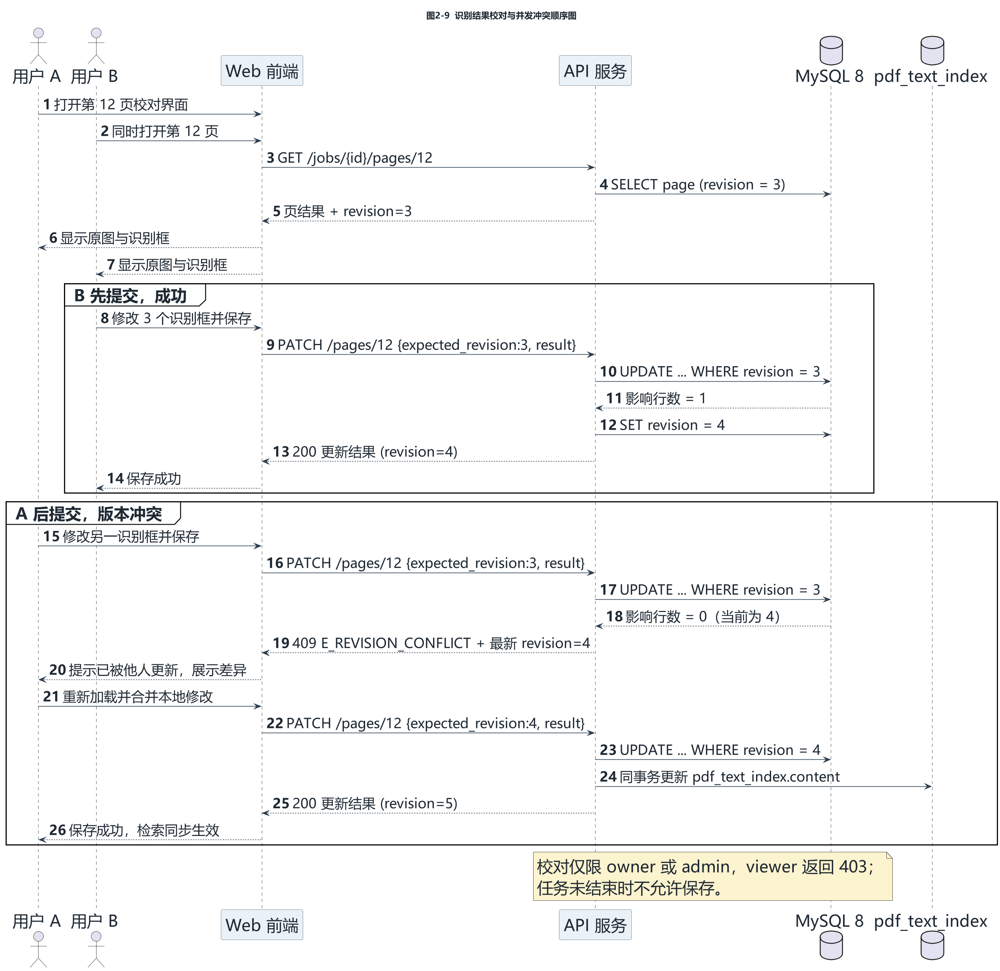{width="5.26875in" height="5.118055555555555in"}

**图 2-9 识别结果校对与并发冲突顺序图**

图 2-9 用乐观锁解决并发：用户 B 先提交成功使修订号由 3 变 4；用户 A
携带期望修订号 3 提交时更新影响行数为 0，据此判定冲突并返回 409。

409
响应必须回传服务端最新修订号，否则前端无法在不重新加载整页的情况下完成合并后重试。

校对保存成功后必须同步更新全文索引，否则会出现"页面上已改、检索仍命中旧文本"的不一致。

该图同时说明为何不采用悲观锁：校对是低频、短时操作，加锁成本高于冲突重试成本，且会阻塞只读访问。

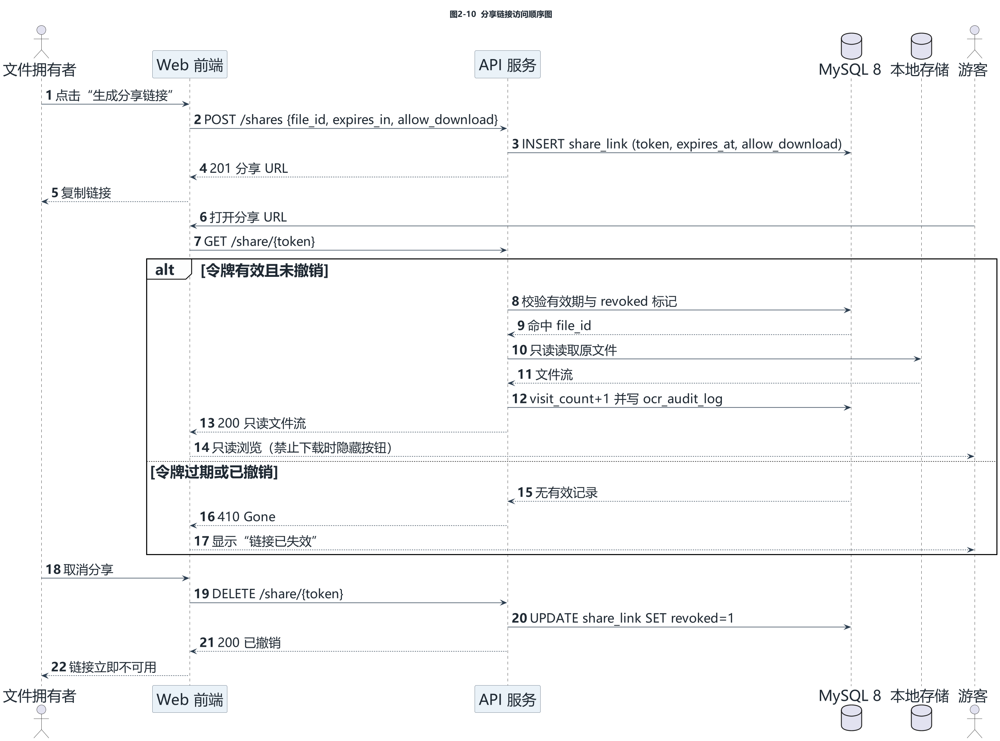{width="5.771527777777778in"
height="4.279166666666667in"}

**图 2-10 分享链接访问顺序图**

图 2-10 的 alt 分支区分令牌有效与失效两种情况：失效时统一返回 410
Gone，不区分"过期"与"已撤销"，避免泄露操作信息。

游客全程无需登录，其权限由链接自身携带（是否允许下载），因此分享链接是唯一的凭证，必须支持随时撤销。

撤销采用标记方式而非删除记录，目的是保留访问审计线索；这与 2.10.2
节规则一致。

> **说明**：结构层面的建模（领域类图 2 张、系统部署图 1 张）属于设计阶段的产物，
> 已按评审意见从本文档迁出，详见《系统设计文档》（`docs/design/系统设计文档_V2.0.md`）。

## **2.13 数据需求**

### **2.13.1 数据实体总览**

本节从需求层面给出系统需要持久化的数据实体及其业务含义。字段级定义（数据字典）、JSON
字段结构定义与校验规则、完整性约束与索引策略、主键与存储约定等属于设计内容，
已按评审意见迁至《系统设计文档》（`docs/design/系统设计文档_V2.0.md`），具体位置见表 2-4。

**表 2-3 数据实体总览（需求层面）**

| 数据实体 | 需求编号 | 业务含义 | 关键业务约束（对应功能需求） |
|---|---|---|---|
| 用户账号 | DR-USER-01 | 登录主体与资源归属者 | 用户名 4～32 字符全库唯一；密码加盐哈希；连续 5 次失败锁定 10 分钟（FR-USER 系列） |
| 角色 | DR-ROLE-01 | user / viewer / admin 三种权限形态 | viewer 被拒绝一切写操作；一个用户对应一个角色（FR-USER-06、表 1-4） |
| 分类与标签 | DR-CAT-01 / DR-TAG-01 | 文件的目录树组织与多对多标记 | 分类层级 ≤ 5 且不成环；标签名全库唯一；同一文件不得重复打标（FR-FILE-05/06） |
| 文件 | DR-FILE-01 | 待归档 PDF / 图片及其元数据 | 单文件 ≤ 20 MiB、≤ 100 页；软删除保留 30 天；携带代次号（FR-FILE 系列） |
| 识别任务 | DR-JOB-01 | 一次 OCR 识别的异步工作单元 | 同一文件至多一个活动任务；最多尝试 3 次；携带代次与租约（FR-OCR 系列） |
| 页识别结果 | DR-PAGE-01 | 任务内逐页的文本、坐标与状态 | 任务与页号唯一；携带修订号用于校对并发控制（FR-OCR-08、FR-COR-04） |
| 全文索引 | DR-INDEX-01 | 供检索的页级文本 | 一页一条；随校对同步更新并携带修订号（FR-SEA 系列） |
| 分享链接 | DR-SHARE-01 | 面向游客的只读访问凭证 | 64 位随机令牌；可设有效期与是否允许下载；可撤销（FR-SHR 系列） |
| 审计日志 | DR-AUDIT-01 | 操作留痕与追溯依据 | 只追加不可修改；保留 180 天；不记录正文与令牌（FR-LOG-04/06） |
| 配额账 | DR-QUOTA-01 | 按用户按月的存储与页数配额 | 预留—结算—退还三段式记账；预留量非负（FR-LOG-01～03） |

**表 2-4 设计内容对应索引（PPT 要求项 → 配套交付物）**

| 模板要求项 | 归属文档 | 位置 |
|---|---|---|
| 数据字典八列（字段 / 类型 / 可空 / 默认 / 键与索引 / 约束与取值域 / 说明） | 《系统设计文档》 | 4.1.3 数据字典 |
| JSON 字段结构定义与校验规则 | 《系统设计文档》 | 4.1.3 |
| 完整性约束与索引策略 | 《系统设计文档》 | 4.1.3 / 4.4 |
| 领域类图（2 张） | 《系统设计文档》 | 图 3-15 / 图 3-16 |
| 系统部署图（1 张） | 《系统设计文档》 | 图 3-3 |
| 界面原型（15 个界面、20 张截图） | 《界面原型设计》 | 全文 |
| REST 接口完整契约 | OpenAPI 契约 / 《系统设计文档》 | `docs/api-contract.yaml` / 5.5 |

上述内容按评审意见从本文档迁出，但作为同一课程设计的配套交付物一并提交，因此 PPT
要求的「数据库属性定义及限制条件」「类图」「部署图」在交付物集合中均有落实，本文档
只保留需求层面的数据实体、E-R 模型、状态枚举、容量估算与保留策略。

### **2.13.2 E-R 模型**

图 2-13a、图 2-13b、图 2-13c
分域给出实体联系模型。分域的原因是单张全图元素过多将导致不可读；三张图之间通过
ocr_files 与 sys_user 两个实体的节选表示建立关联。

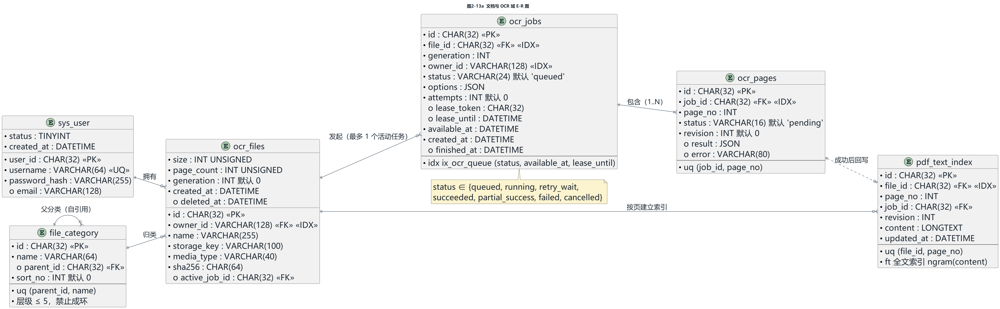{width="9.196527777777778in"
height="2.845138888888889in"}

**图 2-13a 文档与 OCR 域 E-R 图**

图 2-13a
的三处关键联系：用户与文件为一对多且文件必须归属某一用户；文件与任务为一对多但受"最多一个活动任务"的业务约束；文件与文本索引为按页的一对多，且
(file_id, page_no) 唯一。

任务与页之间为一对多，页记录 (job_id, page_no)
唯一，这保证了同一任务内不会出现重复页，也支撑了按页重试。

页到文本索引的联系为"成功后回写"：这是可用性优先的业务取舍，失败页不会清空已有索引。

分类实体通过父节点自引用实现层级，约束为层级 ≤ 5
且禁止成环，由应用层在移动分类时校验。

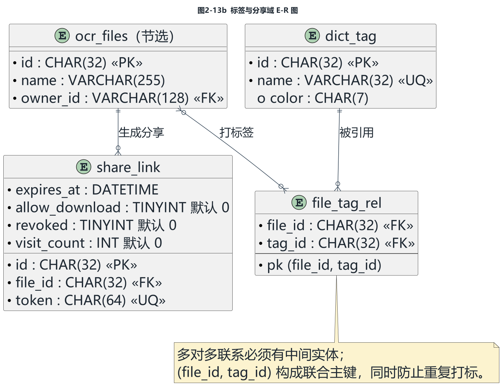{width="5.771527777777778in"
height="4.445833333333334in"}

**图 2-13b 标签与分享域 E-R 图**

图 2-13b 中文件与标签为多对多联系，必须通过关联实体 file_tag_rel
实现，其联合主键 (file_id, tag_id) 同时防止重复打标。

文件与分享链接为一对多，一个文件可同时存在多个有效链接，撤销只影响其中一条。

标签名全库唯一，因此打标时只需按名称查找，不必按用户隔离；标签与文件的关联则受文件归属保护。

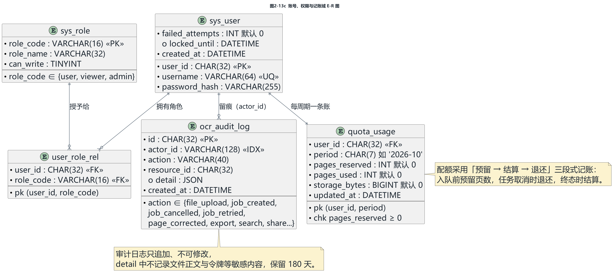{width="5.771527777777778in"
height="2.567361111111111in"}

**图 2-13c 账号、权限与记账域 E-R 图**

图 2-13c 以角色实体与授权关联表达权限模型，刻画"一个账号对应一种角色"的约束，
并为后续扩展多角色留出余地；当前实现将其简化为用户表中的单个角色列（见附录 E）。

用户与配额账为按周期的一对一：每个用户每个周期（格式
YYYY-MM）至多一条记录，便于按月重置。

用户与审计日志为一对多，日志只追加；actor_id 建立索引以支持按人查询。

角色实体的取值域被严格限定为 user / viewer / admin
三个值，由应用层枚举保证。

> **说明**：字段级的数据字典、JSON 字段结构定义与校验规则、完整性约束与索引策略属于设计阶段的内容，
> 已按评审意见从本文档迁出，详见《系统设计文档》（`docs/design/系统设计文档_V2.0.md`）。
> 本节以下仅保留需求层面的数据要求：数据实体总览、E-R 模型、状态枚举、数据量估算与保留策略。

### **2.13.3 状态枚举定义**

**表 2-5 状态枚举定义**

  ----------------- ----------------- ---------------------- -----------------------------------------------------------
      **归属**      **取值**          **含义**               **可迁移到的状态**

        任务        queued            排队中，等待 Worker    running、cancelled
                                      领取                   

        任务        running           执行中，持有租约       succeeded、partial_success、failed、retry_wait、cancelled

        任务        retry_wait        等待重试，退避计时中   running、cancelled

        任务        succeeded         全部页成功（终态）     ---

        任务        partial_success   部分页失败（终态）     ---（可经重试回到 queued）

        任务        failed            全部页失败（终态）     ---（可经重试回到 queued）

        任务        cancelled         已取消（终态）         ---

        页面        pending           待处理                 succeeded、failed

        页面        succeeded         本页成功               succeeded（校对）

        页面        failed            本页失败               pending（重试）

        文件        待识别 / 识别中 / 文件生命周期状态       见图 2-2
                    已识别 / 部分成功                        
                    / 识别失败                               

        用户        active / disabled 账号状态               由管理员操作与登录失败策略驱动
                    / locked                                 

        角色        user / viewer /   角色代码               由管理员调整
                    admin                                    
  ----------------- ----------------- ---------------------- -----------------------------------------------------------

### **2.13.4 数据量估算与容量规划**

估算假设：存量 1000 个文件，平均 30 页，共约 3 万页；单页识别结果 JSON
约 4 KB、抽取文本约 2 KB、渲染页图约 150
KB。据此：元数据表（文件、任务、页）合计不足 100 MB；文本与索引表约 60
MB；文件本体与页图合计约 5 GB，是磁盘占用的主体。

容量结论与阈值：磁盘按 20 GB 预留可容纳约 4000 个文件；当磁盘使用率达到
80% 时向管理员告警，达到 90% 时拒绝新的上传请求并返回 507
E_NO_SPACE。页图缓存保留 7
天，过期由清理任务删除，删除前须确认无任务正在使用。

并发估算：Worker 并发数默认 3，单页 CPU 推理约 2～3
s，则理论吞吐约每分钟 60～90 页；按日均 200
页的使用强度，日累计占用机时约 5 分钟，资源余量充足。

### **2.13.5 数据保留、备份与清理**

**表 2-6 数据保留与清理策略**

  ----------------- ----------------- ------------------------ ----------------------------------
    **数据类别**    **保留期**        **清理方式**             **注意事项**

     回收站文件     30 天             每日定时任务物理删除     删除需同时清理磁盘文件与页图

    操作审计日志    180 天            按月分区删除过期数据     删除前导出归档，删除本身也要留痕

    终态任务记录    90 天             保留最近记录，历史归档   保留期间供统计与追溯使用

   失败任务中间态   7 天              清理未完成的中间结果     不得清理仍持有租约的任务

      页图缓存      7 天              按最后访问时间清理       正在使用的页图不得删除

     数据库备份     每日全量 + binlog 保留 7 天全量            RPO 24 h，RTO 2 h（单机现实取值）
  ----------------- ----------------- ------------------------ ----------------------------------

清理任务的安全约束：任何清理操作必须先排除仍持有有效租约的任务与仍被活动任务引用的文件；清理任务自身不可与识别任务争抢数据库连接，须在低峰时段执行并限制单次删除批量大小（默认
500 条一批）。

# **第 3 章 其他需求**

本章给出除功能以外的全部需求，编号采用
NFR-\<类别\>-\<序号\>。所有指标均为可验证的量化表述，并给出度量方法，避免出现"较快""较好"等无法验收的描述。

## **3.1 性能需求**

**表 3-1 性能指标**

  ----------------- ------------------ -------------------- ------------------------------
      **编号**      **指标项**         **目标值**           **度量方法**

     NFR-PERF-01    页面接口响应时间   P95 ≤ 300            接口埋点统计，1000
                                       ms（不含文件传输）   次请求的分位数

     NFR-PERF-02    100 页 PDF         ≤ 2 s                浏览器端计时，取 10 次均值
                    首屏渲染                                

     NFR-PERF-03    翻页响应           ≤ 300 ms             点击翻页到首帧绘制完成的耗时

     NFR-PERF-04    单页 OCR 处理时延  ≤ 3 s（CPU，A4，300  Worker 端逐页计时
                                       dpi）                

     NFR-PERF-05    全文检索响应       P95 ≤ 1 s（10        按 3 万页实测外推并复测
                                       万页规模）           

     NFR-PERF-06    并发上传           支持 10 路并发上传   并发脚本压测

     NFR-PERF-07    Worker 并发        默认 3               多进程启动与租约互斥验证
                                       个进程，可配置       

     NFR-PERF-08    内存峰值           ≤ 4 GB（含全部进程） 进程监控取样最大值

     NFR-PERF-09    任务排队等待       空闲时 ≤ 5 s 被领取  轮询周期 5 s 的上界

     NFR-PERF-10    导出 50 页结果     ≤ 5 s 返回首字节     流式响应计时
  ----------------- ------------------ -------------------- ------------------------------

测量口径：全部指标在 1.5 节规定的运行环境（4 核 CPU / 8 GB / 纯 CPU 推理）下采集；
P95 取不少于 1000 次请求的第 95 百分位；单页 OCR 时延取稳态逐页计时，不含模型加载与
进程初始化；检索指标以 3 万页样本实测并外推到 10 万页规模。测试数据来源为自建 200
页标注集（印刷体中文，含表格与图片混排）与程序生成的大文件样本；结果记入测试/验收报告，
不达标项按 3.9 风险表处理。上述指标均为验收目标，当前实测状态见附录 E。

## **3.2 可靠性与可用性**

- NFR-REL-01
  任务不丢：任务队列基于数据库表，领取与提交均为条件更新，保证同一任务不会被两个
  Worker 同时处理。

- NFR-REL-02 进程崩溃可接管：Worker 异常退出后其任务在租约 120 s
  后自动可被其他 Worker 接管。

- NFR-REL-03 断点续跑：识别结果按页落库，重新执行时已成功页不重复处理。

- NFR-REL-04
  失败可解释：所有失败均返回可解释错误码，前端给出原因与下一步建议。

- NFR-REL-05 可用性目标：单机场景下月度可用时间比例 ≥
  99%（允许维护窗口）。

- NFR-REL-06
  事务边界：页结果与索引写入同一事务；跨聚合操作（预留配额、创建任务、递增代次）同一事务。

- NFR-REL-07 备份恢复：RPO 24 h，RTO 2 h。

**表 3-2 主要错误码与前端文案**

  --------------------- ----------------- ---------------------- ----------------------------
       **错误码**       **HTTP 状态**     **触发条件**           **前端文案要点**

   E_UPLOAD_TOO_LARGE   413               文件超过 20 MiB        说明上限并建议拆分或压缩

    E_TOO_MANY_PAGES    422               页数超过 100           说明上限并建议分批识别

      E_PDF_INVALID     422               文件损坏或无法解析     建议重新导出源 PDF

     E_PDF_ENCRYPTED    422               文件已加密             提示先解除加密后再上传

      E_JOB_ACTIVE      409               文件已有活动任务       提供查看该任务的入口

    E_QUOTA_EXCEEDED    429               页数或存储配额不足     说明剩余量与重置时间

      E_LEASE_LOST      409               租约过期或令牌不匹配   说明任务已被其他进程接管

   E_REVISION_CONFLICT  409               校对时修订号不一致     提示已被他人更新并展示差异

     E_SHARE_EXPIRED    410               分享链接过期或被撤销   提示联系分享者重新生成

       E_NO_SPACE       507               磁盘空间不足           提示管理员清理回收站
  --------------------- ----------------- ---------------------- ----------------------------

## **3.3 安全性需求**

- NFR-SEC-01 认证：JWT（HS256），含签发者、受众与过期时间；密钥长度 ≥ 32
  字符且仅来自环境变量。

- NFR-SEC-02 授权：角色校验与资源归属校验双重拦截；viewer
  拒绝一切写操作。

- NFR-SEC-03 越权响应：访问他人资源返回 404，不泄露资源是否存在。

- NFR-SEC-04
  密码存储：加盐哈希，禁止明文与可逆加密；修改密码后原有刷新令牌全部失效。

- NFR-SEC-05
  输入安全：上传三重校验、文件名净化、路径穿越防护、XML/压缩包炸弹防护。

- NFR-SEC-06 输出安全：HTML 与 XLSX 导出必须转义并防公式注入。

- NFR-SEC-07
  数据安全：文件与识别结果不得离开本机，禁止任何云端识别通道。

- NFR-SEC-08 日志脱敏：审计日志不记录文件正文、密码与令牌。

- NFR-SEC-09 审计：所有写操作留痕，日志只追加不可修改。

- NFR-SEC-10
  分享安全：链接可撤销、可设有效期、可禁止下载，撤销后立即失效。

## **3.4 易用性需求**

- NFR-USE-01 交互一致性：同一操作在相同位置出现，操作反馈形式统一；以 15 个界面逐一核对，同类操作的位置与反馈形式一致率 100%。

- NFR-USE-02 关键操作二次确认：删除、整册重试、撤销分享须确认；未确认时不得产生写请求，以自动化用例验证。

- NFR-USE-03 进度可见：上传、识别、导出均显示进度与结果汇总。

- NFR-USE-04 错误提示可执行：同时给出原因与下一步操作建议。

- NFR-USE-05 中文字体与排版：界面字体统一，表格与文本不出现截断与乱码。

- NFR-USE-06 快捷键：翻页、搜索、Esc 取消等常用操作支持键盘。

- NFR-USE-07 空态与骨架屏：列表为空与加载中均有明确呈现。

- NFR-USE-08 无障碍基础：对比度达标、焦点可见、图片含替代文本。

- 验收判据：5 名首次使用者中不少于 4 人可在 3 分钟内无指导完成一次校对保存。

## **3.5 可维护性与可扩展性**

- NFR-MNT-01 模块边界：OCR 作为独立可安装模块，通过 install(app,
  settings) 挂载，可与主系统分离部署。

- NFR-MNT-02
  配置化：数据库地址、存储路径、模型路径、各项限额均通过环境变量配置。

- NFR-MNT-03 可替换点：识别引擎、队列实现、存储后端各留一层适配接口。

- NFR-MNT-04 接口文档：REST 接口与 OpenAPI 文档同步产出，作为附录 B
  的来源。

- NFR-MNT-05 日志可诊断：Worker
  输出结构化日志，包含任务标识与页号，便于定位。

- NFR-MNT-06 可测试性：核心逻辑（表格判定、坐标归一化、代次比较）可脱离
  Web 环境单测。

## **3.6 兼容性需求**

- NFR-CMP-01 浏览器：Chrome / Edge 100 及以上为完全支持；Firefox ESR
  保证只读可用。

- NFR-CMP-02 操作系统：服务端支持 Windows 10/11 与 Ubuntu 22.04 及以上。

- NFR-CMP-03 数据库：生产使用 MySQL 8.0+；开发期可用
  SQLite，但全文检索能力以 MySQL 为准。

- NFR-CMP-04 文件格式：PDF 全版本读取；图片支持 PNG / JPG / BMP / TIFF。

- NFR-CMP-05 编码：全链路 UTF-8，繁体与生僻字不出现乱码。

## **3.7 合规与法律需求**

- NFR-LEG-01 著作权提示：上传他人作品须提示用户自负版权责任。

- NFR-LEG-02
  个人信息最小化：仅采集用户名、密码哈希与可选邮箱，不采集与业务无关信息。

- NFR-LEG-03 第三方许可：组件须为 Apache-2.0 / MIT /
  BSD，并在第三方声明与致谢页列出。

- NFR-LEG-04 数据不出域：满足涉密与个人材料本地处理要求。

- NFR-LEG-05 可解释性：识别错误与拒绝原因必须对用户可见，不得静默失败。

## **3.8 质量属性场景**

**表 3-3 质量属性场景**

  ----------------- ------------------------ ----------------- --------------------------------
      **属性**      **刺激源 → 刺激**        **制品 → 环境**   **响应 → 响应度量**

        性能        用户在 10                检索服务 →        1 s 内返回结果并按文件聚合 → P95
                    万页库中输入关键词       正常运行          ≤ 1 s

       可用性       Worker                   任务队列 → 单     租约到期后其他 Worker 接管 →
                    进程在执行中被强制结束   Worker 崩溃       任务不丢失、不重复处理已成功页

       安全性       viewer 账号调用校对接口  鉴权层 → 正常运行 拒绝请求并记录越权审计 → 返回
                                                               403 且有日志

      可修改性      需要替换识别引擎         推理适配层 →      仅替换适配实现，不改业务代码 →
                                             停机维护窗口      改动集中在 1 个模块

       易用性       首次使用者校对识别错字   校对台 → 正常运行 可直接点击识别框改字并保存 →
                                                               无需培训即可完成

      可测试性      需要验证表格判定逻辑     表格还原模块 →    脱离 Web 直接调用判定函数 →
                                             开发环境          可自动化断言
  ----------------- ------------------------ ----------------- --------------------------------

## **3.9 假设、依赖与风险**

假设：单机部署、用户量 \< 30、无
GPU、管理员可信、文件以印刷体中文为主。依赖：PaddleOCR
模型权重可获取、MySQL 8 的 ngram 解析器可用、pdf.js 版本兼容。

**表 3-4 风险登记表**

  ------------------------------ ----------------- ----------------- --------------------------------------------------
             **风险**            **概率**          **影响**          **应对措施**

    CPU 推理速度不及预期，100    中                高                限制并发与页数上限，按页展示进度，允许分册提交
            页耗时过长                                               

   表格还原在复杂版式下不达预期  中                中                仅支持完整线框，其他降级为文本并显式标注"未还原"

           MySQL ngram           低                中                限制单页索引文本长度，按文件分区维护索引
    索引在小内存机器上占用偏高                                       

     识别准确率低于 90% 目标     中                高                提供校对台人工兜底，低分辨率扫描件提前提示风险

    多人同时校对同一页引发冲突   中                低                乐观锁 + 409 冲突提示 + 前端合并引导

   模型权重体积过大导致分发困难  低                中                随安装包分发并校验 SHA256，不运行时下载
  ------------------------------ ----------------- ----------------- --------------------------------------------------

## **3.10 验收标准与需求追踪**

验收方式：①按 7
个演示场景现场演示（上传识别、校对、表格还原、导出、检索定位、分享访问、管理统计）；
②按 2.2～2.11 各节验收标准逐项核对，结果记入测试报告；③性能实测报告满足表 3-1
各项指标，未达标项按 3.9 风险表处理。实现状态与偏差见附录 E。

**表 3-5 需求追踪矩阵（需求编号 → 用例 → 设计章节 → 测试用例 → 验收结论）**

| 需求编号 | 对应用例 | 设计文档章节 | 测试用例（规划） | 验收结论 |
|---|---|---|---|---|
| FR-USER-01～07 | UC01 / UC17 | 3.2 / 5.5 | TC-USER-01～07 | 见附录 E |
| FR-FILE-01～11 | UC02 / UC03 / UC04 / UC20 | 3.2 / 5.5 | TC-FILE-01～11 | 见附录 E |
| FR-READ-01～09 | UC05 / UC06 | 3.2 / 5.3 | TC-READ-01～09 | 见附录 E |
| FR-OCR-01～12 | UC07 / UC08 / UC09 | 3.2 / 5.5 | TC-OCR-01～12 | 见附录 E |
| FR-COR-01～06 | UC10 | 3.2 / 5.5 | TC-COR-01～06 | 见附录 E |
| FR-TBL-01～04 | UC11 | 3.2 / 5.5 | TC-TBL-01～04 | 见附录 E |
| FR-EXP-01～06 | UC12 / UC21 | 3.2 / 5.5 | TC-EXP-01～06 | 见附录 E |
| FR-SEA-01～07 | UC13 / UC22 | 3.2 / 4.1.3 | TC-SEA-01～07 | 见附录 E |
| FR-SHR-01～04 | UC14 / UC15 | 3.2 / 5.5 | TC-SHR-01～04 | 见附录 E |
| FR-LOG-01～06 | UC16 / UC18 / UC19 | 3.2 / 4.1.3 | TC-LOG-01～06 | 见附录 E |
| NFR-PERF-01～10 | --- | 6.4 | TC-PERF-01～10 | 见附录 E |
| NFR-REL-01～07 | --- | 6.2 / 6.4 | TC-REL-01～07 | 见附录 E |
| NFR-SEC-01～10 | --- | 6.3 | TC-SEC-01～10 | 见附录 E |
| NFR-USE-01～08 | --- | 5.4 | TC-USE-01～08 | 见附录 E |
| NFR-MNT-01～06 | --- | 6.5 | TC-MNT-01～06 | 见附录 E |
| NFR-CMP-01～05 | --- | 2.2 / 2.3 | TC-CMP-01～05 | 见附录 E |
| NFR-LEG-01～05 | --- | 6.3 | TC-LEG-01～05 | 见附录 E |
| DR-USER-01～DR-QUOTA-01（11 项） | --- | 4.1.3 | TC-DB-01～08 | 见附录 E |
| 2.13 数据需求（总体） | --- | 4.1 | TC-DB-01～08 | 见附录 E |

说明：设计文档章节列指《系统设计文档》（`docs/design/系统设计文档_V2.0.md`）的对应章节；
测试用例编号为规划值，实际用例与结论随测试报告出具。全部 72 条 FR、51 条 NFR 与
数据需求均已纳入追踪，验收结论当前口径见附录 E。

# **附录**

## **附录 A 功能需求清单汇总**

**表 A-1 功能需求清单（按模块汇总）**

| 编号区间 | 模块 | 条目数 | 优先级 | 版本 | 实现状态 |
|---|---|---|---|---|---|
| FR-USER-01～07 | 用户与权限 | 7 | Must | V1.0 | 见附录 E |
| FR-FILE-01～11 | 文件管理 | 11 | Must | V1.0 | 见附录 E |
| FR-READ-01～09 | 在线阅读器 | 9 | Must | V1.0 | 见附录 E |
| FR-OCR-01～12 | OCR 识别 | 12 | Must | V1.0 | 见附录 E |
| FR-COR-01～06 | 结果校对 | 6 | Must | V1.0 | 见附录 E |
| FR-TBL-01～04 | 表格还原 | 4 | Should | V1.0 | 见附录 E |
| FR-EXP-01～06 | 结果导出 | 6 | Must | V1.0 | 见附录 E |
| FR-SEA-01～07 | 全文检索 | 7 | Must | V1.0 | 见附录 E |
| FR-SHR-01～04 | 分享与协作 | 4 | Should | V1.0 | 见附录 E |
| FR-LOG-01～06 | 配额日志统计 | 6 | Should | V1.0 | 见附录 E |

版本说明：需求条目自 V1.0 起稳定，V1.1（含 2026-11-12 校订）只调整结构、引用与
实现状态说明，未改变需求条文本身，故版本列统一记为 V1.0。

**表 A-2 功能需求逐条索引（共 72 条，与 2.2～2.11 正文一一对应）**

| 编号区间 | 条目摘要（按编号顺序） |
|---|---|
| FR-USER-01～07 | 注册、登录、令牌刷新、登出、修改密码、角色分配、账号禁用 |
| FR-FILE-01～11 | 上传、列表、重命名、软删除与回收站、分类、标签、批量操作、合并、拆分、版本与代次、文件信息 |
| FR-READ-01～09 | 双阅读模式、缩放、翻页与缩略图、大纲跳转、页内搜索、书签与位置记忆、批注、OCR 文本层、双视图 |
| FR-OCR-01～12 | 图片识别、整册/指定页、识别选项、异步任务、取消、重试、能力探测、页结果落库、代次隔离、失败可见、并发控制、低分辨率提示 |
| FR-COR-01～06 | 图文对照逐框改字、合并拆分行、调整顺序、期望修订号保存、撤销、索引同步 |
| FR-TBL-01～04 | 线框表格识别、单元格归属、结构数据输出、前端预览修正 |
| FR-EXP-01～06 | TXT、JSON、CSV、HTML、XLSX、页范围与坐标开关 |
| FR-SEA-01～07 | 关键词检索、按文件聚合、高亮跳页、过滤、检索历史、来源与修订号、权限过滤 |
| FR-SHR-01～04 | 生成链接、取消、访问统计、游客只读 |
| FR-LOG-01～06 | 存储配额、月页数配额、超额拦截、操作日志、统计看板、日志查询 |

## **附录 B 接口清单**

### 接口需求（需求层面）

系统应以版本化 REST API 对外提供全部业务能力：接口统一采用 HTTP/JSON，路径前缀
`/api/v1`；需登录的接口携带访问令牌，游客仅可凭分享令牌只读访问；写操作须具备
幂等或冲突检测语义（如校对携带 `expected_revision`）；错误响应须给出可读原因与
可执行的下一步建议；导出与原文读取须支持流式/分段传输。健康检查 `GET /health`
不带版本前缀。接口请求/响应结构、状态码与错误语义以 `docs/api-contract.yaml`
（OpenAPI 3.0）与《系统设计文档》5.5 为准，不在需求基线中重复定义。

下列表 B-1 摘录主要接口（按代码真实路径列示）；完整契约按「去重别名的 path+method」
计共 59 个逻辑接口（代码注册 64 个 operation，含别名与隐藏路由）。

**表 B-1 主要 REST 接口清单**

| 方法 | 路径 | 鉴权 | 要点 |
|---|---|---|---|
| GET | `/health` | 匿名 | 健康检查（根路径，无版本前缀） |
| POST | `/api/v1/auth/register` | 匿名 | 注册并签发令牌（201） |
| POST | `/api/v1/auth/login` | 匿名 | 登录签发访问/刷新令牌 |
| GET | `/api/v1/auth/me` | 用户 | 当前账号信息 |
| POST | `/api/v1/auth/refresh` | 刷新令牌 | 轮换式刷新 |
| POST | `/api/v1/auth/logout` | 用户 | 吊销刷新令牌（204） |
| POST | `/api/v1/auth/change-password` | 用户 | 改密并使旧令牌失效 |
| PATCH | `/api/v1/auth/users/{user_id}/role` | admin | 角色调整 |
| PATCH | `/api/v1/auth/users/{user_id}/disabled` | admin | 账号禁用/启用 |
| POST | `/api/v1/files` | 用户 | 上传并校验（201） |
| GET | `/api/v1/files` | 用户 | 分页列表、排序与筛选 |
| GET | `/api/v1/files/folders`、`/tags` | 用户 | 目录树与标签清单 |
| GET | `/api/v1/files/{file_id}` | 用户 | 文件详情 |
| GET | `/api/v1/files/{file_id}/content` | 用户 | 原文件流式读取（支持 Range） |
| GET | `/api/v1/files/{file_id}/pages` | 用户 | 页尺寸信息 |
| PATCH | `/api/v1/files/{file_id}` | 用户 | 重命名/移动/打标 |
| DELETE | `/api/v1/files/{file_id}` | 用户 | 软删除进入回收站 |
| POST | `/api/v1/files/{file_id}/restore` | 用户 | 还原 |
| DELETE | `/api/v1/files/{file_id}/purge` | 用户 | 彻底删除（204） |
| GET/POST/DELETE | `/api/v1/files/{file_id}/reader/bookmarks` | 用户 | 书签增删查 |
| GET/POST/DELETE | `/api/v1/files/{file_id}/reader/annotations` | 用户 | 批注增删查 |
| GET | `/api/v1/search`、`/search/suggest` | 用户 | 全文检索（权限前置过滤）、检索建议 |
| POST | `/api/v1/share` | 用户 | 生成分享链接（201） |
| GET | `/api/v1/share` | 用户 | 分享列表 |
| GET | `/api/v1/share/{share_id}` | 用户 | 分享详情 |
| DELETE | `/api/v1/share/{share_id}` | 用户 | 撤销分享（204） |
| GET | `/api/v1/share/{share_id}/stats` | 用户 | 访问统计 |
| GET | `/api/v1/share/token/{token}` | 游客 | 凭令牌只读访问 |
| GET | `/api/v1/quota`、`/quota/overview` | 用户 | 配额使用与总览 |
| GET | `/api/v1/ocr-host/capabilities` | 用户 | 能力探测 |
| POST | `/api/v1/ocr-host/files/{file_id}/sync` | 用户 | OCR 镜像补救 |
| POST | `/api/v1/ocr/jobs` | 用户 | 创建识别任务（202） |
| GET | `/api/v1/ocr/jobs`、`/jobs/{job_id}` | 用户 | 任务列表与状态轮询 |
| POST | `/api/v1/ocr/jobs/{job_id}/cancel` | 用户 | 取消并退还配额 |
| POST | `/api/v1/ocr/jobs/{job_id}/retry` | 用户 | 重试失败页（202） |
| GET | `/api/v1/ocr/jobs/{job_id}/pages/{page_no}` | 用户 | 单页结果（含坐标与置信度） |
| GET | `/api/v1/ocr/jobs/{job_id}/pages/{page_no}/image` | 用户 | 页图 |
| PATCH | `/api/v1/ocr/jobs/{job_id}/pages/{page_no}` | 用户 | 校对保存（期望修订号，冲突 409） |
| GET | `/api/v1/ocr/jobs/{job_id}/export` | 用户 | TXT/JSON/CSV/HTML/XLSX 流式导出 |
| GET | `/api/v1/ocr/search`、`/capabilities`、`/usage` | 用户 | OCR 侧检索、能力、用量 |

注：表中鉴权列「用户」表示已登录且角色非 viewer 时可写，「游客」表示凭分享令牌只读访问；
路径中的 `{file_id}`、`{job_id}` 等为路径参数。接口清单随代码版本同步，差异见附录 E。

## **附录 C 图表索引与建模源码**

**表 C-1 图表索引**

  ----------------- ------------------------------ ----------------- ------------------------
      **图号**      **名称**                       **类型**          **源码文件**

       图 1-1       系统上下文图                   上下文图          uml/fig1-overview.puml

       图 2-1       系统功能结构图                 结构图            uml/fig2-function.puml

       图 2-2       文件生命周期状态图             状态图            uml/fig2-function.puml

       图 2-3a      OCR 任务创建与入队活动图       活动图（泳道）    uml/fig2-function.puml

       图 2-3b      OCR 逐页识别与结果回写活动图   活动图（泳道）    uml/fig2-function.puml

       图 2-4       系统用例图                     用例图            uml/fig2-usecase.puml

       图 2-5       文件上传与校验活动图           活动图（泳道）    uml/fig2-usecase.puml

       图 2-6       全文检索活动图                 活动图（泳道）    uml/fig2-usecase.puml

       图 2-7a      OCR 任务状态图                 状态图            uml/fig2-state.puml

       图 2-7b      页面与全文索引同步状态图       状态图            uml/fig2-state.puml

       图 2-8a      文件上传与任务创建顺序图       顺序图            uml/fig2-sequence.puml

       图 2-8b      Worker 执行与结果回写顺序图    顺序图            uml/fig2-sequence.puml

       图 2-9       识别结果校对与并发冲突顺序图   顺序图            uml/fig2-sequence.puml

       图 2-10      分享链接访问顺序图             顺序图            uml/fig2-sequence.puml

      图 2-13a      文档与 OCR 域 E-R 图           E-R 图            uml/fig2-er.puml

      图 2-13b      标签与分享域 E-R 图            E-R 图            uml/fig2-er.puml

      图 2-13c      账号、权限与记账域 E-R 图      E-R 图            uml/fig2-er.puml
  ----------------- ------------------------------ ----------------- ------------------------

建模工具：PlantUML（文本化建模语言），源码位于仓库根 `uml/`，导出图位于 `docs/media/`，
随课程设计仓库一并提交，便于复现与修改；渲染依赖 Java 与 Graphviz，命令为
`java -jar plantuml.jar -tpng -Sdpi=150 -charset UTF-8 -DPLANTUML_LIMIT_SIZE=16384 uml/*.puml`。
表 C-1 所列 17 张图的源码与导出图均随本文档提交。原编号图 2-11（领域类图 2 张）与
图 2-12（系统部署图）已按评审意见迁至《系统设计文档》，对应图 3-15、图 3-16 与图 3-3，
本索引保留空位不再使用。

## **附录 D 需求变更记录**

**表 D-1 需求变更记录表（模板，随项目推进填写）**

当前无需求变更；需求与实现的偏差不构成需求变更，见附录 E。

  ----------- ----------- -------------- ------------ -------------- -----------
   **编号**   **日期**    **变更内容**   **提出人**   **影响分析**   **结论**

      ---     ---         ---            ---          ---            ---

      ---     ---         ---            ---          ---            ---

      ---     ---         ---            ---          ---            ---
  ----------- ----------- -------------- ------------ -------------- -----------

## **附录 E 需求—实现符合性说明**

本附录用于同时满足三项约束：①课程 PPT 模板要求的三段结构与建模、数据、接口、追踪要素；
②成熟 SRS 规范要求的「需求只描述应然、可验证、可追踪」；③与仓库当前实现的事实一致性。
**正文需求条文为验收目标（应然），不因当前实现状态而改写**；实现状态与偏差集中记录于此，
偏差不构成需求变更，需调整需求时按附录 D 流程办理。

本附录只记录需求层可观察的状态与偏差，不给出类、字段、索引、接口实现或算法等设计细节；
逐条证据可直接对照仓库内对应路由、数据表与测试用例。

**表 E-1 状态定义**

| 状态 | 含义 |
|---|---|
| 已实现 | 代码中存在对应路由 / 数据表 / 逻辑，且有测试或实测支撑 |
| 设计目标 | 已规定但尚未落地，或尚未实测，作为后续验收目标 |
| 未实现（待补） | 代码中无对应实现（多为 W7 待办） |
| 部分符合 | 需求部分成立，需按本表口径理解 |

**表 E-2 需求—实现偏差登记（2026-11-12）**

| 需求/章节 | 当前实现 | 状态 | 处置 |
|---|---|---|---|
| 1.5 / 1.6 N21 完全离线、权重随包分发 | 运行时无外网调用；模型权重未随源码交付，首次部署需下载并校验 SHA256，之后可完全离线 | 部分符合 | 按「部署后完全离线」理解，分发方案随交付包补充 |
| 1.5 / 3.6 生产数据库与中文全文检索 | 开发与实测均使用轻量数据库；生产数据库链路尚未跑通，中文检索当前为子串匹配，全文索引能力待验收 | 设计目标 | 生产链路修复与性能验收列为后续事项 |
| 2.2.2 密码含字母数字、连续 5 次失败锁定 | 仅校验密码最小长度 8 位；未实现复杂度校验、失败计数与锁定状态 | 未实现（待补） | 保留需求 |
| 2.3.2 上传三重校验 | 按文件魔数与内容解析判型；扩展名与 MIME 未做服务端校验 | 设计目标 | 保留需求 |
| 2.3 / 2.4 合并拆分、批量操作、缩略图、页内搜索、大纲、文本层、双视图 | 上述能力列为后续待补；书签与批注的服务端能力已具备，界面尚未接入 | 未实现（待补） | 原型已覆盖，前端后续补齐 |
| 2.6 校对合并/拆分行、调序、撤销 | 校对界面仅支持逐块改字 | 未实现（待补） | 保留需求 |
| 2.7 无线框表格降级并标注「未还原」 | 未检出线框时不产生表格结果，也未给出「未还原」标注 | 未实现（待补） | 保留需求 |
| 2.10.2 分享过期/撤销返回 410、令牌 64 位 | 链接失效统一返回 404；令牌为 32 位十六进制串 | 设计目标 | 保留需求，实现或变更走附录 D |
| 表 3-2 的机器可读错误码 | 错误响应仅含自然语言文案，无机器可读错误码 | 设计目标 | 前端暂按文案分支 |
| 3.1 表 3-1 性能指标、2.5.4 准确率 ≥90% | 无埋点、压测脚本与标注集；已有样例计时含模型加载，未形成准确率或性能基准 | 设计目标 | 补实测报告后再判定达标 |
| 2.11 / 2.13.5 存储配额、保留期、每日备份与 RPO/RTO | 无定时清理、无磁盘阈值判断、无备份脚本 | 未实现（待补） | 列为运维后续事项 |
| 3.10 自动化测试通过率 | 已有后端自动化测试，前端未实测，无整体验收报告 | 设计目标 | 结论以测试报告为准 |
| 队列/租约/CAS、乐观锁、代次、鉴权、越权 404、5 种导出、限额、任务与页面状态 | 与代码一致 | 已实现 | 保持 |
| 附录 B 接口路径 | 接口统一使用版本化前缀；按去重别名计 59 个逻辑接口 | 已实现 | 清单按真实路径列示，完整契约见 OpenAPI 契约文件 |

**表 E-3 与课程 PPT 模板、成熟 SRS 规范的对应**

| 要求来源 | 要求项 | 本文档落实位置 |
|---|---|---|
| 课程 PPT | 三段结构（概述 / 系统主要功能 / 其他需求），重点第 2 章 | 第 1～3 章；2.2～2.13 为主体 |
| 课程 PPT | 图后 3～6 行说明、图题在下、表题在上、全文统一编号 | 2.12 各图；表 0-1～表 E-3；图 1-1～图 2-13c |
| 课程 PPT | 用例/活动/状态/顺序/E-R 建模；类图、部署图、数据字典八列 | 正文 17 图 + 表 2-4 对应索引；类图/部署图/数据字典见《系统设计文档》图 3-15/3-16/3-3 与 4.1.3 |
| 课程 PPT | 附录 A 功能清单、B 接口清单、C 图表索引、D 变更记录 | 附录 A～D（另增附录 E） |
| 课程 PPT | 需求追踪矩阵（编号 → 用例 → 设计章节 → 测试用例 → 验收结论） | 表 3-5，覆盖全部 123 条需求，结论列以本附录为当前口径 |
| 课程 PPT | 与现有代码对齐（状态机、角色、限额、表名、字段名） | 附录 B 真实路径、2.13 数据实体、表 E-2 偏差登记 |
| IEEE 830 / ISO 29148 | 外部接口需求、假设依赖与风险、可验证需求、双向追踪 | 附录 B 接口需求、3.9、2.2～2.11 四段式验收、表 3-5 |
| ISO 29148 | 需求与实现分离（what, not how）、需求属性与状态 | 附录 E、附录 A（优先级/版本/状态） |
| GB/T 9385 | 需求规格说明的完整性、一致性、可追溯 | 表 2-4、表 3-5、附录 E |

说明：本附录依据仓库代码现状逐条整理；
MEET-01～MEET-03 会议记录、竞品试用记录与 200 页标注集为组内留存的过程材料，未随代码仓库提交。
