# 第 4 章 界面原型设计

## 4.1 原型概述

本章为需求文档第 2 章各项功能需求配套的高保真界面原型，用于直观呈现系统的交互形态、页面布局与关键状态，便于评审、开发与验收对齐。

- **覆盖范围**：用户与权限、文件管理、在线阅读、OCR 识别、结果校对、表格还原、结果导出、全文检索、分享与协作、配额与日志等全部功能模块，共 **15 个界面**（截图 20 张，其中上传、阅读器、识别任务、结果校对、表格还原 5 个界面含上、下两屏）。
- **原型形式**：单文件 HTML 原型，位于 `docs/prototype/index.html`，可直接用浏览器打开，无外部依赖、无需联网。顶部导航按"文档／识别／发现／系统／账户"分组，单击即切换对应界面。
- **标注约定**：每个界面对应第 2 章的功能点（FR 编号）与验收标准；状态标签、错误提示、空态／加载态均依据需求文档中的业务规则与异常边界实现。

## 4.2 界面清单与需求追溯

| 界面 | 对应需求 | 主要功能点 | 图号 |
|---|---|---|---|
| 登录与注册 | 2.2 | FR-USER-01～05 | 图 4-1 |
| 文件库 | 2.3 / 2.3.5 | FR-FILE-01～11 | 图 4-2 |
| 上传 | 2.3 / 2.5 | FR-FILE-01、FR-OCR-03/07 | 图 4-3、4-4 |
| 回收站 | 2.3 / 2.3.5 | FR-FILE-04 | 图 4-5 |
| PDF 阅读器 | 2.4 | FR-READ-01～09 | 图 4-6、4-7 |
| 识别任务 | 2.5 | FR-OCR-01～12 | 图 4-8、4-9 |
| 结果校对 | 2.6 | FR-COR-01～06 | 图 4-10、4-11 |
| 表格还原 | 2.7 | FR-TBL-01～04 | 图 4-12、4-13 |
| 结果导出 | 2.8 | FR-EXP-01～06 | 图 4-14 |
| 全文检索 | 2.9 | FR-SEA-01～07 | 图 4-15 |
| 用户与角色 | 2.2 | FR-USER-06/07 | 图 4-16 |
| 配额与统计 | 2.11 | FR-LOG-01/02/05 | 图 4-17 |
| 操作日志 | 2.11 | FR-LOG-03/04/06 | 图 4-18 |
| 分享与协作 | 2.10 | FR-SHR-01～04 | 图 4-19 |
| 游客只读访问 | 1.2.2 / 2.10 | 只读浏览约束 | 图 4-20 |

## 4.3 各界面原型

### 4.3.1 登录与注册（2.2）

登录与注册为无侧边栏的全屏界面。注册须满足用户名 4～32 字符、仅字母数字下划线且全库唯一；密码至少 8 位且含字母与数字。登录签发 JWT 访问令牌（2 小时）与刷新令牌（7 天、一次性轮换）；同一账号连续 5 次失败锁定 10 分钟。注册成功默认分配 user 角色。

### 4.3.2 文件库（2.3 / 2.3.5）

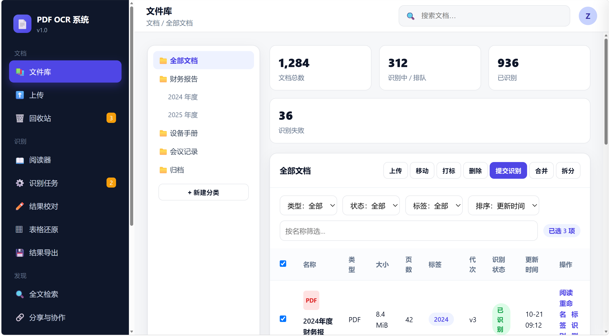

左侧为分类目录树（层级 ≤5），顶部支持按名称／时间／大小／状态排序，按类型／状态／标签筛选。列表含名称、类型、大小、页数、标签、代次、识别状态、更新时间与操作入口，满足 2.3.5 界面要素。工具栏提供上传、移动、打标、删除、提交识别、合并、拆分等批量与组合操作；批量结果以"成功 N 项、失败 M 项及原因"汇总。点击文件名打开右侧抽屉，展示大小、页数、SHA256、创建时间、所属分类与标签。

### 4.3.3 上传（2.3 / 2.5）

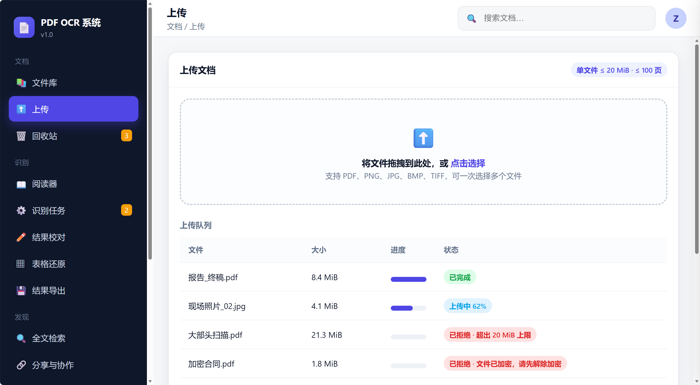
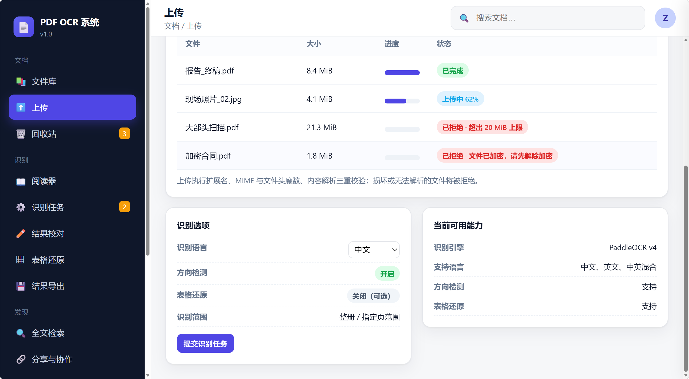

支持点击选择与拖拽多文件上传，上传前本地预判大小。执行扩展名 → MIME 与文件头魔数 → 内容解析三重校验。单文件 ≤20 MiB、≤100 页，超限分别返回 413、422；加密 PDF 直接拒绝并提示先解除加密。下方为识别选项（语言、方向检测、表格还原开关）与当前可用能力探测（引擎、语言、方向检测、表格还原）。

### 4.3.4 回收站（2.3 / 2.3.5）

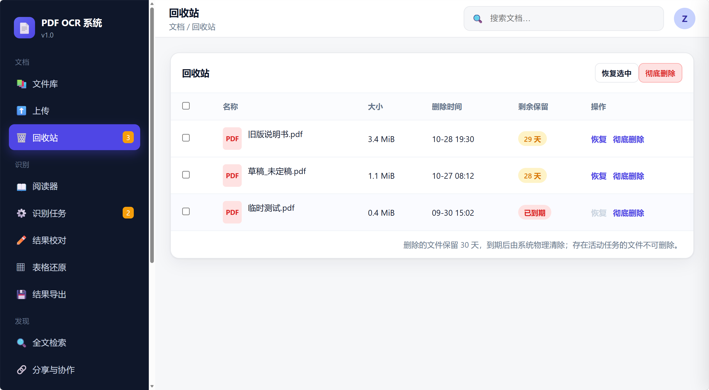

软删除文件进入回收站，保留 30 天，显示剩余保留天数；支持还原与彻底删除。到期项不可恢复，由定时任务物理清除，与 2.3.4 的过期清理规则一致。

### 4.3.5 PDF 阅读器（2.4）

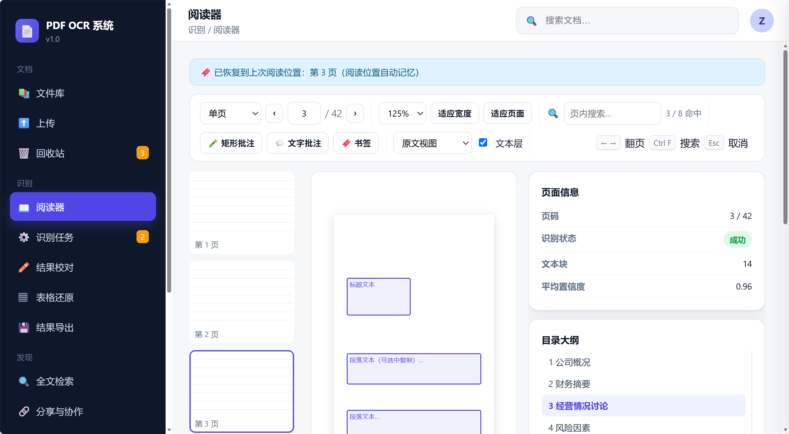
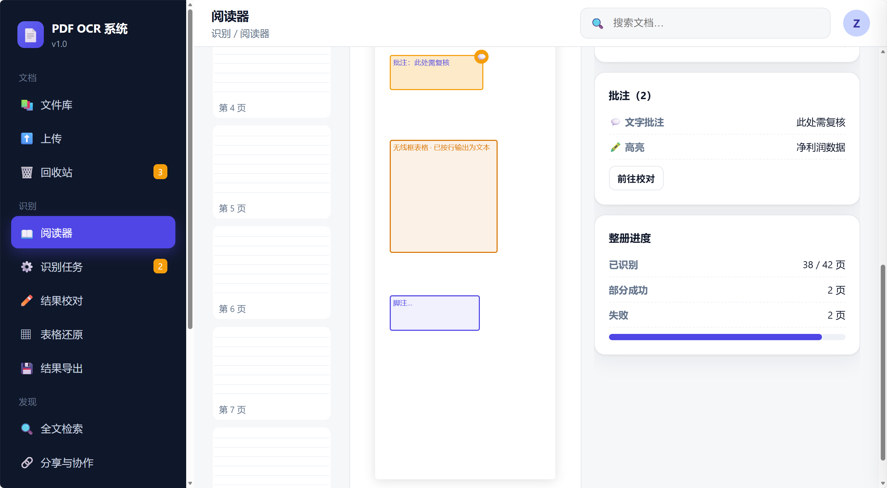

支持单页与连续滚动两种模式，缩放 50%～400% 并提供适应宽度／适应页面；含翻页、跳页、缩略图侧栏、目录大纲跳转、页内搜索与高亮、书签与阅读位置记忆。页面叠加可编辑的 OCR 文本层（可选中复制），并提供原文视图／识别文本视图双视图切换。右侧面板汇总页面信息、批注列表与整册进度。

### 4.3.6 识别任务（2.5）

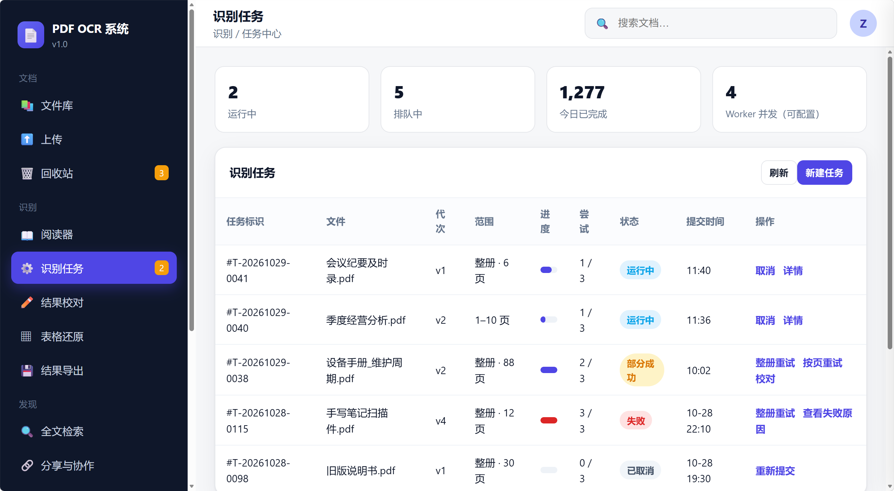
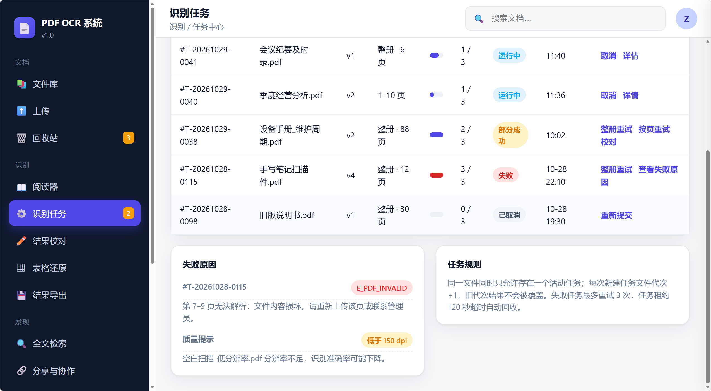

异步任务列表展示任务标识、文件、代次、识别范围、进度、尝试次数（上限 3）、状态与操作。支持取消任务、整册重试与按页重试；失败原因以可解释错误码（如 E_PDF_INVALID）展示，低分辨率给出质量风险提示；Worker 并发数可配置。规则说明：同一文件仅允许一个活动任务，新建任务代次 +1，旧代次结果不被覆盖。

### 4.3.7 结果校对（2.6）

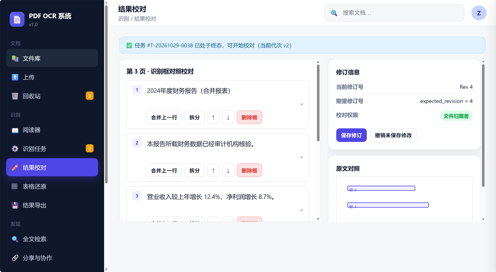
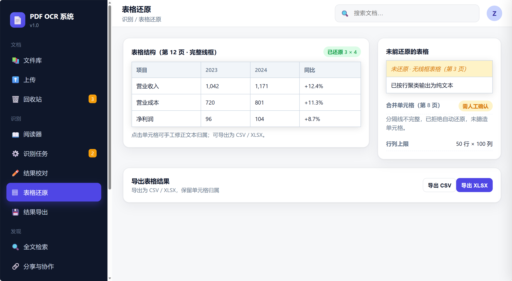

左侧按页展示原图与识别框对照，逐框改字、合并／拆分文本行、删除误检框、调整阅读顺序；保存须携带期望修订号 expected_revision，每次成功保存修订号 +1 并同步全文索引。并发保存时若服务端修订号不一致返回 409 并回传最新修订号。下方展示修订信息、原文对照与权限说明（仅文件归属者与 admin 可校对，viewer 不可）。

### 4.3.8 表格还原（2.7）

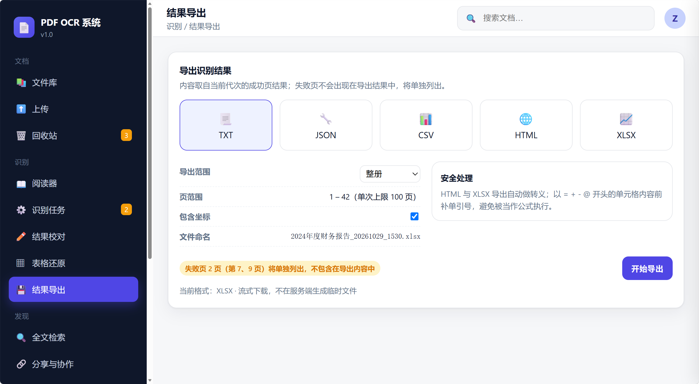

自动识别完整规则线框表格并输出单元格结构，支持前端预览与手工修正单元格归属，可导出 CSV／XLSX。分隔线覆盖不足 90% 或存在合并单元格时拒绝还原并提示人工确认；无线框表格降级为按行聚类的纯文本并标注"未还原"。行列上限 50 行 ×100 列。

### 4.3.9 结果导出（2.8）

支持 TXT／JSON／CSV／HTML／XLSX 五种格式，可选整册或指定页范围、包含或去除坐标。导出文件名含原文件名与时间戳；失败页不进入导出结果并单独列出；单次导出上限 100 页，超出分批。HTML 与 XLSX 做转义，以 = + - @ 开头的单元格前补单引号防止公式注入。

### 4.3.10 全文检索（2.9）

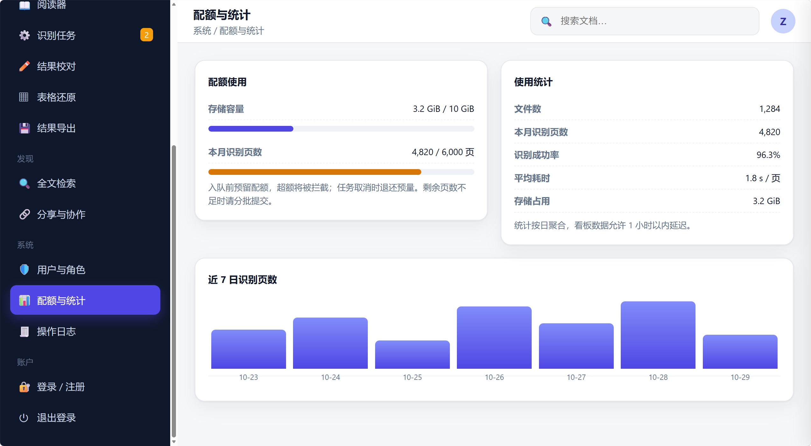

按关键词检索，结果按文件聚合展示命中页数与文本片段并高亮、可跳页定位；支持按类型／时间／标签过滤与检索历史重跑。结果标注来源任务与修订号，结果可能已过时予以提示；关键词为单字时降级为子串匹配并提示。仅返回当前用户有权访问的文档。

### 4.3.11 用户与角色（2.2）

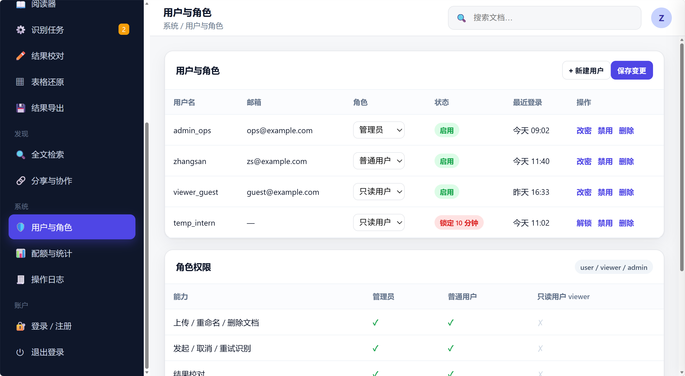

用户列表支持角色在 user／viewer／admin 间调整、启用／禁用与改密；显示锁定状态（连续失败 5 次锁 10 分钟）。下方为角色权限矩阵，列示七项能力在三类角色下的差异，viewer 一切写操作被拒绝。

### 4.3.12 配额与统计（2.11）

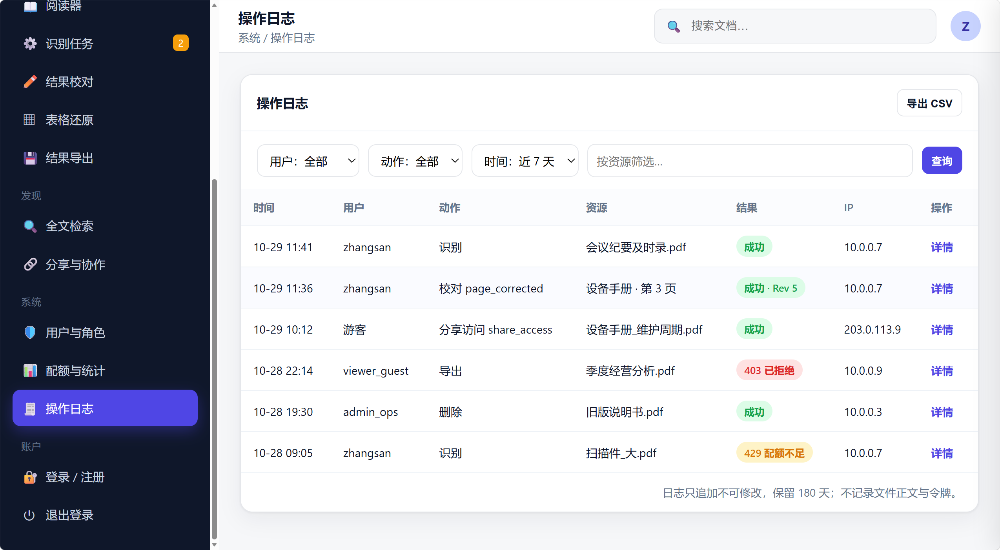

展示存储容量与本月识别页数双配额进度条，超额将被拦截（对应 429 E_QUOTA_EXCEEDED）。统计看板含文件数、识别页数、成功率、平均耗时与存储占用；附近 7 日识别页数图表，数据按日聚合、允许 1 小时以内延迟。

### 4.3.13 操作日志（2.11）

支持按用户／动作／时间筛选与导出。日志含时间、用户、动作、资源、结果与 IP，动作覆盖上传、删除、识别、校对（page_corrected）、导出、分享访问（share_access）等，并体现 403 拒绝与 429 超额等边界；日志只追加、不可修改，保留 180 天，不记录文件正文与令牌。

### 4.3.14 分享与协作（2.10）

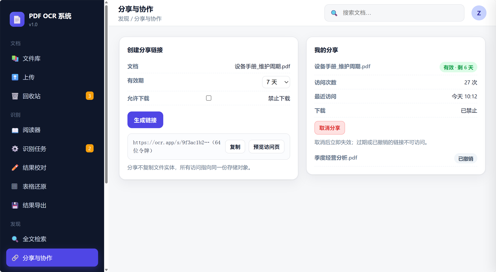

生成 64 位令牌的分享链接，可设有效期（1／7／30 天）与是否允许下载，取消分享立即失效（返回 410 Gone）。右侧"我的分享"提供访问次数与最近访问时间等访问统计；分享不复制文件实体，所有访问指向同一份存储对象。

### 4.3.15 游客只读访问（1.2.2 / 2.10）

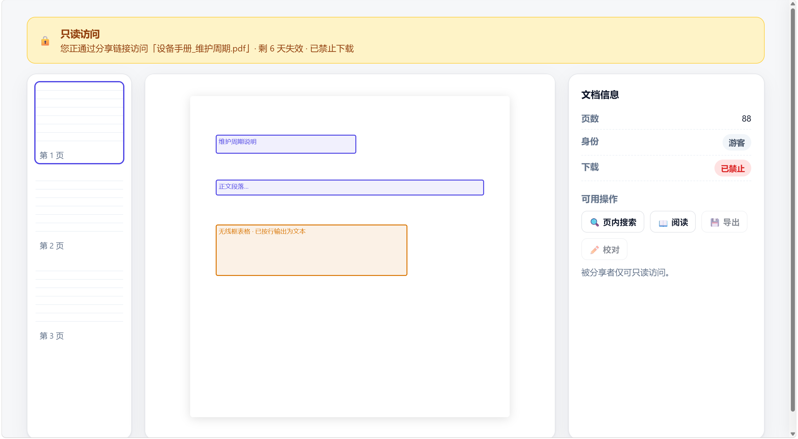

通过分享链接访问的用户仅可只读浏览，不可导出、校对或下载；页面以只读横幅、游客身份标签与置灰的写操作呈现，与归属者／admin 的编辑视图形成差异。

## 4.4 关键交互与易用性对照（3.4）

| 易用性需求 | 原型体现 |
|---|---|
| NFR-USE-01 交互一致性 | 全站统一卡片、标签、按钮与圆角风格；导航与面包屑一致 |
| NFR-USE-02 关键操作二次确认 | 删除、整册重试、撤销分享、彻底删除均二次确认 |
| NFR-USE-03 进度可见 | 上传、识别任务、批量操作均显示进度与结果汇总 |
| NFR-USE-04 错误提示可执行 | 413／422／429／409 等提示附带操作建议（如"先解除加密"） |
| NFR-USE-05 中文字体与排版 | 使用中文优先字体栈，文本层级清晰 |
| NFR-USE-06 快捷键 | 阅读器提供翻页、搜索、取消等快捷键提示 |
| NFR-USE-07 空态与骨架屏 | 列表、搜索、回收站等提供空态与加载态文案，不留白 |
| NFR-USE-08 无障碍基础 | 焦点可见、对比度达标、图形辅以文字标签 |

## 4.5 范围外功能的降级处理说明

原型严格遵守 1.2.2 系统边界，对范围外能力仅作降级与提示，未实现为可用功能：

- **手写体识别**：按印刷体模型尽力识别，校对页以黄色警示块标注"疑似手写批注"，仅提示风险，不做专项训练。
- **竖排与无线框表格**：竖排不在保证范围；无线框表格降级为按行聚类的纯文本并标注"未还原"，不臆造单元格。
- **移动端与跨机分布式**：原型为桌面布局，不含 App、多机部署与消息中间件。
- **公式与图表识别**：不还原数学公式与统计图表内容。
