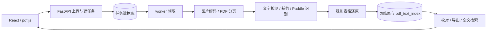

# 功能板块与代码逻辑

## 调用链



API 与 worker 属于同一后端代码库和数据库。请求负责校验入队，模型在独立 worker 中懒加载。模块自身包含推理配置、字典和所需第三方代码。

## 板块

| 文件 | 功能与做法 |
|---|---|
| config.py | 统一数据库、存储和模型配置；可选能力按实际配置开放 |
| backend.py | 严格校验权重参数；检测文字框、透视裁剪、预处理、前向计算、CTC 解码 |
| runtime.py | 初始化 Paddle、Windows DLL，缓存写入服务存储目录 |
| yolo_runner.py | 在隔离 Torch 进程执行可选专用模型，JSON 返回坐标 |
| media.py | 内容与大小校验，处理 EXIF，按页渲染 PDF，进程内锁保护 PDFium |
| tables.py | 二值化、形态学提取横纵线，识别完整网格，以文字框中心分配单元格 |
| queue.py | 条件更新及 MySQL 锁定领取，租约 token 拦截失效 worker |
| worker.py | 逐页处理，保存成功页，失败重试，后台心跳续租 |
| api.py / schemas.py | HTTP 编排、数据约束、校对、检索与结果查询 |
| exports.py | 五种导出格式；转义 HTML、清理 XML 控制字符、防止表格公式执行 |
| auth.py | JWT 验证、角色和文件归属检查 |
| db.py | ORM、页结果与检索索引、审计日志 |

## 数据表

ocr_files 保存归属、存储 key、页数和活动任务；ocr_jobs 保存任务代次、选项、尝试次数和租约；ocr_pages 以 job_id + page_no 唯一保存结果与修订号；pdf_text_index 以 file_id + page_no 唯一保存最近成功文本；ocr_audit_log 保存操作记录。

每个文件最多一个活动任务。generation 随新任务递增，较早任务不能重试覆盖较新结果。页面与全文索引在同一事务内更新，失败页保留此前成功索引；检索返回 job_id/revision 标识结果来源。

## 异步任务

queued → running → succeeded；存在失败页时进入 retry_wait，重试耗尽后为 failed 或 partial_success。活动任务可取消，失败任务可手动重试。成功页不会重复执行。

默认最多 3 次尝试，间隔 15、30 秒；租约 120 秒，每 40 秒续租。进程退出后可在租约到期时接管，失效 token 的提交被拒绝。模型可能重复计算，数据库只接受有效租约持有者提交。

校对在任务结束后进行，提交 expected_revision。版本冲突或页面已被新任务替代时返回 409，前端重新读取并合并修改。

## 主系统集成

```python
from fastapi import FastAPI
from ocr_service.api import install
from ocr_service.config import Settings

app = FastAPI()
install(app, Settings(), before_enqueue=reserve_ocr_quota)
```

before_enqueue(session, user, file, page_numbers) 在入队事务中执行；可锁定配额行并预留页数，超额抛出 HTTPException(429)，不要自行 commit。取消退款、计费和最终结算由主系统实现。

通过 app.dependency_overrides[current_user] 接入主系统认证，返回经过凭证验证的 Principal。关闭主系统时释放 app.state.ocr_engine。

文件管理模块可将 ocr_files 作为统一文件表的适配层；合并、拆分或替换应建立新版本。删除操作由主系统协调任务取消、数据清理和文件清理。

React 调用示例在 examples/client.ts。OCR 框使用左上原点的归一化坐标；页码从 1 开始。阅读器额外旋转时，需要变换四个角的坐标。

## 边界

横排阅读顺序使用启发式；多栏、竖排、无线框和合并单元格需要更复杂的版面模型。标准权重为预训练推理基线，质量需独立标注集评价。SQLite 用于本地开发，MySQL ngram 和多 worker 行为需部署环境验收。
