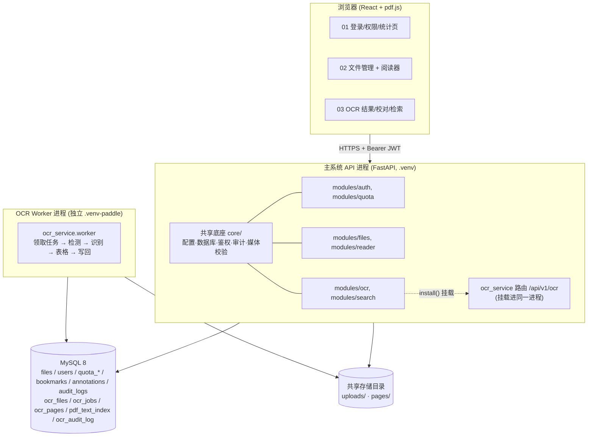
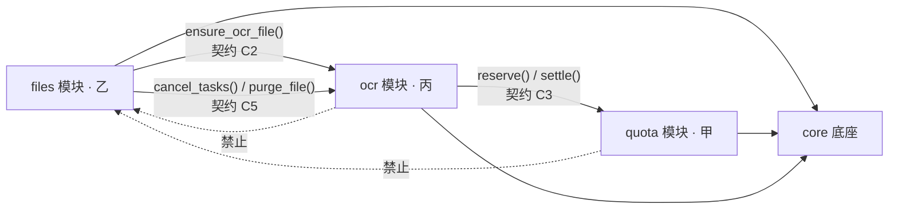
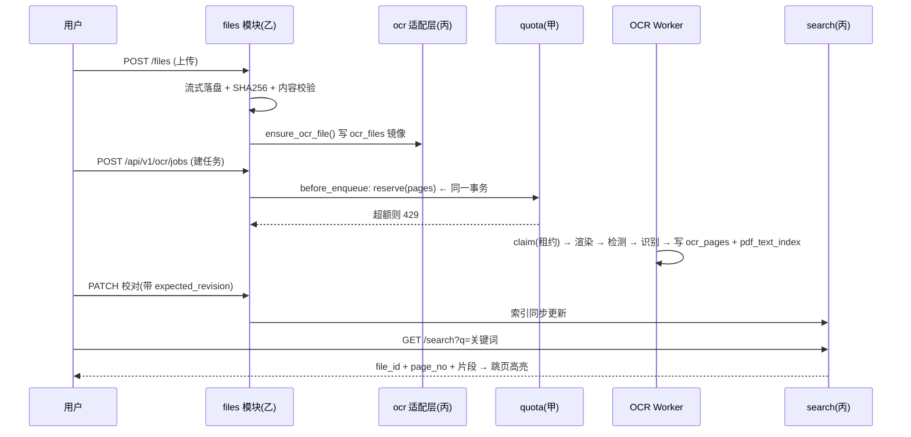

# 系统架构说明

> 题目：基于本地 OCR 的 PDF 文件显示与管理系统
> 技术栈：React + pdf.js / FastAPI + MySQL（单体）／PaddleOCR 本地推理
> 团队：3 人 × 6 个一级功能 = 18 个功能点，按**纵向功能线**拆分

---

## 一、总体架构（部署图）



**为什么 OCR Worker 要独立进程**：OCR 依赖 Paddle 3.0 + numpy 1.26 + opencv，与主后端依赖易冲突；
worker 与主 API 只通过**数据库与共享存储**耦合，可分别重启、分别扩容（部署图中的两个进程框）。

---

## 二、三条纵向功能线与负责人

| 线 | 后端 | 前端 | 负责的一级功能 | 负责人 |
|---|---|---|---|---|
| 01 用户与权限 | `modules/auth`<br/>`modules/quota`<br/>`modules/share` | `features/auth`<br/>统计页 | 1–6 | 甲（组长） |
| 02 文件管理与阅读器 | `modules/files`<br/>`modules/reader` | `features/files`<br/>`features/reader` | 7–12 | 乙 |
| 03 OCR 与检索 | `modules/ocr`<br/>`modules/search` | `features/ocr`<br/>`features/search` | 13–18 | 丙 |
| 共享底座 | `core/` | `src/app`<br/>`src/shared` | 由甲维护，改动走 PR | 甲 |

### 18 个一级功能点

| # | 功能 | 线 |
|---|---|---|
| 1 | 注册与登录 | 01 |
| 2 | 角色与权限（user/viewer/admin） | 01 |
| 3 | 分享链接（W7） | 01 |
| 4 | 配额管理（预留/结算/退款） | 01 |
| 5 | 操作日志 | 01 |
| 6 | 使用统计 | 01 |
| 7 | 文件上传与列表 | 02 |
| 8 | 分类与标签 | 02 |
| 9 | 合并与拆分（W7） | 02 |
| 10 | 批量操作（W7） | 02 |
| 11 | PDF 在线阅读（缩放/翻页/缩略图/页内搜索） | 02 |
| 12 | 书签与批注 | 02 |
| 13 | OCR 识别任务（图片/PDF，异步队列，失败重试） | 03 |
| 14 | 结果校对（版本冲突处理） | 03 |
| 15 | 表格还原（规则线框） | 03 |
| 16 | 多格式导出（TXT/JSON/CSV/HTML/XLSX） | 03 |
| 17 | 中文全文检索 | 03 |
| 18 | OCR 可视化覆盖层与命中定位 | 03 |

---

## 三、模块边界（唯一的跨线调用）



**规则**

1. 三条线之间**禁止直接 import 对方业务模块**，唯一例外是上图中标注的 3 个契约调用；
2. 共享能力只能进 `core/`，由甲维护；任何人改 `core/` 必须开 PR 并至少 1 人 review；
3. 前端同理：`features/*` 只依赖 `shared/` 与 `app/`，不得跨 feature 引用组件（OCR 覆盖层以 props 注入阅读器）。

---

## 四、关键时序：上传 → 识别 → 校对 → 检索



---

## 五、目录结构

```
pdf_system/
├── backend/
│   ├── core/            # 共享底座（甲）：config / database / security / principal / errors / audit / media
│   ├── models/          # 全部 ORM（甲：user,quota,audit；乙：file,tag,reader）
│   ├── modules/
│   │   ├── auth/        # 01 甲
│   │   ├── quota/       # 01 甲
│   │   ├── files/       # 02 乙
│   │   ├── reader/      # 02 乙
│   │   ├── ocr/         # 03 丙：mount / bridge / quota / lifecycle
│   │   └── search/      # 03 丙
│   ├── scripts/init_db.py
│   └── main.py          # 装配（甲）
├── frontend/src/
│   ├── app/             # 甲：路由、AuthProvider、Layout
│   ├── shared/          # 甲：http 封装、共享类型
│   └── features/
│       ├── auth/        # 01 甲
│       ├── files/       # 02 乙
│       ├── reader/      # 02 乙
│       ├── ocr/         # 03 丙
│       └── search/      # 03 丙
└── docs/
    ├── ARCHITECTURE.md
    ├── DATABASE.md
    └── contracts/       # C1–C5 接口契约
```

---

## 六、与 OCR 独立模块的关系

`../pdf_ocr_module/ocr_service` 是**已成型、可独立运行的子模块**，通过 `install(app, settings, before_enqueue=...)` 挂进主系统：

| 关注点 | 做法 |
|---|---|
| 路由 | 自带 `/api/v1/ocr/*`（15 个接口），前端直连，主系统不重复封装 |
| 鉴权 | `app.dependency_overrides[ocr_current_user]` 复用主系统解析（停用立即生效） |
| 配置 | 主系统把 `PDF_*` 配置注入为 `OCR_*` 环境变量，保证同库、同存储、同密钥 |
| 文件 | 主系统 `files` 是事实来源，`ocr_files` 是镜像（同 id、同 storage_key） |
| 配额 | OCR 入队钩子 → 甲的 `quota.reserve`；任务终态 → `/ocr-host/jobs/{id}/settle` |
| 降级 | 缺 Paddle 环境时 `mount_ocr` 返回 False，主系统其余功能照常启动 |

---

## 七、W7 迭代清单（尚未实现）

| 线 | 待补 |
|---|---|
| 01 | 分享链接签发与校验、管理员改角色 |
| 02 | 合并/拆分（生成新版本文件 ID）、批量操作、缩略图、页内搜索 |
| 03 | 手写模式（需配置专用 YOLO 权重）、OCR 准确率评测集 |

---

## 八、已知技术风险

1. **MySQL 专属缺陷**：OCR 模块 `queue.locked_job` 与 `api.correct` 两处依赖"把字段更新成原值"的 `rowcount`，
   MySQL 默认只统计值真正变化的行 → worker 无法提交结果、校对恒 409。**上线 MySQL 前必修**（丙，W6）。
2. **准确率未量化**：OCR 模块现有 10 项测试是确定性替身，不含准确率评测（丙，W8 补标注集）。
3. **存储只增不减**：失败/取消任务的页 PNG 未回收；`purge_file` 已提供，需接入回收站清理任务（乙 + 丙）。
4. **ngram 分词**：MySQL 默认 `ngram_token_size=2`，单字查询退化为 LIKE。
